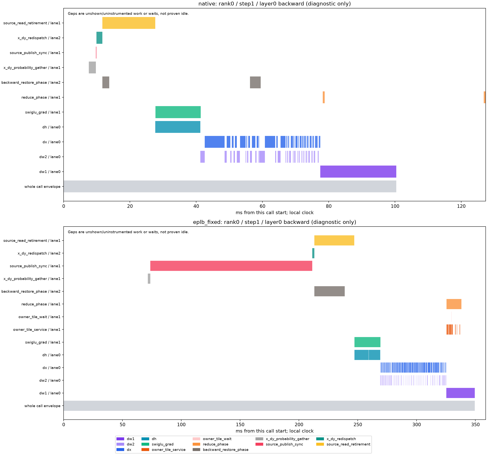
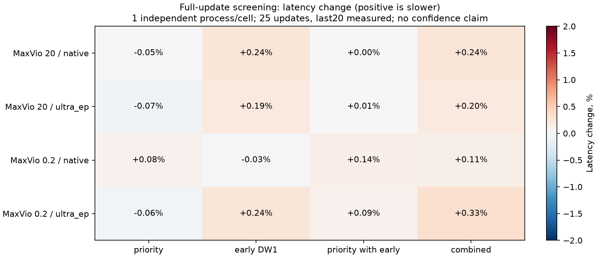

# Existing planner diagnostic evidence

Independent calibration MaxVio7, steps1/2/3, 8 ranks x 2 layers =48 calls/phase.
Timer-on measurements; these are not formal step-time performance claims.

| Policy | Phase | Replay | Mean kernel ms | Mean active replicas/rank |
|---|---|---|---:|---:|
|echo|backward|False|115.188|1.208|
|echo|forward|False|40.203|1.208|
|echo|forward|True|35.677|1.208|
|eplb_fixed|backward|False|322.116|27.604|
|eplb_fixed|forward|False|63.552|27.604|
|eplb_fixed|forward|True|60.842|27.604|
|moonep|backward|False|126.899|1.208|
|moonep|forward|False|45.511|1.208|
|moonep|forward|True|36.546|1.208|
|native|backward|False|118.869|1.042|
|native|forward|False|40.055|1.042|
|native|forward|True|36.736|1.042|
|ultra_ep|backward|False|136.259|1.000|
|ultra_ep|forward|False|39.880|1.000|
|ultra_ep|forward|True|38.406|1.000|

## Interpretation and pending interventions

EPLB-fixed assigns its full instance budget before coalescing same-rank instances. Its substantially greater active-copy count coincides with longer forward and backward envelopes. This is correlation, not a measured causal decomposition.

Required interventions: fixed capacity with instance-budget sweep; fixed placement with source-quota alternatives; identical-plan online/replay; per-expert order intervention. The dH/dX increase means gradient bytes alone are an insufficient explanation.

Other planners being close in total time does not prove optimality. Old step_time adopted zero new plans, so its experiment did not test execution of an improved candidate.

Raw source: D:\megamoe_train\planner-executor-ep8-lab\calibration\reduced

## 副本预算反事实：已完成 CPU 结构扫描，未测 NPU 时间

同一基础银行、固定32home+32副本槽、接收容量163840。梯度字节仅统计当前协议下非零远端贡献者的完整84MiB；不含其他通信，也不代表暴露时间。

|逻辑MaxVio|策略|活跃远端副本|执行rank MaxVio|远端梯度MiB|容量合法|
|---:|---|---:|---:|---:|---|
|0.2|native|0|0.01771|0|True|
|0.2|ultra_ep|1|0.01000|84|True|
|0.2|eplb_budget_8|8|0.00535|672|True|
|0.2|eplb_budget_32|25|0.00488|2100|True|
|0.2|eplb_budget_256|224|0.00684|18816|True|
|5|native|5|0.02122|420|True|
|5|ultra_ep|4|0.01000|336|True|
|5|eplb_budget_8|8|0.21527|672|True|
|5|eplb_budget_32|30|0.00784|2520|True|
|5|eplb_budget_256|226|0.02600|18984|True|
|20|native|7|0.02377|588|True|
|20|ultra_ep|6|0.01000|504|True|
|20|eplb_budget_8|7|0.40046|588|False|
|20|eplb_budget_32|30|0.03567|2520|True|
|20|eplb_budget_256|177|0.03196|14868|True|

满预算不保证更均衡。MaxVio0.2的预算8在这两个结构指标上优于预算256；但MaxVio20的预算8超过容量，不能当作有效性能候选。该发现支持预算干预实验，不构成整步加速或顶会创新证明。

## 原始反向打点图

同一诊断银行step1/layer0/rank0：Native调用约100.38ms，EPLB约349.51ms。图中每事件取一个真实lane，嵌套阶段分行展示；transport取原始同卡计时，owner区间取同调用origin的稀疏记录。其他rank、step和layer不可由这一张图替代。

EPLB在计算前的准备/同步区间也明显延长。例如该调用lane1 source_publish_sync约73.59–211.26ms，Native约2.21–58.34ms。这是含等待的区间，不能直接解释为网络传输耗时，更不能把dW、归并和这些嵌套区间相加。需要跨rank就绪证据和同计划实测确定因果。

## 多起点离线搜索：预测，不是新性能

|逻辑MaxVio|已评估去重合法候选|相对候选银行最佳原策略预测节省ms|
|---:|---:|---:|
|0.2|372|0.0852|
|1|397|1.8991|
|5|415|4.2990|
|10|375|5.1049|
|15|345|0.0000|
|20|329|0.1966|

沿用旧47.40ms误差裕量的模型，候选形状域与排序尚未重验；所有预测增量均不足以支持上线。未证明已到上限，也未证明实现开销掩盖了实际收益。下一门禁是候选同计划预载的native实测，随后才做在线化和流水改造。

## 执行状态与限制

544组CPU交叉检查通过，包括原五策略回归、预算0/full边界、非法预算、空专家、重复assignment及完整physical ID物化。此处为连接恢复前的历史状态：当时NPU节点连接/跳板认证失败。最新设备资格见下文；不得将预算基线作为已成立的新owner-aware planner。未修改其他任务的节点或运行目录。

## 2026-11-16：连接恢复与native资格

当前可用的免密入口为pod5-8，非之前探测的第一机柜跳板。新容器独立部署，原项目只读；SHMEM编译实现头从相同冻结环境只读恢复到新项目。Host/planner重新构建成功。公共计划门禁每rank90项通过；随后10项资格任务全部通过（4策略独立输出梯度、2策略checkpoint、4策略各三步整网Adam更新），整卡峰值90319MiB。它们不是五次重复稳态性能或自然训练质量结果。

旧worker实际flags0、restore2、operand-ready1、replicated-DW1-early1、SwiGLU2。新增实验为生产者/owner匹配的贡献者优先顺序，目前仅120组CPU调度不变量通过，NPU构建/数值/性能待验收。构建显式保持SwiGLU2并比较priority0/1；旧代价模型不能直接当作新流水的已校准模型。

### 构建配方补全与64专家门槛

实测worker完整CMake缓存还启用了shared forward/backward。第一版重建遗漏该能力，routed-redispatch2门禁在数学计算前明确拒绝；失败原件保留。已按完整配方重建，不改变数值门槛。实际early-DW1还受expertPerRank<=32限制，64物理槽主形状因此不启用。新增64位完成掩码与运行时门槛作为独立消融，CPU验证120组调度不变量和65组完成子集（含31/32/63边界）通过；设备资格和整网稳态收益尚未建立。

### MaxVio5同权重与基线重复性

冻结StepTime与Native配对诊断在新节点跑满25步、8rank完整退出，整体梯度最大相对L2为0.004067，专家/共享梯度最大0.001507，固定权重global norm相对差最大8.13e-6，loss差0；原聚合/关键梯度门槛通过。原脚本没有对每个dense参数执行2%门槛，个别参数最大相对误差6.496，因此不能将该结果写成所有参数正确或旧MoonEP轨迹告警已解决。

Native自身对照和MoonEP对Native各3步也通过原门槛：整体梯度最大相对L2分别0.004017、0.003979。Native自对照的单参数最大0.08434（ffn_hc.base，reference norm2.40e-5、差值norm2.03e-6）；MoonEP对Native最大0.59331发生在reference norm5.41e-13的attn_hc.scale。原比较器分母有1e-12范数下限，极小梯度的数值不能按普通百分比解释。自对照已有非零误差，不能把全部差异归因于planner；也不能凭短对照宣布所有误差来源已定位。严格门槛与训练质量验证仍待完成。

完整紧凑统计：[numerical-controls](analysis/numerical-controls.json)；原件在本项目evidence/diagnostic-*-pair-vio5-*，远端同名项目/evidence。该诊断在CPU保存参考梯度，不导出训练性能分数。

四个完整配方worker均已构建完成（matched-priority0/1、wide-priority0/1），对应源archive哈希与CMake配置在各variant/build.json。匹配配方priority0/1的8项数值、checkpoint、三步整网Adam门禁全部通过（evidence/priority-qualification-v2.json）；64槽位变体单独验收中。新planner和正式性能资格仍未完成。

后续资格完成：wide0/1的10项门禁全部通过，含EPLB满预算和64槽位边界参考；完整资格阶段18项全部通过，三步主形状峰值90319MiB（88.2GiB）。开始25更新/5预热的Native、UltraEP × legacy、matched0/1、wide0/1筛选；单进程结果不能当成五次重复或稳定收益。筛选协议见SCREENING-PROTOCOL.md。

为后续运行补齐审计：controller同时记录当前所有工具、模型/代价配置、planner/Host SO和实际worker的前后哈希；loaded_libraries按本项目实际路径收集。此前旧过滤条件没有列出新路径下的worker，已有variant门禁的build.json与controller指定worker哈希仍可追溯，但不回填伪造原运行的已加载清单。

### 原始计划与贡献者依赖核验

对五策略 × step1/2/3 × 两层 × 八rank的240份反向快照，逐assignment检查物理位置解析出的逻辑expert、每source配额、每目标实际执行计数及跨rank计划一致性，全部通过。这限定于已检查调用，支持排除这些调用中固定owner、同卡合并或assignment物化错误，不能替代输出梯度参考验证。

六个调用点全八rank合计均值：Native／EPLB-fixed的活跃远端副本为8.33／220.83，非零物理专家262／476.83；128行tile数8320／8426.83（仅约1.28%差异），192行tile数5589／5691.5（约1.83%）。每个非零物理专家生产完整dW输出，输出tile任务数352128／640864；这不是dW FLOPs增加82%，因为每份副本的归约K更小。它说明必须同时检查额外启动/收尾、GEMM波次、完整partial写出、恢复与owner服务，不能只拿token padding解释反向约2.7倍差距。

[依赖账本](analysis/original-contributor-dependencies.json)把每调用最大采样owner等待关联到参与同一逻辑gradient tile的79份实际producer release记录，无缺失。只保留各rank自身时钟的tick与逻辑依赖边；未计算跨rank release的数值max。当前column0采样落在偶数静态owner任务上，不能识别最后远端贡献者，也不能把它当奇数早期owner的逐tile证据。后续需要增加owner端的per-peer等待/ready采样。

容量扫描也已改为检查实际50份step/layer排列。[预算可行性](analysis/budget-legality.json)显示高偏斜预算8/16有后续调用溢出，即使前三步资格跑通也不能进入25步性能对照。预算32及以上在当前六档全部合法；不通过增大容量或自动切换Native来补救这些无效候选。

### 第一轮整步筛选：高偏斜未见2%收益

当前MaxVio20的十个进程已完整完成。每格独立启动一次进程组，25步，去掉前5步；每步先取八rank最大wall time再平均，包含在线统计/规划、F/B、归并、clip及optimizer。模型、初始权重、输入与路由身份核验通过，实际worker SO哈希完整保留，原始记录在evidence/codesign-pilot-vio20-*。以下不是五次重复或统计显著性结论。

|planner|旧worker ms|匹配重建0 ms|仅贡献者优先 ms|仅64槽early-DW1 ms|两者联合 ms|
|---|---:|---:|---:|---:|---:|
|Native|1209.57|1210.60|1210.03|1213.47|1213.49|
|UltraEP|1193.00|1193.94|1193.05|1196.20|1196.27|

对匹配重建0，优先顺序仅改变约-0.05%/-0.07%；early-DW1约+0.24%/+0.19%，正号表示变慢。两项均未达到约2%的扩大实验门槛。不能据此宣布整个单microbatch方向没空间，也不能将对较慢planner的交叉比较称为流水收益。低偏斜与同计划干预继续进行，新owner-aware在线planner尚未实现。

这里固定强对照UltraEP来自旧正式六档选择；旧StepTime模型的Native初始策略来自另一套独立校准选择，两者不能混为一个选择协议。后续还需保留逐点最强结果、预算受限EPLB和五次进程配对重复。

低偏斜0.2也完成十格，仍未出现2%增量；全部20进程各25更新，峰值90348MiB。两档的细小差异只用于筛选，不宣称显著。原始数据和完整汇总见[20格汇总](analysis/codesign-pilot-v1-summary.json)。

进一步按同一rank时钟比较owner完整完成与最后本地dW结束：Native、UltraEP分别42/48个调用已在最后本地dW前完成owner；正的局部拖尾均值分别0.655/0.773ms，最大10.15/11.24ms。EPLB为21/48个，局部正拖尾均值3.614ms。该观察不是“移除归并能省多少”的整步上界；已重叠的归并仍可能争用带宽，远端最后生产者也未识别。它提示先做固定计划的准备/配额/顺序干预，不继续假设提前dW就能获得主要收益。

预载工具v1在数学验收前被路由身份守卫拒绝：模型为gather把fixture转成int64，dispatcher再转回int32，内容相同但指针不同。失败保留。v2改为完整值验证，并给online/quota/body三个诊断臂同样计入该同步检查和预载存储；不修改模型，也不降低数值门槛。这些均是instrumented诊断，不能把回放速度当成在线新planner成绩。

### 固定计划与 owner 窗口门禁完成

六项预载配对门禁通过（evidence/prepared-plan-gates-v3.json）：Native 的 online/quota/body，以及 budget32 的 local-source、reverse-slots、Native return-smallest。v2 的 budget 名称被旧诊断 argparse 拒绝，失败保留；v3 仅扩展生成的诊断解析器，不修改原冻结脚本或原数值阈值。Native 三项通过经过源码/SO/配置身份核对后显式沿用，另三项重新执行。三个诊断臂均支付相同的路由内容检查与预载存储开销，在线成绩仍需独立运行。

owner-window0/1 的完整配方构建和12项独立参考、checkpoint、三步整网门禁全部通过；修改只改变早期 owner 服务窗口，原partial贡献和求和顺序保持。当前开始22项固定计划因果计时，随后执行 owner 窗口整步筛选。门禁通过不等于性能通过。

Native 同权重自对照另加24次调用的输入梯度和计划身份检查。24次计划完全相同；最后层 y/dy/dx/dp 差异均为0，前一层进入专家反向的 dy 已有最大相对L2 0.000202，dx为0.001189。整体梯度最大0.004005、关键梯度0.001375。该结果将部分差异定位在专家反向输入之前，但不能据此断言具体算子原因，严格单参数及长期训练质量问题仍未解决。紧凑记录见 analysis/incoming-gradient-control.json。

### 优先级干预的有效覆盖与新的依赖切分原型

按实际50份fixture重建顺序发现：低偏斜Native/UltraEP的400个rank-call中，fan-in优先级没有改变任何活跃生产者顺序；高偏斜分别仅改变33/400和35/400。EPLB高偏斜则改变400/400。因而前一轮“优先级未赢”的证据对强基线主要是低覆盖干预，不能据此否定一般的就绪时间调度。完整覆盖记录见 analysis/priority-order-coverage.json。逆转副本槽位会改变前向物理顺序，但反向按逻辑共享专家排序，可能保持相同反向顺序；不能把它直接当作任意反向顺序实验。

当前另实现了尚未构建/验收的窄流水原型：只让 saved-BF16/GM/routed-only 路径中的 AIC dHp=dY@W2 提前，AIV的P读取与dX返回前仍保留原全局读租约。四个编译模式分别为原始控制、仅dHp提前、加home-first P1、再加W2恢复前置（W1仍后置）。它不增加激活副本、不按planner名称切换、不改求和顺序；源码依赖说明见 source/native-balanced/docs/redispatch-runahead-diagnostic.md。先在Native和UltraEP测出可兑现空间，再决定是否围绕源就绪、梯度贡献者与恢复流水建立新planner；当前不能声称新planner已完成或有新性能收益。

### 22项因果计时与owner窗口筛选已完成

全部22项计时通过完整进程、初始身份与冻结计划一致性核验。EPLB满预算/预算32的instrumented online整步，高偏斜为1566.20/1238.68ms，低偏斜1612.76/1202.94ms；预算32仍慢于Native。Native的完整body回放仅改善约9ms，满预算EPLB反而更慢，不能把旧差距解释成在线生成开销。高偏斜固定budget32布局后，local-source少约17.2%远端token行，但整步未改善；它也改变了最大单链路任务量，因此不能只按总字节排名。所有这些是单进程诊断对照，不是普通在线成绩或统计显著性结论。

owner-window的四项正常在线整步均未达到2%增量：Native原/late为1210.25/1210.14ms，EPLB原/late为1638.58/1642.34ms。四组初始身份和实际SO路径/哈希已核对。late同时改变服务并行度，负结果不能据此排除通信争用。阶段因果报告见 [single-mb-causal-results](source/native-balanced/docs/single-mb-causal-results.md)，完整紧凑统计在analysis/prepared-plan-pilot-v2-summary.json、prepared-plan-features-summary.json和owner-window-screen-summary.json。

当前从不可变a1722b6 archive构建四版redispatch dHp runahead；旧计时队列确认结束后才启动编译。后续29门禁和两端点Native/UltraEP的在线整步先行，不把该执行器原型称作新planner。

### 补充核验：host分配与device执行模式不能混同

host确实传64槽描述，但实际forward kernel以及routed-only backward ABI3根据header副本标志覆盖homeTiling：零副本执行32专家，并跳过EnableGradientPipe/Restore。此前仅沿host形状推断固定64执行的说明已在阶段报告和结构特征中更正。当前runahead原型以active gradient pipe为条件，所以低偏斜Native是未激活该干预的no-op对照，不得当成提前dHp无效的证据。

另在原冻结源码中确认：EnableGradientPipe的插入排序在每次GradientKey比较时重新扫描整个副本表并使用Fresh读取。它是需要单独干预的实现开销，不能先把EPLB差距全部解释成不可避免的梯度成本。缓存精确键值并保持顺序完全不变，应作为额外匹配执行器基线；尚无此优化的NPU时间结论。

### 新流水门禁与强制计划搜索

redispatch runahead四版全部构建完成，29项独立数值/梯度、checkpoint、主形状三步Adam和saved-input回退门禁全部通过（evidence/redispatch-runahead-qualification-v1.json）。端点Native/UltraEP在线整步筛选进行中；新planner与稳定性能仍未验收。

对300个实际调用穷举Native副本删除子空间，共33925子集、17613容量合法；仅把删除目标的来源配额退回固定owner，其余布局/配额不变。这是明确有限子空间，不是完整布局搜索或实际执行最优证明。已生成proxy_best/sparse_best两类强制计划银行，并把端点800个实际路由fixture哈希核对一致。旧模型仍不完整，其预测最优每调用平均仅0–1.86ms，不能当作新时间成绩。强制执行工具已支持带SHA/shape/fixture守卫的银行，尚未部署或做NPU门禁，不会修改当前运行的harness。

精确GradientKey缓存原型在8572个CPU rank/order对照中保持原顺序，覆盖实际端点与EP2/4/8边界；源码级高偏斜EPLB每core/call读取约392767次全局计划项，Native约33439次，缓存实现只读256次。计数不等于编译指令或毫秒。该优化要先作为匹配执行器强基线独立测量，不能作为新的负载均衡算法贡献。

## Metadata-only causal intervention: verified screening

Both workers built from cb4c5df; all14 device gates passed. All16 online25-update screens downloaded and independently audited for initial state, routes, inputs, loaded SO and full-update records. Warmup5; one process per cell. At MaxVio20 Native1210.340->1171.825ms, Ultra1193.586->1157.106ms, budget32 1253.414->1169.724ms, fullEPLB1639.596->1308.716ms. Low-skew fullEPLB1717.999->1356.731ms; inactive-copy Native1081.609->1081.776ms. This is executor initialization, not a new planner. Both sides must receive the fix in subsequent planner comparisons. Five fresh paired process repetitions pending.

Six forced Native-subset banks passed paired3-update numerical gates. Independent CPU compilation matched288 captured physical rank-call hashes across27 changed invocations. Replay timing is next and cannot count as online scores. Modes4/5 asymmetric/no-copy runahead have288 CPU coverage checks only; no NPU qualification or timing.

## Staged source prototypes, not NPU results

Fast-metadata controls and asymmetric P1 modes4/5 retain original gradient production/owner contracts. Additional transport batching0/1/2 keeps single-row/static-ring/temporary whole-UB alternatives, restricted to routed BF16 GM; source preparation unchanged, rings and panels drained before UB reuse, original layout restored before P1. CPU288 coverage/DAG and110 byte-layout/tail cases passed; no device correctness or speed claim. Timer schema10 retains original per-expert AscendTimerV2 and four XP phase pairs while compiling out coordinate records. Final-update-only snapshots export after training; their timings remain diagnostic. A sealed build/qualification stage waits for all24 forced-plan diagnostic cells and30 fresh metadata-confirmation processes before any compilation or runtime deployment.

## Forced deletion headroom: negative after executor repair

All24 replay cells downloaded/audited for initial states, actually loaded cache0/1 SO and unchanged50 physical plans per rank across executor interventions. Fast-executor proxy-vs-Native reductions at MaxVio1/5/20 are0.1115%/0.1683%/0.1568%; vsUltra0.3383%/0.0076%/-1.1257%. Sparse candidate gains vsNative0.5872%/-0.2839%/-0.5579%. No fast-executor candidate reaches2% over the stronger existing policy. One process/cell, prepared-body diagnostic only. This rejects these forced deletion candidates as the new planner, not all copy/quota/ordering headroom.

## Source heterogeneity coverage and fixed-compute quota oracles

Original six route banks have mean source-pair L1 .040-.049 and token-weighted largest source share .131-.133. Six new complete-row regroupings preserve exact global expert counts, token count per rank and every top-k row, increasing L1 to .467-.486 and weighted source share to .309-.320. This is controlled synthetic stress, not natural quality evidence. Source provenance permutations are archived for paired real-data application.

600 offline fixed-placement LPs (original/regrouped,1/5/20,Native/Ultra,50calls) minimize aggregate largest remote-link row count, then remote volume; feasible integer repair preserves source/destination marginals, GEMM shapes and full-gradient contributor sets. Ultra high20 largest-link means17808.6->16553.7 rows (original),23083.1->21348.9 (regrouped). These are network-row objectives, never latency bounds. Numerical LP optimum is not an exact dual certificate; an independent analytic row lower bound is supplied.100 exhaustive toy cases and90 independent physical-compiler cases passed. Four source-quota banks are CPU-only and must pass native numerical/physical gates before replay timing.

New nearby memory mechanisms were read in primary papers: MegaScale-MoE2505.11432 (selective activation rematerialization and overlap), RelayMoE2610.07333 (per-hop reconstruction/consume/release), MemFine2511.21431 (memory-aware chunk/recomputation). Activation retention/chunking alone is not novelty. See docs/single-mb-headroom-status.md for the evidence boundaries and data indexes.

## Confirmed executor effect, five independent process pairs

Thirty fresh full-update training processes completed and downloaded/audited after the screening set, which is excluded from inference. At MaxVio20, original/cached means are Native1209.696/1171.495ms, Ultra1193.339/1156.139ms, fullEPLB1639.479/1308.455ms. Geometric paired reductions with unadjusted log-t95(df4): Native3.158%[3.098,3.218], Ultra3.117%[3.005,3.230], fullEPLB20.191%[20.146,20.236]. All five process pairs improve per policy. Statistics are over independent process pairs, not updates. Fixed synthetic bank/shape only; no natural quality or new planner inference. Both sides receive the fix in subsequent comparisons.

After all30 timings retired, the eight b69b753 fast-pipeline/light-timer workers started building. Subsequent qualification and source-quota diagnostic queues remain serialized/guarded. Original dX-GEMM-to-exit diagnostic spans average25.14/25.54ms forNative/Ultra but are NOT final dX readiness or removable whole-step time; current-node light original timers will separate actual unpermute and retirement.

## 2026-11-16: fast pipeline build complete; immediate home reuse remains unqualified

All eight immutable b69b753 workers built and passed actual SO/getter/flag
checks. The wait wrapper accidentally let `docker exec -i` consume subsequent
script input after compilation; no validation commands ran in that invocation.
Removed unnecessary stdin attachment and resumed only sealed deployment,
capability checks and guarded gates in session73619. No rebuild or previous
measurement replacement. The matched r0 control has passed independent
Native/budget32/full-EPLB tests, checkpoint poisoning/replay and three-update
main-shape Native/Ultra/full-EPLB gates. Other worker gates are ongoing.

A separate default-off home-weight reuse probe is implemented locally in the
native bridge and FSDPTurbo config. Only immediate matching recomputation may
skip backward BF16 parameter casts/home copies; replica restore is unchanged.
16 lease plus23 actual-control/config CPU cases pass. No NPU deployment, math
qualification or speedup yet. See docs/checkpoint-home-reuse-probe.md. This is
an executor cost investigation and must benefit all old planners equally;
new online planner and paper evidence remain pending.

## 2026-11-16: strengthen old Native controls; numerical provenance remains open

2100 exact CPU Python/C++ old-Native parameter cases passed. Frozen18 plan
banks vary common row granularity at fixed row-equivalent penalty/threshold
or change penalty separately. No NPU result, online gain or new method claim.
The new actual-control home reuse probe has39 CPU cases; payload1e09bf0e is
artifact-staged only and session20222 waits all old queues before deployment.
Local collector24604 waits for the sealed fast stage and will download all
gates/screens plus explicitly selected small TimerV2 snapshots.

Old per-parameter energies locate above2% relative deviations in HC for the
three3-step controls, including Native self. Non-HC maxima stay below.0072.
This does not resolve the25-step6.50 warning or Adam/quality sensitivity. A
new deterministic diagnostic remains unexecuted. See
docs/native-tuning-and-numerical-provenance.md. Related-work addendum pins
Megatron MoonEP-derived VE code0be53c7 and rechecks LAER-MoE/ReLibra; already
existing FSDP/replay/FC2-overlap mechanisms cannot be claimed as new.
