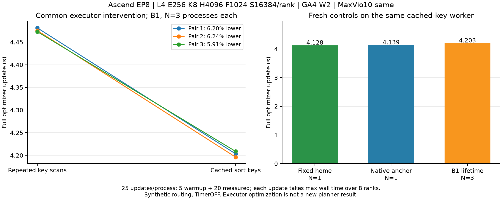

# 排序键缓存：公共执行器干预与匹配控制

当前完整训练步联合规划目标仍在研究中。本阶段验证一项公共执行器优化，没有实现或确认新的联合planner。

## 已完成结果

|独立配对|旧worker秒/完整更新|新worker秒/完整更新|耗时减少|
|---|---:|---:|---:|
|1|4.481169|4.203338|6.20%|
|2|4.475336|4.196073|6.24%|
|3|4.472871|4.208686|5.91%|

三次新进程配对均为同方向。先取每进程20个测量更新的中位，再统计运行间中位：4.475336→4.203338秒，减少6.08%。这是MaxVio10/same人工路由/B1的一项公共执行器收益，不能推广为生命周期策略收益、自然路由收益或官方MoonEP复现结果。

|相同新worker上的新控制|秒/完整更新|独立进程数|B1相对该控制的耗时减少|
|---|---:|---:|---:|
|control1-fixed_home|4.127910|1|-1.83%|
|control1-anchor|4.138520|1|-1.57%|

控制各只有一组匹配筛查。负号表示B1较慢；不能将这些点宣称为稳定策略优劣。所有方法共用相同资源上限；不需要lifetime adapter的控制不强制分配未使用的缓存。

## 改了什么，为何可比较

独立research/step-lifetime-priority-cache，仅修改backward头文件中稳定排序键的求值方式：原本每次比较重复扫描全局copies，改为本次每个expert计算一次，原排序和tie-break不变。不改变copies/quota、ExpertAt执行顺序、ready、owner、通信格式或生命周期策略。局部int数组256B/core，不新增HBM缓存。

实际编译选项和CMake cache只归一化明确任务路径后完全相同，编译输入仅一个头文件不同。baseline worker SHA72653abf3c22fb951624dd5dc420c488d2511d1c22e5e605a3621cb4210502bf；candidate e2868fd2fef49e089513191c9ccbb0ca3c39c857ac9a07d8f6bce255d6f946ed。基线的编译来源单独冻结，不能用计时时磁盘上的新头文件替代旧SO来源。

384份实际计划的排序oracle一致；新内核128项NPU独立数学比较（bank＋空owner/远端贡献，B0–B3、W1/W2）通过。小形状L2/H512/F512/S256的完整三次Adam更新及step0逐参数FP32梯度比较通过；主形状各运行另有前三更新参数抽样变化和全25更新有限性检查，不冒称导出了全主形状逐参数梯度。资格原始张量保留在对应远端项目目录。

## 实验条件与计时

L4 EP8/E256/Top8 H4096 routed/sharedFFN1024，每条完整16K序列，每卡四条、MB1/GA4/W2；vocab32768、Q-heads32、mHC2、shared expert1、SwiGLU limit10、hash0；V4 attention/mHC普通MegaMoE，shared由框架计算；FSDP8/E-FSDP1固定owner，FP32参数/梯度/Adam、BF16专家计算，recv262144，无CPU offload，整卡上限90GiB（沿用allocator预算89.5GiB留出余量）。本阶段最高实测69.48GiB。具体配置见各run/effective-config.json。

每次新进程25次更新，前5次预热；每次更新八rank最大完整wall，覆盖GA4、在线规划、全部交付、clip、Adam和设备完成。Timer/profiler关闭。第一轮旧→新，第二轮新→旧，第三轮旧→新。20个更新不当作20个独立重复。

实际SO/单SHMEM、受保护源码、初始逻辑及持久参数、全部25更新输入与逻辑路由、任务组、重放次数、有限性和内存均检查。正式计时没有额外导出完整计划张量；数值比较、顺序oracle和此前全量计划一致性是独立资格，不能声称本次每一步都另存了完整实际计划。

## 未完成、限制与下一步

原33点负结果和raw-schedule单轮约0.06%负结果保持不变。当前B路径仍是CPU观察实际计划及串行化HCCL公共梯度的正确性原型，不是设备端在线生命周期planner。当前B3也不是REM完整系统复现。

旧rich capture存在未覆盖的主机入口间隙、额外设备Event/snapshot及仅前三更新的观察限制，不能直接拿它推导可消除关键路径。独立host-boundary诊断正在用TimerOFF和不增加设备Event/同步的主机封套重新验证。先据此定位实际依赖，再决定group交付或其他单变量控制；新策略必须胜过同一公共优化底座的强基线。

所有实际数据、失败记录、源码/构建/SO指纹、重放脚本和PNG/SVG/PDF均在本项目目录；大张量仅在对应独立远端路径，receipt及source-snapshot指向来源。summary.json、runs.csv、measured-updates.csv是本报告数据源。原始失败审计保留为pilot-identity-audit-initial-schema-assumptions.json：属于审计脚本对既有日志字段的错误假设，经核对train.py及实际库名修正，不是被删除的训练失败。
