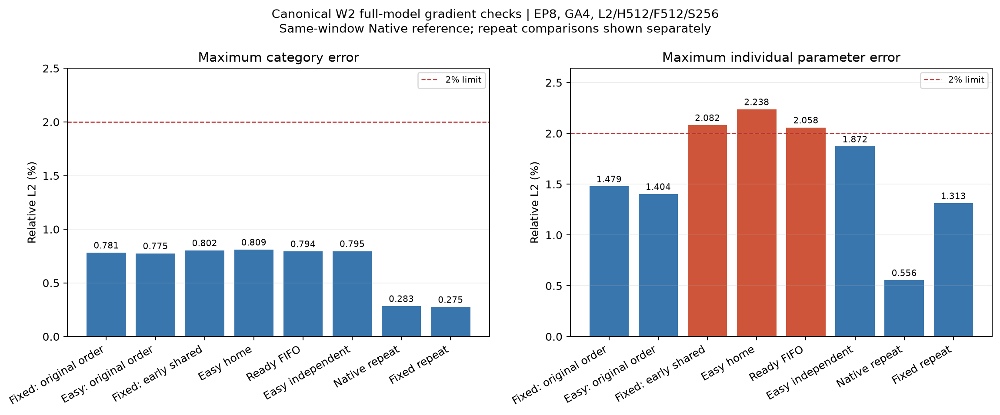
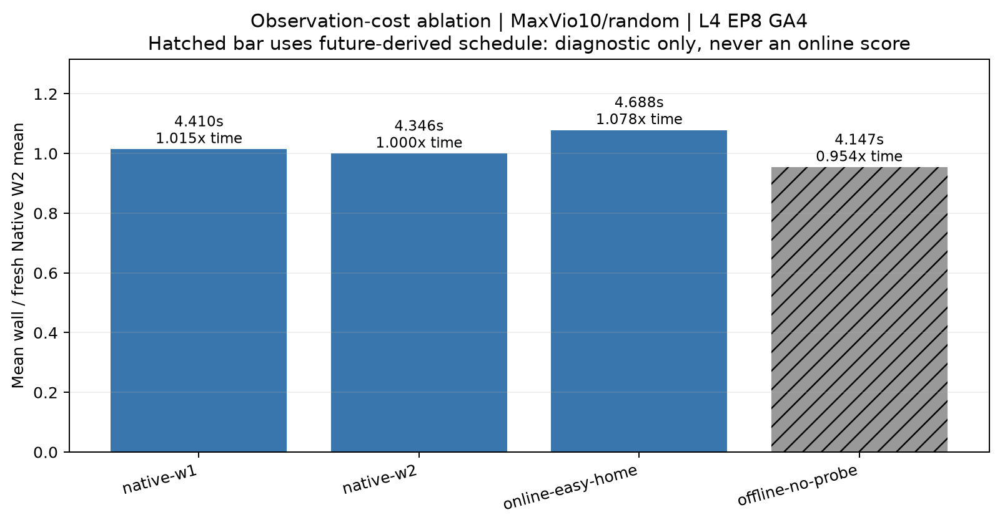
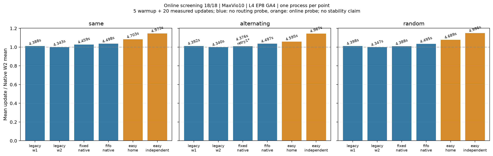
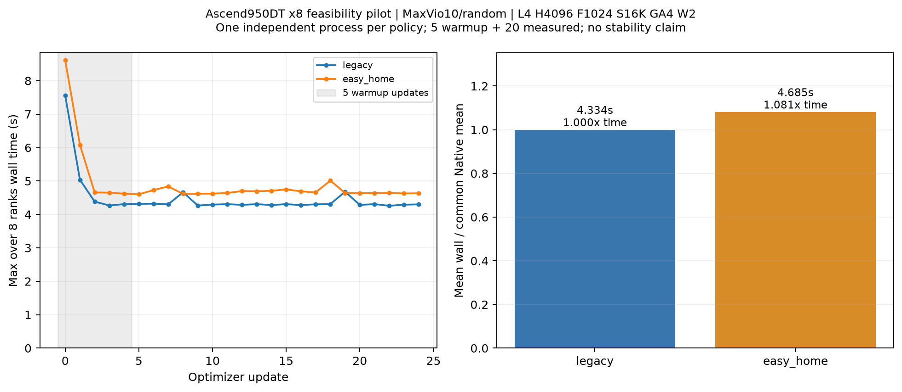
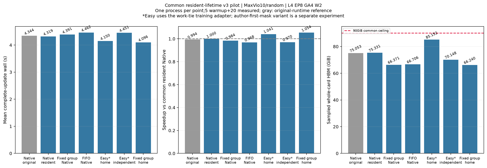
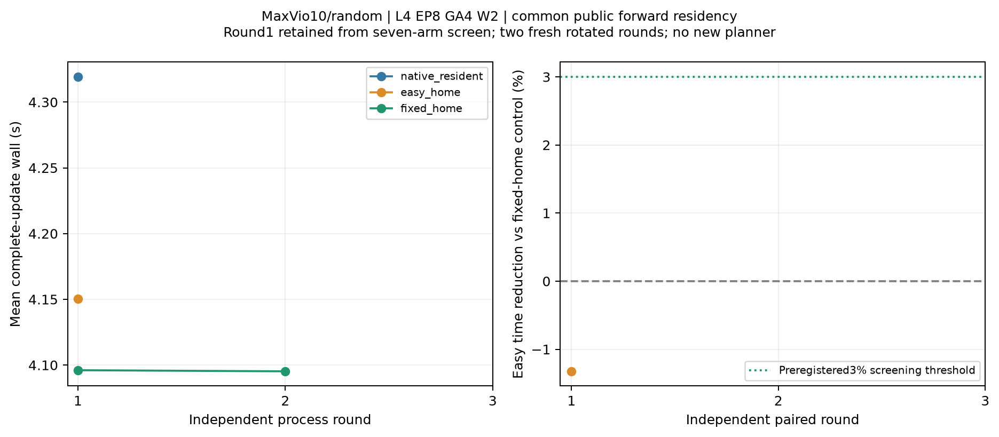
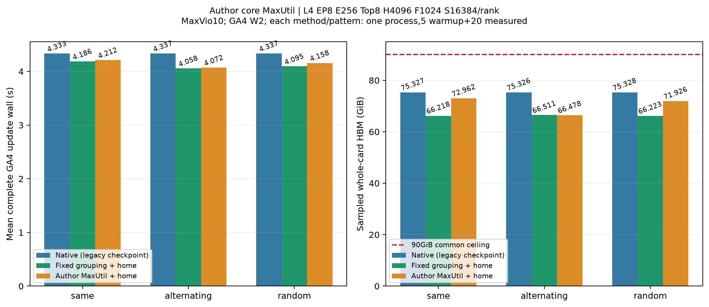

# 时间互补与专家复制研究：实施与验证报告

更新时间：2026-11-15T16:24:10.068231+08:00。

本轮已经实现普通 MegaMoE 上的 GA4、真实就绪前沿、同层/跨层 FFN 分组，以及 CPU/AscendC 的 FIFO、固定分组和 EasyBalance-style MaxUtil。**完整计划未完成**：四任务整网梯度检查失败，主研究条件按显存回退规则使用 W2；Afore-style 副本缓存、新联合策略、108 次正式配对矩阵和泛化实验均未完成。没有可报告的新策略性能收益或论文创新性结论。

**作者规则复核的新发现：旧work_tie适配在平局及防饥饿处理上与作者代码不同，same档因而没有形成跨层组。旧负结果不能否定原版EasyBalance。** 已新增独立`upstream_first`及ABI4选择器，CPU与固定作者函数直接比较560用例通过；训练重新验收阶段为`pilot_complete`，见下文与[源码审计](UPSTREAM-MAXUTIL-AUDIT.md)。原普通worker及旧ABI3二进制保持不变。

**最新筛查结果：** 九点单轮筛查全部完成。作者选择相对固定分组的减少时间为：same -0.62%、alternating -0.34%、random -1.53%（负值为更慢）。三档均未胜过同prefix/驻留配方的固定home分组，未达到3%的继续筛选门槛；不启动108正式矩阵。这是MaxVio10、单银行、W2和当前MegaMoE训练适配的观察，只有每点一个独立进程，不是普遍无效或统计显著性结论。

最新：v1的18次在线筛查已完成，各时间调度路径在该单轮中均未胜过Native W2；prefix v2的Easy-home梯度失败已保留。共同驻留v3：6/6条小形状门禁通过，7/7个25更新pilot已核验。 本轮控制中最快为固定同层分组＋固定home（4.0961s）；两条Easy路径中较快的是Easy选择＋固定home（4.1503s），相对该控制加速比0.9869×。这仍只有每方法一个独立进程，不能据此声称稳定收益；Afore设备基线尚缺。 数值隔离及新结果在下文独立列出，不混合不同运行时配方。

后续三路独立进程确认：阶段`stopped_at_gate`，已收齐1/3轮。是否达到预登记的稳定选择收益门槛：`False`；未收齐前该字段不能作为最终否定结论。
该追加批次的停止原因：Automatic admission guard stopped at external NPU usage; after upstream audit, cancel four unstarted old-tie confirmations。没有把未启动或未收齐的轮次填入图中。

本轮曲线全部使用同一个普通MegaMoE后端；Native指其中现有的单调用空间planner，legacy_w1/w2指原训练调用顺序。它与此前Native/共享融合/Ascend MoonEP三后端对照分开，不把本轮Easy训练适配称为原作者完整系统复现。

## 当前工程与固定条件

- 源码：[stack](stack/)，分支 `research/temporal-replica`，本地HEAD `44b4e0d2cb46933c22fad1922ff24d603fd5d2ac`，未提交改动 `False`，基线 `84a3363d95e11096de95332f9b691f736be752d1`。运行时实际源身份以各tag的source-identity及冻结归档为准；本地文档或原型更新不冒称已在旧运行中加载。原公开栈、旧 GA1 和先前三后端数据保留。
- L4、EP8/E256/Top8、H4096、routed/shared FFN1024，V4 attention/mHC；模型 shared expert 仍走框架。
- 具体沿用 vocab32768、Q-heads32/head-dim512、KV-head1、Q-LoRA1536、O-LoRA1024、mHC2/Sinkhorn20、SwiGLU limit10、hash0/MTP0。四层 Attention 为 HCA/HCA/CSA/HCA，使用原 V4 的压缩及滑窗机制；完整16K序列输入，不把它描述成16K稠密Attention。
- 当前mHC2走该公开栈的PyTorch实现，mHC参数与计算映射使用FP32；原模型的residual混合显式转回流dtype。此处没有使用仅支持mHC4的Ascend fused MHC路径。前缀观察区间同时包含mHC、Attention、router与统计，不能全归为Attention纯计算。
- 每条完整 16384 token；microbatch1、GA4，每次更新 32 条序列/524288 序列 token。窗口改变不改变 batch；next-token 有效标签数按实际有效位置归一化。
- 合法合成 token 输入与 next-token 标签，seed42，并以 rank/step/microbatch 确定性派生；这批数据验证系统路径，不用于证明模型质量。dropout0、router辅助损失收集关闭，各策略保持共同条件。
- FP32 参数/梯度/两份 Adam 状态，BF16 专家计算；FSDP8、Expert-FSDP1、TP/CP1；整层非重入重计算，无 CPU offload。
- 从八rank初始本地参数指纹累加，模型全局唯一参数为13,714,328,923（约13.714B），其中routed专家12,884,901,888。仅routed参数、梯度及两份Adam数组理论合计24GiB/rank，不是实测总HBM；[参数计数](diagnostics/model-parameter-count.json)。
- FunctionalFusedAdamW：LR1e-5、betas=(0.9,0.95)、eps1e-8、weight decay0.01；四份梯度完成后一次全局 norm、clip1 和 Adam。
- 新双池执行器共同接收容量 262144（2×S×K）、共同最大 W2。原容量 163840 在固定 home 下不够：实需 167680–179072 行，已明确失败并保留。
- 整卡共同门槛 90GiB；Torch allocator 目标 89.5GiB。HBM 是 npu-smi 采样峰值，不能当连续瞬时峰值。

`runtime-freeze.json`沿用了历史捕获，运行校验只使用其中binaries映射；其旧capacity/primary_runs字段不是本轮配方或已测次数。当前容量与条件以每tag的effective-config、命令和本报告为准。24个路径别名/22个不同SO及构建元数据已本地归档并逐项验SHA：[构建导出](implementation/frozen-build-export.json)、[SO与构建包](implementation/frozen-build-export.tar.gz)。

## 实际实现的边界

任务身份为 `(optimizer_step,microbatch,layer,invocation)`，重计算绑定原始计划，参数版本不跨更新混用。逻辑专家身份包含 layer，owner 不变。原生执行器只消费原有计划；公共路由校验、梯度贡献者和重放机制继续使用。

原 kernel 单次上限为 16K 行。多个完整序列先完成完整 Attention，再分成多个 FFN 波次：每一波包含所选任务各自的一段，总行数仍为 16K；任务内行顺序保持不变，不切 Attention 上下文。当前最多两个层域（本地64个home专家），跨层组固定home，不伪称已支持跨层任意复制。

| 执行方式 | 选择依据 | FFN执行与复制边界 |
|---|---|---|
| Native W1/W2 | 按原microbatch顺序，无探测 | 原始整层checkpoint；W2保存两个前向图再反向，单调用Native规划 |
| fixed_native | 当前可用层输入、同层身份，无探测 | 固定同层合组；16K波次，单层Native复制 |
| fifo_native | 当前可用层输入、FIFO，无探测 | W2下最小集合为1，逐任务16K执行、Native复制 |
| easy_home | 真实路由探测，MaxUtil | 选择1或2任务，固定home合组；跨层最多64home |
| easy_independent | 真实路由探测，MaxUtil | 被选任务分别作完整16K Native调用及独立复制；没有假定两次Native大核能自由并行 |

这些是同一普通MegaMoE执行器中的训练适配方式。跨层合组后再任意复制的联合执行、持久副本缓存都尚未实现；现有Easy-independent不能替代这些能力的验收。

Easy-home/独立复制的负载选择通过实际 Attention/router 前缀探测获得，只读取当前任务的真实路由，不读取未来层/步路由。探测会额外执行一次前缀，它及统计、选择、编译、校验全部计入整步。普通 Native、固定分组和 FIFO 的决策不需要路由负载；后两者从 layer input 已可用的前沿按身份/到达顺序选任务，随后正常计算 Attention/router，不做探测。未知负载记录为 null，选择器 scratch 零值不冒称实际负载。选择器的 host 包络可能等待先前设备工作，不能将其直接称为纯 planner 开销。

人工路由的 same/alternating/random 控制同一 step/layer 内不同 microbatch 的相关性，层间使用独立的确定性专家置换。same 不等于全图所有层的热点卡完全相同。全局专家置换保留原银行的 MaxVio，rank聚合负载和跨任务互补性另行记录。

冻结银行的实际expert MaxVio为9.982666。对25更新的400个逻辑任务离线核对：same与alternating的平均rank MaxVio约0.323，random约0.346；每rank聚合32个home专家，expert偏斜不会原样成为rank偏斜。相邻同层microbatch配对的线性理想互补度均值分别为0%、9.704%、8.295%。这只是忽略通信、依赖、复制和观察成本的负载向量量度，既不证明这些任务同时就绪，也不等于训练加速。未来数据只用于离线解释，没有供给在线选择器。

[路由构造审计图](diagnostics/route-correlation-audit.png)、[200对/相关性的CSV](diagnostics/route-correlation-pairs.csv)、[核验JSON](diagnostics/route-correlation-audit.json)。

权重、接收和反向池仍按共同配置预分配，少用副本不会自动释放 HBM。不同任务 Native 调用通过显式依赖保持各 rank 同一反向/collective 顺序，没有删除 kernel 屏障。

关键源码：

| 功能 | 文件 |
|---|---|
| 任务/窗口选择、无丢行波次编译 | `stack/tools/temporal_scheduler.py` |
| 前缀、FSDP、组 checkpoint、执行与反向顺序 | `stack/tools/temporal_model.py` |
| `(layer,expert)` 域及实时 owner 权重桥接 | `stack/tools/grouped_experts.py` |
| 固定 home 配额及公共设备校验 | `stack/source/native-balanced/ascend_deepep/home_group_planner.py` |
| AscendC 在线选择器 ABI3 | `stack/source/native-balanced/kernels/mega_moe_bf16/mega_moe_temporal_scheduler.cpp` |
| GA4、更新边界、dtype/身份/有限性检查 | `stack/tools/train.py` |
| 准入、冻结、采样、失败状态 | `stack/tools/controller.py` |

## 正确性证据

CPU 合约 9 项；AscendC ABI3 在八 rank 各通过 506 项决策/拒绝检查。检查包括 FIFO 到达顺序、强制纳入、确定性 tie-break、两层域上限、非法输入和实际库 SHA。

独立 FFN 数学参考：八 rank × 8 个场景（Native/home × 1/2/3/4 任务），全部通过。最大相对 L2：`{"output": 0.0003226622939109802, "dx": 0.002615690464153886, "dp": 0.0027116015553474426, "dw1": 0.0023476413916796446, "dw2": 0.002348609734326601}`。输出门槛0.004，梯度0.02。参考明确复现冻结算子的 BF16 中间舍入：SwiGLU 后舍入、GMM2 前路由乘权以及 TopK 顺序 BF16 加法。此前参考把乘权放在 GMM2 后，错误参考已单列排除，不将该失败解释为 kernel 错误。

原有多保存态、热点切换、池污染、反序反向、分组非法协议集体拒绝后恢复也有八卡通过回执。独立 FFN 通过不能替代整网梯度通过。

### 历史版本：规范行序但 shared 提前

本表是已排除的早期版本，**不是当前源码验收状态**。当前恢复原始shared顺序的检查在下一表。

小形状 L2/H512/F512/S256、GA4/W2，八 rank 的初始参数、输入、step0 路由 SHA 相同。同步后、clip/Adam 前导出所有 FP32 owner 梯度，使用同窗口普通 Native 参考。每个参数及每个类别分别要求相对L2≤0.02，未放宽门槛。三次更新后还检查有限性、实际参数改变、重放调用数和零遗留计划。

| 策略 | 三次更新执行 | 全量梯度 | 类别最大相对L2 | 单参数最大相对L2 |
|---|---|---|---:|---:|
| fixed_native | passed | failed | 0.008024 | 0.020820 |
| easy_home | passed | failed | 0.008089 | 0.022377 |
| fifo_native | passed | failed | 0.007936 | 0.020583 |
| easy_independent | passed | passed | 0.007952 | 0.018716 |

逐参数原始比较见 `evidence/canonical-w2-adam3-*-comparison.json`。早期旋转分块顺序下 fixed-native 的 HC scale 超过2%门槛，记录仍保留；规范行序的重新验收是独立的新记录。

上图只包含已收集检查；Native/Fixed repeat 是同策略重复的诊断，不能代替不同策略正确性通过。独立 FFN 参考图：[PNG](figures/independent-runset-math.png)，同时提供 SVG/PDF/CSV。

### 恢复 routed→shared 原始顺序的重新检查

源码复核发现，首版准备阶段提前计算框架 shared FFN，改变了原模型先 routed 后 shared 的图构建顺序。最新版本恢复原顺序，用第二次公开 layer 前向取得 FSDP 的 shared 参数；未替换 Parameter。这个改动也可能增加 FSDP 工作，必须计时，不把正确性修正宣称为调度收益。

| 策略/窗口 | 三次更新执行 | 全量梯度 | 类别最大相对L2 | 单参数最大相对L2 |
|---|---|---|---:|---:|
| fixed_native_w2 | passed | passed | 0.007809 | 0.014787 |
| easy_home_w2 | passed | passed | 0.007750 | 0.014038 |
| fifo_native_w2 | passed | passed | 0.007746 | 0.013935 |
| easy_independent_w2 | passed | passed | 0.007697 | 0.014559 |
| fixed_home_w4 | passed | failed | 0.177589 | 1.116388 |

这里的回执独立保存为 `evidence/ordered-shared-*/`，不覆盖上表的失败。不以执行成功替代梯度检查通过。

### 无路由探测的强基线重新验收

源码审计确认固定分组与FIFO只依赖当前层输入、任务身份及到达顺序，不需要提前观察路由。移除两者不必要的Attention/router探测后，重新进行八卡三次Adam与全部owner梯度检查。实际router调用由每任务3次降为2次（原始+重计算）；改变不是绕过计时，而是取消算法不需要的工作。

| 策略 | 三次更新执行 | 全量梯度 | 类别最大相对L2 | 单参数最大相对L2 |
|---|---|---|---:|---:|
| fixed_native | passed | passed | 0.007780 | 0.015964 |
| fifo_native | passed | passed | 0.007756 | 0.014189 |

门槛仍为每类别和每参数≤0.02，身份一致性逐rank检查。新筛查使用这版更强的固定/FIFO基线，旧有探测版本保留为历史验收记录。

W2的最新顺序恢复检查和W4失败是不同适用范围；小形状W2通过不等于任意四任务训练通过。研究下一步的具体隔离顺序见[NEXT.md](NEXT.md)。

### 主形状显存与生命周期

当前原始 shared 顺序、清理计时边界的主形状25次更新状态：**passed**；采样峰值 **81.621GiB**，见 `evidence/pilot-clean-timing-random-easy_home-w2/`。前3次更新同时完成Adam/dtype/更新资格检查。
早期非规范分块的 W2 主形状完成8×3次更新、80.781GiB，作为历史验证保留，不能替代当前源版本验收。
W4 在2×接收容量下触及 allocator 预算并 OOM，采样88.942GiB；该值没有超过90GiB并不意味着内存门禁通过。根据约定，所有高级方法共同退至 W2，GA4、模型和输入不变。

三次更新均位于正式5次预热以内，**不产生加速比或最优窗口结论**。早期普通保图 W1/W2/W4 使用另一容量/池配置，不能与新双池数据计算显存优势。

## 仍未解决的失败

固定四任务整网分组存在约8%–21%的类别梯度误差。完整导出同步、固定home、保持原始任务行序以及公开 `reshard_after_forward=False` 隔离均未消除；对应原始失败与诊断保留。独立 FFN 四任务通过将调查范围收窄到整网组合，但尚不能认定 FSDP、checkpoint 或 kernel 中哪项是根因。W4 不作为可用训练路径。

首次跨层 checkpoint 重放曾出现 HC 分片 Tensor/DTensor 混用，改用公开 unshard 接口后已重跑。初期误加载非冻结 timeroff SO 的错误/NaN全部排除，后续使用冻结 aligned worker，SHA `46772ebc9fe69442e786dd4e9bd6892bb79bfe6e3944069df05bfafaf684712e`。新选择器 SHA `f13c3eec86373e253d2281eda829eb6ba1dc3a72465288c933e4178c5047d667`。

其他项目占卡的测试只等待或记录准入失败，没有停止外部进程。源与 SO 启动前冻结、结束后复核；发生重叠的采样会使运行失去性能资格。部分大梯度原始张量保留在项目专属远端目录，metadata-only 收集不代表张量已全部下载；见[RAW-DATA.md](RAW-DATA.md)。

## 性能与下一步

### 原TimerV2与框架事件诊断

冻结性能worker的Timer schema为0，直接开启捕获的首次尝试在训练前拒绝，未改动或删除schema检查。另用相同计算配置构建TimerON/schema9副本，SHA `6933b6470f5a9cdc821a48b25fd21310ef0c96d4f1c78534513b7fa7b44c020b`；小形状八卡三次Adam及完整梯度比较通过，随后完成主形状Easy-home与普通Native各三次诊断更新。诊断副本不用于上面的正常步时或显存比较。

update2中，每rank普通Native的Attention前向为16次原始+16次重放；Easy-home为32次原始/探测+16次重放。Easy-home额外执行16次前缀探测，其流区间并集八rank中位约512.95ms；选择区间中位约5.10ms。它们包括依赖和host供给空隙，类别间有嵌套/重叠，不能相加或直接从正常步时中扣除。

重放还有执行边界差异：Native沿用原checkpoint的early-stop，诊断中每rank update2有16次decoder layer尾部提前结束记录；分组为保证共同Native/collective序列，显式要求完整body重放。Attention及shared模块的重放调用没有因此少登记。此记录不能换算成跳过了多少FLOP，也不能把两条路径的全部步时差称为纯planner开销；[原始逐rank审计](diagnostics/checkpoint-early-stop-audit.json)保留。共同逻辑层仍完整覆盖所需梯度，W2逐参数检查已通过。

此诊断点普通Native平均每次调用每rank活跃副本约0.969、最大4，Easy-home为0。Native副本的梯度释放/owner等待确有采样；固定home代表调用未产生这类副本采样，未造数据补齐。稀疏采样不能证明全部梯度服务的结束时间，也不能把所有wait时长直接视为关键路径。

### 实际规划后的负载：单看home需求会高估均衡空间

对同一主形状诊断update2的16个原始Native波次，逐一核对八rank的全局quota/copies一致、assignment守恒及实际execution_counts：普通Native的平均home rank MaxVio约0.362，经过空间规划后实际执行rank MaxVio约0.0140，最大0.0227；Easy-home的实际执行偏斜约0.257。后者通过时间组合降低部分home偏斜，同时关闭了空间复制，因此不是在Native剩余1.4%偏斜上继续改善。

在仅按token数线性计算、其他成本固定的模型里，这个Native诊断点继续均摊token的空间已经很小。未来联合策略若有整步收益，必须检验复制/梯度交付、真实kernel形状及依赖成本如何变化；不能把原始home负载向量9%互补度当作对强Native基线的9%可得加速。以上仅覆盖一个诊断步和银行，不是硬件耗时上界或普遍结论。

[逐调用及八rank一致性CSV](diagnostics/actual-plan-balance.csv)、[汇总JSON](diagnostics/actual-plan-balance.json)；诊断副本的时间开销没有进入正常性能分数。

[框架区间CSV](diagnostics/framework-summary.csv)、[每次Native调用](diagnostics/native-calls.csv)、[owner采样](diagnostics/native-owner-release-service.csv)。框架Event和原Timer均按各rank自己的时钟分别导出Chrome Trace，利用invocation/operator_event_sequence关联，不拼接独立零点。

[原始AIC图](diagnostics/original-aic-two-layer-backward.png)、[原始AIV图](diagnostics/original-aiv-two-layer-backward.png)、[梯度采样图](diagnostics/owner-release-service.png)，均保留SVG/PDF。硬件图使用原始GetSystemCycle tick差，避免把短时标定的launch包络误差当成精确频率。Native Chrome Trace中的毫秒是独立标定的估算量，不能与框架Event坐标直接合并。

32MiB点对点探测的八卡56条有向链路，估计中位约679.89us，最快676.98us、最慢686.90us（最大/最小1.0147）。时钟比例本身有launch包络偏差，当前差异量级不足以证明可利用的单机拓扑异质性；不预先给拓扑策略记收益。[矩阵](diagnostics/peer-link-probes.png)和[CSV](diagnostics/peer-link-probes.csv)保留。

### 路由可见性消融：在线与离线诊断分开

完成四个新进程、各25更新的对照，MaxVio10/random、相同初始参数/输入/路由。离线项保持已观察到的Easy-home任务顺序，省去前缀探测与选择；Native配额仍按实际当前路由编译。它使用未来派生的任务顺序，不能进入在线planner成绩，也不是全知最优上界。263组任务顺序在八rank逐项核对。

| 方法 | 性质 | 平均更新(s) | 步时/本轮Native W2 | HBM采样峰值(GiB) |
|---|---|---:|---:|---:|
| native-w1 | 在线 | 4.410 | 1.015 | 66.982 |
| native-w2 | 在线 | 4.346 | 1.000 | 75.035 |
| online-easy-home | 在线 | 4.688 | 1.078 | 81.740 |
| offline-no-probe | 离线诊断 | 4.147 | 0.954 | 81.718 |

本轮在线Easy-home约4.688s，比Native W2约4.346s慢7.85%。保持该任务顺序、移除观察/选择后的离线诊断约4.147s，比在线Easy-home少0.541s，比Native W2低4.60%。这表明路由可见性及选择包络可能遮住这份任务顺序的潜力，**没有证明在线调度已获得4.60%收益**；差额也不能全归为Attention纯计算。每方法只有一个独立进程，没有稳定性结论。

[原始逐步CSV](figures/observation-ablation-steps.csv)、[SVG](figures/observation-ablation.svg)、[PDF](figures/observation-ablation.pdf)，核验结果见`observation-summary.json`。小形状梯度门禁及预登记见`observation-gates.json`、`observation-ablation.json`。

### 六策略×三相关性在线筛查

已完成：**18/18** 次；正式108次矩阵：**0**。当前是MaxVio10的单轮筛查，每点一个新进程，不把20次进程内测量当20个独立重复。全部在线工作计时，实际加载SO、每rank25次更新、400个逻辑任务的router/重放次数、完整初始参数/输入/路由身份均复核。失败点保留明确状态，尚未完成的点不进入数值曲线。

| 时间相关性 | 策略 | 平均更新(s) | 相对同相关性Native W2加速比 | HBM采样峰值(GiB) |
|---|---|---:|---:|---:|
| same | legacy_w1 | 4.388 | 0.989798 | 66.981 |
| same | legacy_w2 | 4.343 | 1.000000 | 75.055 |
| same | fixed_native | 4.459 | 0.973884 | 76.461 |
| same | fifo_native | 4.498 | 0.965551 | 68.457 |
| same | easy_home | 4.703 | 0.923455 | 76.504 |
| same | easy_independent | 4.973 | 0.873315 | 76.462 |
| alternating | legacy_w1 | 4.392 | 0.988087 | 66.982 |
| alternating | legacy_w2 | 4.340 | 1.000000 | 75.055 |
| alternating | fixed_native | 4.376 | 0.991626 | 76.304 |
| alternating | fifo_native | 4.497 | 0.965000 | 68.458 |
| alternating | easy_home | 4.595 | 0.944415 | 76.444 |
| alternating | easy_independent | 4.967 | 0.873638 | 76.149 |
| random | legacy_w1 | 4.398 | 0.988480 | 67.021 |
| random | legacy_w2 | 4.347 | 1.000000 | 74.938 |
| random | fixed_native | 4.388 | 0.990743 | 76.267 |
| random | fifo_native | 4.495 | 0.967119 | 68.457 |
| random | easy_home | 4.689 | 0.927231 | 81.625 |
| random | easy_independent | 4.996 | 0.870202 | 79.785 |

加速比分母与分子都只取同一相关性的在线完整更新；Native W2尚未收齐时留空。组互补度另由冻结路由银行离线审计，只解释任务组合，不向在线无探测基线提供路由信息，也不把线性互补度当整步收益。

失败尝试另列，未产生完整训练测量的数据没有数值步时。启动失败的有界重试使用新tag、同源码/配方，原尝试不覆盖。图中retry1*表示该点另保留一次设备启动失败记录。

| 原始失败tag | 分类 | 已完成更新 | 退出码 |
|---|---|---:|---:|
| screen-v1-vio10-alternating-fixed_native-r1 | device_initialization_timeout | 0 | 1 |

[失败尝试CSV](figures/screening-failed-attempts.csv)与原始tag日志保留。设备启动失败不代表该planner的性能或数值失败；启动超时的进一步根因尚未确认。

[HBM图](figures/screening-online-hbm.png)、[每进程CSV](figures/screening-runs.csv)、[逐步CSV](figures/screening-steps.csv)、[组级离线审计](figures/screening-groups-offline-audit.csv)。每图同时提供SVG/PDF；机器可读核验见`screening-summary.json`，预登记/退出状态见`screening-results.json`。Afore缓存和新联合策略尚未纳入，不能据此宣称已胜过全部强近邻。

### 单轮 MaxVio10/random 可行性 pilot

共同L4/EP8/E256/Top8/H4096/F1024/S16K/GA4/W2；每个策略一个独立进程，25更新、前5预热、后20测量。每更新取八rank最大wall time。诊断JSON写盘已移出计时；在线统计、规划、校验、通信、前反向、重计算、clip、Adam、计划退休及设备完成仍在计时内。此处顺序为普通Native后Easy-home，未做独立三轮或置信区间。

| 策略 | 平均步时(s) | 中位步时(s) | 平均步时/统一Native均值 | 采样HBM峰值(GiB) |
|---|---:|---:|---:|---:|
| legacy | 4.334 | 4.304 | 1.000 | 75.189 |
| easy_home | 4.685 | 4.645 | 1.081 | 81.621 |

这组观察中 Easy-home 平均步时比普通 Native **增加8.11%**，HBM采样峰值增加约6.43GiB，**没有观察到收益**。只覆盖一个MaxVio、一种相关性和一轮，不据此推断其他条件或统计稳定性。两者八rank的初始参数、全部输入和路由SHA一致；实际加载Native/SHMEM/选择器库按冻结清单逐项核验。

[CSV](figures/pilot-step-times.csv)、[SVG](figures/pilot-step-times.svg)、[PDF](figures/pilot-step-times.pdf)，机器可读结果为 `pilot-summary.json`，预登记及退出状态为 `pilot-results.json`。原TimerV2诊断另行验收，不混入此表；尚不能把8.11%的差额全部归因于某一个kernel或planner阶段。

待完成：

1. 完成当前18次在线筛查，先判断固定分组或FIFO是否已解释全部收益；无路由探测的强基线已经重新通过完整梯度门禁。
2. 原算子 AscendTimerV2 的数值验证和两条主形状诊断已完成；owner稀疏采样不足以推断完整暴露尾部，后续只补有明确问题的依赖证据。
3. 若在线观察成本是主要限制，先研究可合法复用的前缀/路由可见性；不得拿未来派生的离线顺序冒充在线算法。
4. Afore-style 真实副本缓存与经训练成本校准的在线收益判定尚未实现，不能把复用 planner 输出冒称副本复用。

补充实现：[Afore训练适配边界](AFORE-ADAPTATION.md)与`prototypes/afore_reference.py`已提供CPU/NumPy语义参考，复用现有`PlannerProposal`及公共编译器，通过10个测试（包含120个固定seed用例）。它没有设备搬运、已校准训练成本或NPU梯度/性能资格；实际Afore训练基线仍未完成。测试回执为`diagnostics/afore-reference-tests.json`。
5. 只有观察到简单组合可重复失效后，才实现任务选择与复制联合策略，并冻结成本参数、开展108次正式配对、独立银行与条件消融。

已发现但尚未形成性能因果证据的两项工程代价：额外前缀的路由可见性成本；16K行上限引起的多波次完整专家梯度交付义务。不得据此预先宣称新策略有效。

### 独立运行时v2：前缀复用的门禁状态

[前缀复用原型](prototypes/README.md)把逻辑层分成prefix与FFN/shared收尾的两个非重入checkpoint，用真实前缀提供观察。它改变重计算划分并可能增加保存态，因此与v1矩阵独立命名。当前自动化阶段：`stopped_at_gate`；错误：`RuntimeError: Runtime-v2 numeric/source/exclusivity gate failed: prefix-v2-easy_home-adam3`。初始语法及“运行中拒绝发布”保护检查通过；只有v1全部完成后才允许接入，再逐条做数值/内存门禁。每条门禁通过之前不生成该路径性能成绩，失败即停止后续阶段。最初一次设备启动失败曾使该保护正确拦住转换，原状态保留。

| v2路径 | 三Adam及全量梯度 | 最大单参数相对L2 |
|---|---|---:|
| fixed_native | True | 0.014542 |
| fifo_native | True | 0.012613 |
| easy_home | False | 1.760583 |

v2可用路径共同获得前缀复用；普通Native保留原始强路径作新进程对照。另已在v2数据产生前登记固定分组＋固定home对照，用于区分时间选择与关闭复制：`stopped_at_gate`。它同样先做全量梯度门禁。只用同一v2 pilot中的新Native作为分母，不混用v1时间。新planner、Afore缓存仍未实现。

| v2 pilot路径 | checkpoint划分 | 平均完整更新(s) | 相对本轮Native加速比 | HBM(GiB) |
|---|---|---:|---:|---:|
| — | 尚未运行 | — | — | — |

当前没有可入图的v2完整性能数据。

状态及核验见`prefix-reuse-summary.json`；当前单轮工程pilot即使出现改善，也不宣称新planner或稳定收益。v1失败尝试和全部已测点继续单列保留。

### v2失败的独立数值诊断

初始v2固定/FIFO通过，Easy-home的类别误差最高17.06%、单参数最高176.06%，已拒绝并停止后续主形状/计时。前向loss接近参考，原始与重放各24次、计划退休及17组任务顺序与合格v1一致；这些检查不能替代梯度正确。[同顺序核验](diagnostics/prefix-failure-schedule-check.json)。

新的数值诊断预登记原控制重跑、阶段零值依赖链、前缀设备同步、反向全局屏障和同任务顺序延迟前缀准备。仅允许最多3更新并导出step0梯度，所有时间排除。输出梯度就绪/重计算入口顺序仅是诊断记录，不直接等同实际collective发起顺序；根因和修复尚未确认。任何通过点还需完整路径重新验收后才可能进入性能测试。

| 隔离项 | 状态 | 类别最大相对L2 | 单参数最大相对L2 | 八rank首就绪阶段序列一致 |
|---|---|---:|---:|---|
| repeat-control | failed_numeric | 0.200889 | 3.356372 | True |
| stage-chain | failed_numeric | 0.170617 | 2.117868 | True |
| prefix-device-sync | passed_numeric | 0.007827 | 0.013523 | True |
| backward-global | failed_numeric | 0.170403 | 1.703963 | True |
| deferred-same-order | passed_numeric | 0.007791 | 0.013139 | True |

原始预登记与状态为`prefix-failure-diagnostics.json`，核验为`prefix-failure-diagnostics-summary.json`。初始失败源码保存于`implementation/v2-initial-failed-code/`；新的诊断代码不覆盖其运行时冻结源。

另一个公开FSDP配置对照`prefix-diagnostic-hold-forward`使用训练入口已有的`reshard_after_forward=False`，通过了三次更新和全量梯度检查；详见`prefix-hold-forward-control.json`。这些结果把调查范围收窄到跨阶段保存前缀时的完成边界/计算镜像生命周期，但尚未确认具体实现缺陷。反向末尾屏障和阶段零值依赖没有修复初始错误，不据此宣称collective顺序就是根因。

### 共同FSDP驻留配置v3：独立重新验收

此表与图中的Easy路径均为旧`work_tie`适配，作为独立历史版本保留；作者`upstream_first`规则在下一节重新验证。

当前阶段`pilot_complete`，错误`None`。对训练入口FSDP plan包装的模块共同设置`reshard_after_forward=False`；其余模型、数据、FP32 master/梯度/Adam、BF16专家计算、owner和90GiB预算保持同一研究条件。参数组没有迁移，原生专家副本仍按每次计划搬运，这不是Afore权重副本缓存。

本版关闭数值诊断输出梯度钩子和阶段记录，不使用前缀设备同步、反向全局屏障或离线任务顺序。先重新验收原Native驻留路径以及五条前缀复用路径，每路径八rank三次Adam与每参数≤2%；再做主形状内存/生命周期门禁。全部通过才运行单轮25更新pilot，任何失败保留并停止，不缩模型。

| 路径 | 数值门禁 | 最大单参数相对L2 |
|---|---|---:|
| native_resident | True | 0.004451 |
| fixed_native | True | 0.014265 |
| fifo | True | 0.013882 |
| easy_home | True | 0.014587 |
| easy_independent | True | 0.016775 |
| fixed_home | True | 0.017355 |

共同驻留配置内使用新的`native_resident`作分母；另保留新进程的原始`native_original`，用于区分公共运行时改动与任务调度的影响。固定分组＋固定home也列为强控制。以下仍是单轮工程pilot，没有新联合planner或稳定收益结论。

表中“相对”数值是加速比=`对应Native平均完整更新耗时÷本方法平均完整更新耗时`，大于1才表示更快。Native指你的普通MegaMoE后端；固定home表示不增加routed专家副本，模型本身的shared expert仍由框架正常计算。HBM为整卡采样峰值。

| 路径 | 平均完整更新(s) | 相对本轮原Native | 相对共同驻留Native | HBM采样峰值(GiB) |
|---|---:|---:|---:|---:|
| 原始普通MegaMoE (`native_original`) | 4.344 | 1.000000 | 0.994205 | 75.053 |
| 普通MegaMoE＋前向驻留 (`native_resident`) | 4.319 | 1.005829 | 1.000000 | 75.331 |
| 固定同层分组＋Native (`fixed_native`) | 4.391 | 0.989383 | 0.983649 | 66.371 |
| FIFO＋Native (`fifo`) | 4.462 | 0.973723 | 0.968080 | 66.706 |
| Easy选择＋固定home (`easy_home`) | 4.150 | 1.046767 | 1.040700 | 85.152 |
| Easy选择＋逐任务独立Native (`easy_independent`) | 4.451 | 0.975964 | 0.970308 | 70.148 |
| 固定同层分组＋固定home (`fixed_home`) | 4.096 | 1.060622 | 1.054475 | 66.240 |

本轮控制中最快为固定同层分组＋固定home（4.0961s）；两条Easy路径中较快的是Easy选择＋固定home（4.1503s），相对该控制加速比0.9869×。这仍只有每方法一个独立进程，不能据此声称稳定收益；Afore设备基线尚缺。

预登记/状态`resident-prefix-v3.json`，核验`resident-prefix-v3-summary.json`。v1、失败v2和数值隔离的原始记录独立保留，完整正式矩阵仍为0。

### 三路独立进程确认：选择是否胜过固定分组

第一轮原始数据完整保留，另登记两轮新进程并轮换顺序，只复核共同驻留Native、Easy＋固定home、固定同层分组＋固定home。三个方法形状、全局batch、输入、路由、正常worker和源代码均保持一致，不同步新源码或重建SO。这是同一MaxVio10/random工程确认，不是108次新方法正式矩阵。

| 独立轮次 | 驻留Native(s) | Easy＋固定home(s) | 固定分组＋固定home(s) | Easy相对固定分组减少时间 |
|---|---:|---:|---:|---:|
| 1 | 4.3192 | 4.1503 | 4.0961 | -1.32% |

最后一列为`1−Easy时间/固定分组时间`，负数表示Easy更慢。每个点使用一个独立新进程的20次测量均值，不能将进程内20步当20个独立重复。三轮全部同向且该列中位≥3%才达到本次研究筛选门槛；它不是统计显著性或论文录用标准。

预登记与失败状态`resident-v3-confirmation.json`；逐进程严格核验`resident-v3-confirmation-audit.json`；配对汇总`resident-v3-confirmation-summary.json`。只有实际收齐的完整轮次进入配对图。Afore设备基线与新联合策略仍未实现。

### 作者核心MaxUtil规则：独立基线重新验收

冻结作者源码`6327f7bf`的核心选择集合，按实际ready到达顺序枚举mask，平局保留首个最大值，之后加入强制任务。训练仍保留双层域上限及规范执行顺序，不能称为作者完整CUDA运行时复现。见[差异、反例与源身份](UPSTREAM-MAXUTIL-AUDIT.md)。CPU直接对照560例和3个训练回归反例通过，另有原9项CPU合约回归。

当前阶段`pilot_complete`，错误`None`。先做八rank各674个ABI4设备检查、三条小形状三Adam/逐参数梯度门禁、same主形状90GiB检查，再做三相关性×三方法共9个新进程screen。原先的18点及v3七点不重命名成作者规则数据。

九点单轮筛查全部完成。作者选择相对固定分组的减少时间为：same -0.62%、alternating -0.34%、random -1.53%（负值为更慢）。三档均未胜过同prefix/驻留配方的固定home分组，未达到3%的继续筛选门槛；不启动108正式矩阵。这是MaxVio10、单银行、W2和当前MegaMoE训练适配的观察，只有每点一个独立进程，不是普遍无效或统计显著性结论。

| 时间相关性 | 路径 | 平均完整更新(s) | HBM采样峰值(GiB) |
|---|---|---:|---:|
| same | 普通MegaMoE＋驻留 | 4.3329 | 75.327 |
| same | 固定同层分组＋固定home | 4.1861 | 66.218 |
| same | 作者MaxUtil选择＋固定home | 4.2120 | 72.962 |
| alternating | 固定同层分组＋固定home | 4.0580 | 66.511 |
| alternating | 作者MaxUtil选择＋固定home | 4.0717 | 66.478 |
| alternating | 普通MegaMoE＋驻留 | 4.3372 | 75.326 |
| random | 作者MaxUtil选择＋固定home | 4.1580 | 71.926 |
| random | 普通MegaMoE＋驻留 | 4.3366 | 75.328 |
| random | 固定同层分组＋固定home | 4.0954 | 66.223 |

| 相关性 | 固定/作者的任务与波次完全相同 | 固定/作者选择次数 | 作者跨层波次（含预热） |
|---|---|---:|---:|
| same | False | 200 / 310 | 180 / 400 |
| alternating | True | 200 / 200 | 0 / 400 |
| random | False | 200 / 263 | 104 / 400 |

以上结构统计覆盖25更新、400个原始Native波次，八rank实际清单逐项一致。same的新规则产生180个跨层波次，说明先前平局差异已修正；alternating两种方法的实际执行清单完全相同，固定分组已经利用该档互补。random有104个跨层波次。清单与结构几何审计见`diagnostics/upstream-execution-geometry.json`；它们不能代替实际梯度交付/关键路径时间。

主对照是固定home分组与作者选择：两者都使用相同prefix＋finish重计算划分及公开驻留。Native legacy保留原整层划分，作为原有快路径参照，因此不能把相对Native的全部差异归因于关闭复制，或把其较高HBM全部说成副本占用。v3中同prefix/同层分组的Native与固定home对照另保留，两者HBM接近。

执行器还有一个边界：本适配为避开现有逐调用全局屏障，把跨层任务编码成64home虚拟域，在16K Native行上限下拆为多个波次；未移植作者CUDA/NCCL的阶段拆分。因此结果评价的是这个训练适配，不能把额外域/保存态成本认作训练不可避免的下界。完整owner服务结束点尚未测得，不能将结构尺寸直接叫作梯度通信或暴露尾部。

预登记/状态`upstream-maxutil-results.json`，严格核验`upstream-maxutil-audit.json`，选择集合和各rank实际执行一致性在`upstream-maxutil-summary.json`。只有实际完成且通过资格的数据进入此节。任何失败保留并停止，不缩小模型、不读取未来路由、不替换失败计划，也不声称新策略或正式矩阵已完成。

历史主形状三次更新的就绪集合记录中，32次选择有16次选择多个任务、4次跨层，共48个Native波次。按 token 数线性估算，逐次选择的互补度均值5.53%、最大19.54%；这是忽略通信、权重、反向、屏障和探测开销的诊断量，**不是5.53%的整步加速**，也未通过设备时间线验证。原始统计见 `opportunity-reference.json`。

完整方案：[PLAN.md](PLAN.md)。决策和失败依据：[DECISIONS.md](DECISIONS.md)。机器可读状态：[STATUS.json](STATUS.json)。执行说明：[RUNBOOK.md](RUNBOOK.md)。本目录保留所有原始记录，D:\WORK仅放报告或路径索引。
