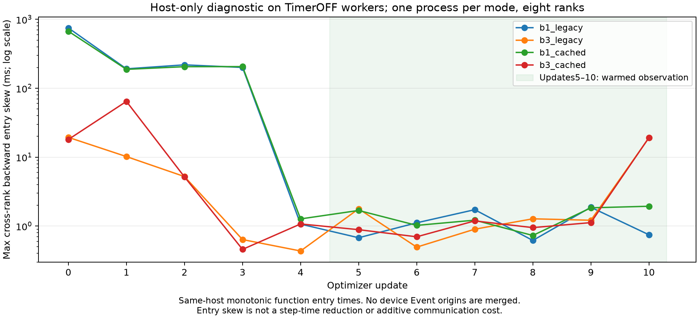

# 主机边界诊断：先纠正预热与稳态的混用

完整更新联合规划目标仍未完成。本分支只做诊断，没有新planner，也不提供正式性能分数。

## 结果

|方式|预热前最大入口差距ms|预热后最大入口差距ms|预热后大于100ms的调用组|预热后finish主机中位ms|
|---|---:|---:|---:|---:|
|b1_legacy|749.878|1.871|0|0.051|
|b3_legacy|19.364|19.018|0|163.079|
|b1_cached|672.083|1.936|0|0.052|
|b3_cached|64.393|19.187|0|160.547|

每模式只有一个独立11更新进程，表中的入口差距按相同保存计划身份匹配八rank，以同一主机monotonic_ns计算最早/最晚进入真实反向C++调用的差。预热前为updates0–4的80组，预热后为updates5–10的96组；每组包含八rank，不把这些组当成独立重复。finish中位按六更新×八rank的48个主机封套统计，也不是48次独立运行。

B1 legacy在前几更新仍有约200ms差距，而预热后最大1.87ms。因此旧rich capture仅前三更新的来源发布等待不能直接解释正式25更新、5预热计时的稳态差距。新host-only路径也出现预热前差距，故不能将原因简单归于旧Event记录；确切启动原因仍未定位。

B3 legacy预热后finish仍有约163ms主机等待。这个等待包括服务流依赖与同步，不等于纯通信耗时，也不是可直接节省的163ms。四组诊断的wall time均不进入正式性能图。

## 方法与资格

显式--host-boundary-trace默认关闭；入口第一步读取主机时钟，无新增设备Event、tensor快照、CPU tensor读取或设备同步；记录保存在CPU内存，训练循环结束后导出。它仍有Python包装/GC记录开销，不能认为零扰动。记录已有pool/真实operator、planner/publish、FSDP、优化器、lifetime/drain/flush/owner、P2P和GC主机封套；不拼接设备独立原点，不相加嵌套封套。

四条小形状L2/H512/F512/S256路径分别通过三次完整Adam更新、step0逐参数FP32梯度相对L2≤0.02、实际SO/单SHMEM、全部入口覆盖和有限性检查。随后四条主形状L4/EP8/E256/K8/H4096/F1024/S16384/GA4/W2、MaxVio10/same各11更新通过：每rank每更新16次真实反向入口完整，各rank全部初始参数、11更新输入/路由/重放身份与正式冻结数据前缀一致，全部梯度交付完毕、源码不变、独占与90GiB门禁通过。

B1/B3 legacy使用72653abf... TimerOFF worker，B1/B3 cached使用e2868fd2... TimerOFF worker；两者ABI2且各进程只有匹配的一套SHMEM。实际完整SHA在每run的libraries-rank*.json、冻结manifest及SOURCE-INDEX。应在同一worker内比较生命周期；legacy与cached之间还改变raw schedule和排序开销，不当作单变量算法对比。v5额外B3 cached专为补齐当前正式B3路径的匹配诊断。

## 失败与覆盖范围

v1/v2在torchrun启动前因端口冲突失败，未开始八rank训练；v2 IPv4 loopback探测漏掉了既有IPv6 kube-apiserver客户端连接。v3改用实际ephemeral32768–60999以下并探测双栈后可训练三更新，但记录器漏包TimerOFF backward_replica_redispatch入口，覆盖门禁拒绝。v4只补该包装名称后重做全部资格。补丁首次发送还因Windows文本换行在bash set处退出，尚未改源文件；改为字节输入后部署，前后SHA核对通过。所有失败状态、stdout及源码快照保留；没有停止其他服务，也没有把它们放进成功曲线。

大梯度PT仅保留在对应独立远端receipt.large_tensors_remote；完整主机JSONL和小模型数值比较、源文件快照在本项目。该诊断不是完整设备依赖DAG，自然路由、完整模型W1/W4、设备在线生命周期planner仍未验收。

## 下一项有界干预

源码中flush当前先在调用时对整个当前流record ready，可能把早已就绪的梯度bank排在随后无关Attention/FSDP工作之后。下一步应在独立分支比较“当前流fence”和“对应梯度bank最后一次写入的ready”，保持copies/quota、FP32格式、owner、已有drain/租约和确定提交顺序不变。必须覆盖中途容量flush、零任务、更新切换及三更新数值检查，再看完整更新是否实际减少；不能删同步或把主机等待搬地方就宣称收益。

另一个待验证因素是raw dW record_stream与服务队列对大输出缓冲释放的影响；现有B1与B2/B3的整卡峰值不同仅是线索，尚未证明原因。公共quota推导实际贡献者可作为消除重复host元数据观察的独立控制，不能和ready/缓冲修改混在同一首次干预中。上述都不是已实现的新策略或论文创新点。
