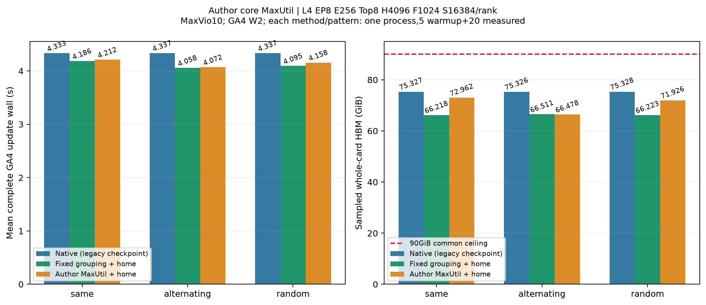

# EP8训练版EasyBalance：本轮结果

2026-11-15。**本轮已完成作者核心选择规则的接入、正确性验收及9点筛查，尚未证明动态选择优于固定分组；未实现新联合planner或Afore设备副本缓存。**

## 条件与数据

普通MegaMoE；V4 attention/mHC2，模型shared expert由框架计算。L4/EP8/E256/Top8/H4096，routed/shared FFN1024，完整16K序列；microbatch1、GA4、W2，全局每更新32条序列/524288标签。FP32参数/梯度/Adam、BF16专家、公共FSDP前向驻留、无CPU offload，90GiB共同门槛。

合法合成token/next-token标签，seed42；同一受控银行目标MaxVio10、实际9.982666。每点新进程25更新，5预热/20测量；每步取八rank最大完整wall，包含在线统计/选择/计划、通信、前反向、重计算、clip、Adam及设备完成。**每点一个独立进程，未运行六档正式矩阵、独立银行或自然路由预训练。**

## 实测完整更新均值

| 模式 | Native原快路径＋驻留(s) | 固定同层分组＋home(s) | 作者MaxUtil＋home(s) | 作者比固定分组慢 |
|---|---:|---:|---:|---:|
| 同热点 | 4.3329 | 4.1861 | 4.2120 | 0.62% |
| 交替热点 | 4.3372 | 4.0580 | 4.0717 | 0.34% |
| 随机热点 | 4.3366 | 4.0954 | 4.1580 | 1.53% |

[SVG](figures/upstream-maxutil-screen.svg) · [PDF](figures/upstream-maxutil-screen.pdf) · [逐进程CSV](figures/upstream-maxutil-runs.csv) · [逐步CSV](figures/upstream-maxutil-steps.csv) · [配对CSV](figures/upstream-maxutil-pairs.csv)

主比较是后两列：它们共享prefix＋finish重计算划分。Native保留原整层划分作快路径参照，不能把其差异全部归为复制。HBM是整卡采样峰值，不能把单次差异当内存成因证明。

## 本轮修正了什么，证明了什么

- 复核作者冻结代码6327f7bf，发现旧work-tie的平局与强制任务处理会抑制跨层机会。新增独立upstream_first规则和ABI4选择器；旧数据没有重命名。对齐的是核心选择集合，不是作者完整CUDA/NCCL执行体系。
- CPU560个集合用例、原9个CPU合约、八rank各674个设备用例通过；三条整网路径均完成三次Adam和全部owner参数step0梯度≤2%，主形状及9个25更新进程通过身份、真实SO、有限性、独占与预算核验。
- 同热点实际产生180/400跨层波次，随机104/400；交替热点与固定分组的实际任务/波次清单八rank完全相同。负结果并非完全没有执行跨层，但也不能推广成方法普遍无效。
- 当前适配受16K Native行上限和逐调用屏障限制，使用虚拟专家域和分波。额外域尺寸不能直接称为梯度通信或关键路径尾部；当前尚无完整owner服务结束的因果证据。

## 决策与交付

三档均未达到相对固定分组3%的继续筛选门槛，**108次正式矩阵保持关闭**。下一项应是原AscendTimerV2的受控成本/依赖定位，验证域转换、真实前反向和保存态成本后再设计联合策略；这项诊断尚未完成，不先命名新算法。

[完整报告](REPORT.md) · [作者规则审计](UPSTREAM-MAXUTIL-AUDIT.md) · [执行/重放](RUNBOOK.md) · [原始数据位置](RAW-DATA.md) · [研究边界](RESEARCH-FINDINGS.md) · [源码使用说明](stack/docs/temporal-replica-study.md)

运行逻辑提交2c4f800，状态/文档交付提交44b4e0d；源码覆盖包和diff在implementation/，原始运行精确源快照在evidence/source-snapshots/。旧24个SO别名/22份去重二进制及新ABI4实际字节、精确4MiB路由银行均已本地校验。部分大梯度PT仍保留在项目专属远端，RAW-DATA.md明确索引，不声称全量已下载。Afore目前仅CPU语义参考，设备缓存、新联合策略、泛化与正式重复均未完成。
