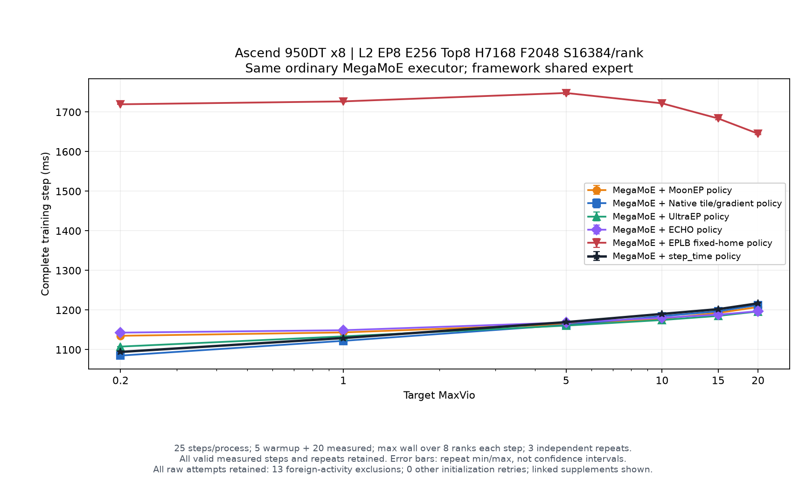
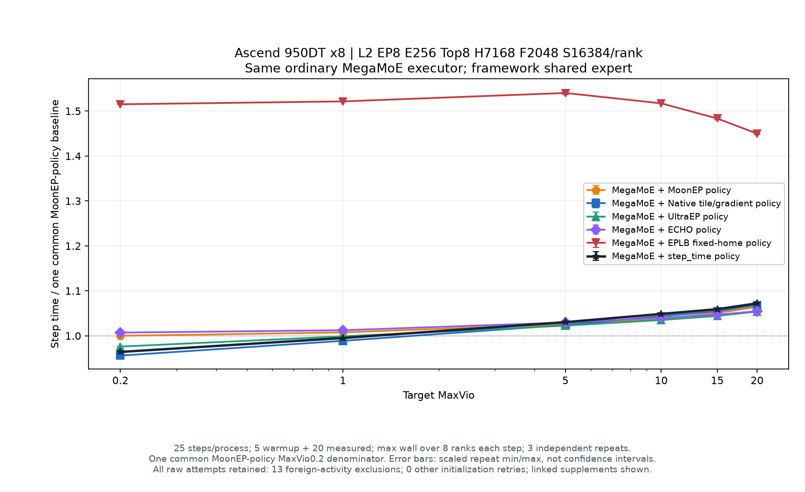
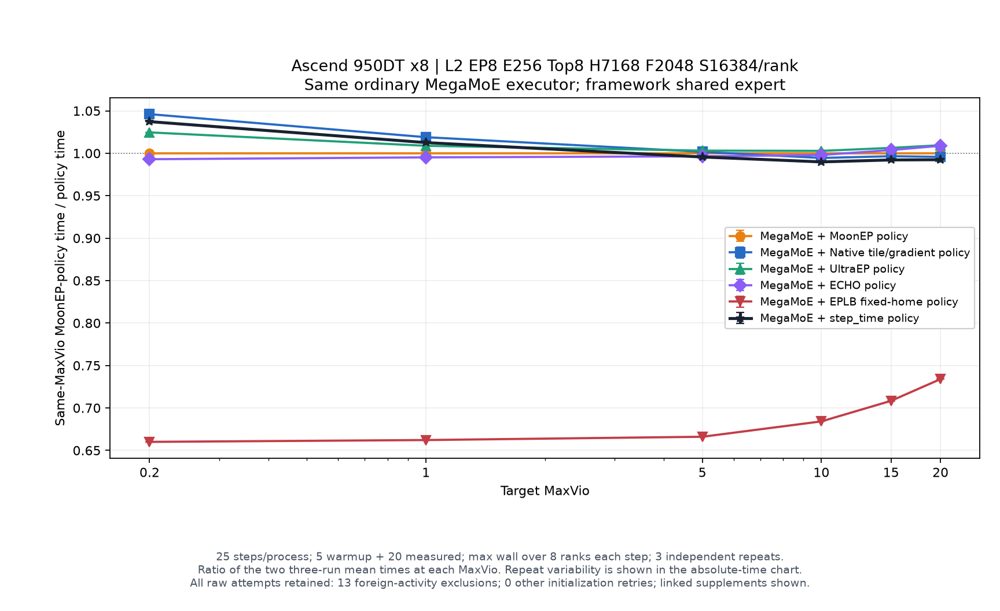
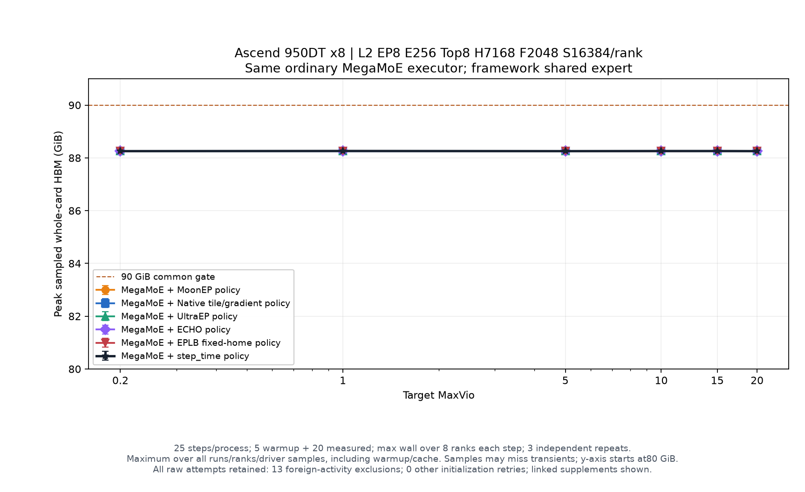
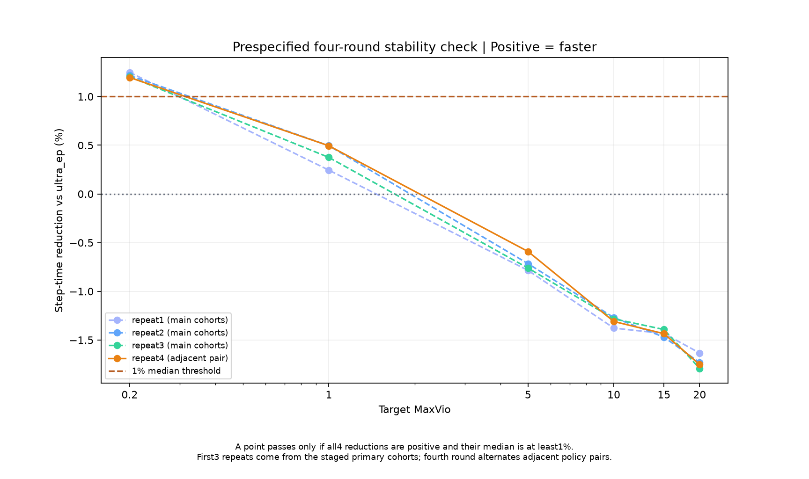

# 普通MegaMoE统一Planner的EP8整步对照

更新时间：2026-11-14T10:17:17.635902+00:00。已按用户要求收尾；原完整验证未完成。

项目及原始数据：D:/megamoe_train/planner-executor-ep8-lab。主矩阵合格运行108/108次。所有数值来自实际训练；不填入官方图读数、预测耗时或未完成运行。

## 结果与结论

已按用户要求停止后续实验并收尾。当前负结果：未证明step_time新搜索相对Native起点有收益；不追加调参或为获得正结果更换条件。
MegaMoE＋MoonEP策略六档平均完整步时为1134.98–1207.65ms，同档MoonEP策略加速比为1.000–1.000倍。
MegaMoE＋Native策略六档平均完整步时为1085.00–1212.79ms，同档MoonEP策略加速比为0.994–1.046倍。
MegaMoE＋UltraEP策略六档平均完整步时为1107.75–1196.33ms，同档MoonEP策略加速比为1.003–1.025倍。
MegaMoE＋ECHO策略六档平均完整步时为1143.01–1197.10ms，同档MoonEP策略加速比为0.993–1.009倍。
MegaMoE＋EPLB-fixed六档平均完整步时为1645.45–1748.12ms，同档MoonEP策略加速比为0.660–0.734倍。
MegaMoE＋step_time六档平均完整步时为1094.21–1216.89ms，同档MoonEP策略加速比为0.990–1.037倍。
四轮逐点检验达到“4/4同向、改善中位数至少1%”的MaxVio为0.2。
最强已有基线为UltraEP策略，按六档三次重复的平均完整步时几何均值确定，不是逐点挑选不同对手。
实际新策略主矩阵的900次全局规划调用中，0次采用搜索后的计划；八rank决策逐条一致。其余精确恢复Native起点，规划开销仍计入步时。
本轮主矩阵未采用任何新计划，不能将可能的步时差异归因为梯度服务搜索策略的收益。
主矩阵step_time完整步时比Native起点高0.34%–0.85%；在线搜索已经执行，预测收益不足时保留起点也仍有开销。分阶段运行的时序差异属于测量限制。

已验证：CPU独立策略参考480组、七项最终设备门禁、五策略独立输出和梯度参考、两层重放，以及全部五策略完整模型三次Adam更新和163840容量门禁。证据分别保存于evidence/cpu-policy-oracle.json、final-gates-v4.json、qualification-accuracy-v2.json、qualification-pool-v2.json和capacity-gate-163840.json。所有正式步时均来自同一pod6-1；pod5-8的补充正确性测试不混入性能曲线。

每次新进程25步，前5步预热。每个测量步先取八rank的最大完整wall time，再平均后20步得到运行均值；每点取三次运行均值的平均。误差棒为三次运行的最小值到最大值，不是置信区间。

| MaxVio | MoonEP策略 ms | Native策略 ms | UltraEP策略 ms | ECHO策略 ms | EPLB-fixed ms | step_time ms |
|---:|---:|---:|---:|---:|---:|---:|
|0.2|1134.98 [1134.70, 1135.43]|1085.00 [1084.45, 1085.43]|1107.75 [1107.60, 1107.96]|1143.01 [1142.88, 1143.27]|1719.59 [1719.20, 1720.00]|1094.21 [1093.86, 1094.48]|
|1|1143.51 [1143.27, 1143.64]|1122.26 [1122.08, 1122.54]|1133.54 [1132.35, 1134.50]|1149.07 [1148.30, 1149.53]|1726.88 [1725.45, 1727.94]|1129.32 [1128.88, 1129.58]|
|5|1164.32 [1163.71, 1164.79]|1162.42 [1161.38, 1163.06]|1160.72 [1160.58, 1160.86]|1168.55 [1167.93, 1169.20]|1748.12 [1743.66, 1750.82]|1169.47 [1169.17, 1169.69]|
|10|1178.08 [1177.85, 1178.40]|1184.64 [1183.93, 1185.42]|1174.80 [1174.62, 1174.95]|1180.48 [1179.85, 1180.96]|1721.95 [1721.79, 1722.17]|1190.19 [1189.69, 1191.14]|
|15|1192.72 [1192.32, 1193.17]|1196.87 [1196.56, 1197.19]|1185.23 [1184.77, 1185.85]|1188.29 [1187.82, 1188.87]|1683.76 [1680.54, 1685.45]|1202.20 [1202.05, 1202.36]|
|20|1207.65 [1207.09, 1208.14]|1212.79 [1212.68, 1213.00]|1196.33 [1195.58, 1197.25]|1197.10 [1195.95, 1197.83]|1645.45 [1642.82, 1646.78]|1216.89 [1216.80, 1216.99]|

统一归一化分母：主矩阵MaxVio0.2的MoonEP策略三次运行均值的平均，1134.984064ms。同档加速比＝MoonEP策略步时÷本策略步时，越大越快。

### 绝对完整步时

[SVG](../figures/absolute-step-time.svg) · [PDF](../figures/absolute-step-time.pdf)

### 统一分母归一化步时

[SVG](../figures/normalized-step-time.svg) · [PDF](../figures/normalized-step-time.pdf)

### 相对同档MoonEP策略加速比

[SVG](../figures/speedup-vs-moonep-planner.svg) · [PDF](../figures/speedup-vs-moonep-planner.pdf)

### 整卡HBM采样峰值

[SVG](../figures/whole-card-hbm.svg) · [PDF](../figures/whole-card-hbm.pdf)

### 四轮逐点稳定性

[SVG](../figures/four-round-reductions.svg) · [PDF](../figures/four-round-reductions.pdf)

## 模型、数据与统一条件

| 项目 | 实际共同条件 |
|---|---|
| 执行器 | 普通megamoe-balanced，Native48ef24a6＋已验收64槽及本轮接口补丁；不使用共享融合分支 |
| 训练栈 | MindSpeed-LLM dd5ee032 / FSDPTurbo 9c443c6，显式适配；无sitecustomize |
| 模型 | V4结构完整模型，L2、H7168、FFN2048、E256/Top8、每层一个框架shared expert；hash0/MTP0 |
| 公共裁剪 | vocab32768、mHC2、attention Q-heads32；保留attention、mHC、embedding、lm-head和next-token loss |
| 并行与输入 | 单机8×950DT，EP8/FSDP8/Expert-FSDP1/TP1/CP1；microbatch1/GA1；16384 token/rank |
| 精度 | FP32参数、梯度及两份Adam状态；BF16专家计算镜像；无CPU offload |
| 优化器 | FunctionalFusedAdamW，LR1e-5，betas(0.9,0.95)，eps1e-8，WD0.01，全局clip1 |
| 重计算 | 整层非重入checkpoint；原始前向在线规划，重放同一计划；backward输入redispatch |
| 容量与owner | 接收163840/rank，64物理槽＝32home＋32replica；固定专家/优化器owner；90GiB门槛 |
| 数据 | seed42合法合成token及next-token标签；不是自然语料收敛实验 |
| 主路由 | 官方lognormal无放回TopK方法；seed1234基础银行，逐层逐步共同置换；六档三重复共用IDs |
| 独立路由 | 校准seed20261114；heldout-a31415、heldout-b27182；未来路由不传入Planner |

MaxVio＝最热逻辑专家任务数÷专家平均任务数−1；20表示约21倍平均负载。逻辑路由与权重始终不变，变化的是物理执行地点和来源配额。

计划中的曲线比较MegaMoE＋某Planner策略，不能替代上一轮完整Ascend MoonEP后端的曲线，也不代表复现UltraEP、ECHO或EPLB原系统性能；不是官方H20九层图的严格复现。

## 接口和关键路径

原容量131072的新旧接口端点对照已完成，详见analysis/interface-regression.json；该诊断用于分开接口变化和容量变化，单次配对不作稳定收益结论。

独立校准银行0.3/7/18选出的冻结起点为Native策略。已验收的模型按实际的前向、checkpoint重放、反向dW2/dX/dW1及固定owner服务依赖评估配额；只读当前路由和历史观测，不读取未来步或未来层的路由。副本有非零任务就承担完整56MiB dW1和28MiB dW2交付，不能按token占比缩小。有副本专家优先的GradientKey顺序也随候选计划重新计算。

已完成的独立校准使用独立校准路由拟合GEMM非线性/tile尾块、链路与并发竞争、梯度释放和owner服务、框架FSDP/attention/重计算/优化器依赖。原始TimerV2按rank保存，Event区间含等待与主机供给间隙；嵌套区间不相加，不拼接各rank的独立零点。column0梯度样本只覆盖偶数静态任务余数，对奇数owner worker的逐tile观测有限；以原始每lane阶段包络约束，并保留预测误差。最终预测误差裕量47.40ms；独立设备校准后冻结为1轮、最多4个候选。首次稠密副本低估后，仅在独立诊断集上增加正干扰校准；owner系数达到网格边界，模型仍有限制。单机链路差异不可分辨，统一拓扑消融不具有独立可辨识性。

Planner只产出copies[EP,slots]和quota[source,expert,destination]。公共编译器检查来源守恒、槽位、容量、rank一致性与实际非零贡献者，产生不可变计划正文；epoch/stream/租约另行绑定。原始前向提交一次，checkpoint与反向绑定同一计划，最后退休。执行器不按Planner名称分支。

[新策略实现、校准修订与模型限制](STEP-TIME-IMPLEMENTATION.md)。已有策略90次先完成，随后独立校准和新策略18次；第四轮轮换对手顺序，独立银行未执行。主矩阵六策略并非同一时段交织运行。

## 独立验证

已完成108次主矩阵和12次第四轮。原门槛为每点四轮同向且改善中位至少1%；MaxVio0.2达到步时统计门槛，但实际仍用Native起点，不构成新搜索收益的证据。两份独立银行72次、条件消融54次及隔离规划银行按用户要求取消。

正确性门槛为独立参考输出相对L2≤0.004、梯度≤0.02；另查32/64槽、空专家、热点切换、非均衡接收、容量越界、非法计划集体拒绝、跨层污染、反序反向和三次Adam更新。

附加训练轨迹审计仍有未解决告警：第四轮MaxVio5的step_time与MoonEP在第22步的全局梯度范数相差2.415%，loss相差0.068%。初始参数、输入、路由SHA一致；不同训练轨迹的范数差不等于同权重梯度L2，但其具体根因没有确定，原严格检查保留失败。第一次同权重诊断通过前4步后出现HCCL notify-wait错误；增加主机对齐后的重试按用户要求停止，未完成25步验收。这些诊断不进入性能曲线，也不能据此宣称全部整网数值验收通过。

[中止诊断原始状态](../evidence/diagnostic-fixed-state-pair-aligned-vio5/status.json) · [原始停队轨迹检查](../evidence/trajectory-audit-strict-fourth-pause.json) · [第22步逐项调查](../analysis/fourth-vio5-trajectory-investigation.json)。

## 失败、排除和限制

当前保留12个原始非合格进程状态、0个部分目录，主矩阵中13次尝试因已验证外部设备活动窗口排除；原记录不修改，补测通过retry_of显式关联。外部容器启动到本任务停队的保守窗口内，所有策略和快慢运行使用同一个排除规则。训练前HCCL初始化故障的根因未获证明，不能直接归因Planner。全部慢的有效运行保留；OOM、超时、非法计划不静默回退。

HBM来自npu-smi约1秒加命令开销的整卡采样，包含预热与缓存，可能漏掉瞬态峰值；单机链路若近似均匀，拓扑因素标为不可分辨。短程随机输入不能证明训练收敛。

## 数据与复跑

[主矩阵逐点CSV](../analysis/points.csv) · [逐次CSV](../analysis/runs.csv) · [完整验收与待办](../ACCEPTANCE.json) · [失败索引](../evidence/failure-and-exclusion-index.json) · [结构](ARCHITECTURE.md) · [决策](DECISIONS.md) · [复跑](../REPRODUCE.md) · [基线源码和SO](../evidence/BASELINE-FREEZE.json) · [源码补丁](../patches/) · [依赖](../dependencies/)
