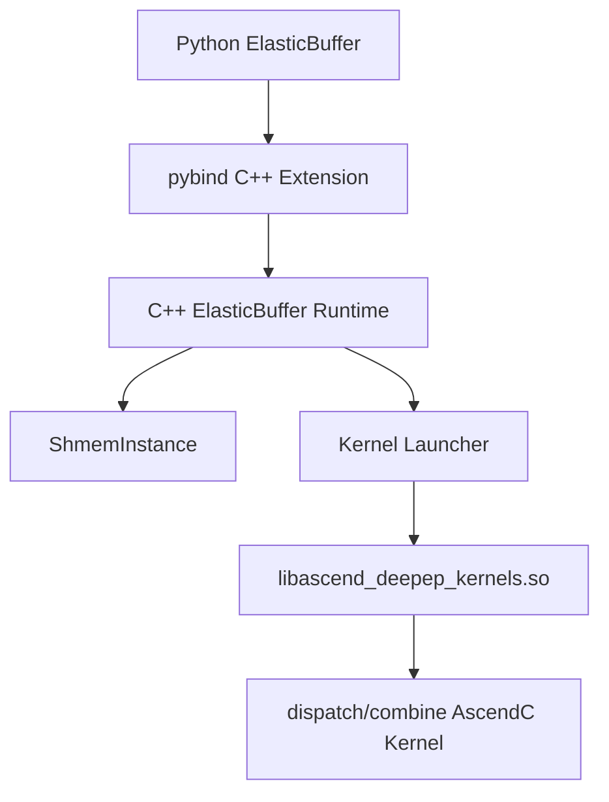
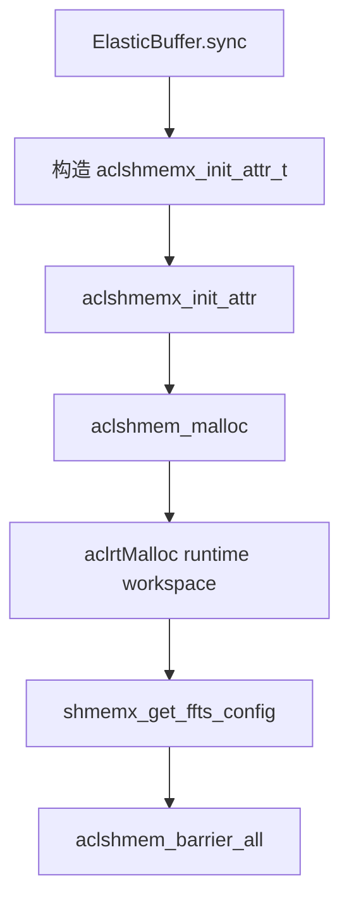
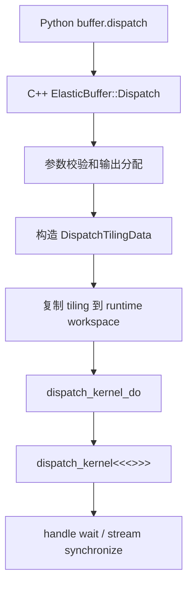
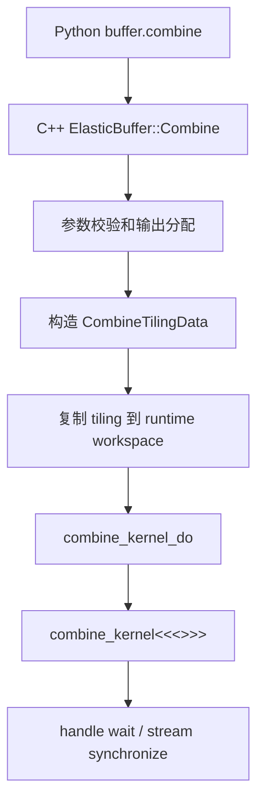

# ascend-deepep 设计文档

## 1. 总体架构



`ElasticBuffer` 只保存通信运行时配置并管理 `ShmemInstance`，不保存 hidden、topk、expert 数等算子业务参数。业务参数在每次 `dispatch` / `combine` 调用时传入。

## 2. SHMEM 依赖管理

`cann/shmem` 位于 `3rdparty/shmem`，通过 Git Submodule 固定版本：

```ini
[submodule "3rdparty/shmem"]
    path = 3rdparty/shmem
    url = https://gitcode.com/cann/shmem.git
```

默认安装目录为：

```text
3rdparty/shmem/install
```

`scripts/build_shmem.sh` 检查并复用已有安装；未安装时调用 SHMEM 仓内的 `scripts/build.sh`。

## 3. Kernel 编译方式

所有 AscendC kernel 通过一次 `ascend_deepep_add_kernel_library` 调用编译到同一个共享库：

```cmake
ascend_deepep_add_kernel_library(
    ascend_deepep_kernels
    SOURCES
        kernels/dispatch.cpp
        kernels/combine.cpp
)
```

主要产物：

```text
libascend_deepep_kernels.so
```

该共享库同时导出：

```text
dispatch_kernel_do
combine_kernel_do
```

host wrapper 内部使用 AscendC `<<<>>>` 启动对应 kernel。新增算子时，在 `kernels/` 增加源文件和导出 wrapper，并将源文件加入同一个 `SOURCES` 列表即可。

## 4. CANN SHMEM 生命周期

`ShmemInstance` 封装以下 host 接口：

```text
aclshmemx_init_attr
aclshmem_malloc / aclshmem_free
aclshmem_barrier_all
aclshmemx_handle_wait
aclshmem_finalize
shmemx_get_ffts_config
```

初始化流程：



SHMEM runtime 是进程级资源。`ShmemInstance` 使用进程内引用计数，首次实例创建时初始化 SHMEM，最后一个实例销毁时执行 `aclshmem_finalize`。每个实例独立分配自己的 symmetric buffer。

## 5. 调用链

### 5.1 Dispatch



### 5.2 Combine



当前 launcher 使用同步语义。kernel 完成后才返回，因此连续调用可以安全复用同一块 symmetric buffer 和 runtime workspace。后续引入异步重叠时，需要增加多 slot symmetric buffer、event 和 slot 生命周期管理。

## 6. Kernel 共享库与 Python 扩展

构建产物关系：

```text
kernels/dispatch.cpp + kernels/combine.cpp
    -> libascend_deepep_kernels.so

csrc/*.cpp
    -> ascend_deepep/_C.so
    -> links libascend_deepep_kernels.so and libshmem.so
```

构建脚本会把 kernel 共享库复制到：

```text
ascend_deepep/lib/libascend_deepep_kernels.so
```

Python 扩展使用 `$ORIGIN/lib` rpath 查找该库。

## 7. JIT 方案选择

DeepEP 的 JIT 编译对象是 CUDA device kernel。其运行时链路包括生成 CUDA 源码、调用 NVCC 生成 cubin、动态加载 cubin、查找 kernel symbol 并启动 kernel。ops-transformer 的 JIT 则编译 Python 到 ACLNN 的 C++ wrapper，不编译 AscendC device kernel。

本工程采用 AscendC AOT 编译与 kernel 直调方式：Bisheng CCE 在构建阶段生成 kernel 共享库，运行阶段由 C++ Runtime 调用共享库导出的 host wrapper。该方式与当前 AscendC/CANN 构建体系一致，也便于集中管理 SHMEM、symmetric buffer、tiling 和 kernel ABI。

## 8. 扩展新算子

新增算子时需要：

1. 在 `include/ascend_deepep/kernels/launch.h` 增加 host wrapper 声明；
2. 在 `include/ascend_deepep/kernels/types.h` 增加共享参数结构；
3. 在 `kernels/` 增加 device kernel 和 `xxx_kernel_do`；
4. 将新源文件加入根 CMake 的 `SOURCES`；
5. 在 `csrc/launcher.*` 和 `ElasticBuffer` 增加调用入口；
6. 在 `csrc/pybind.cpp` 与 Python 层暴露接口。
