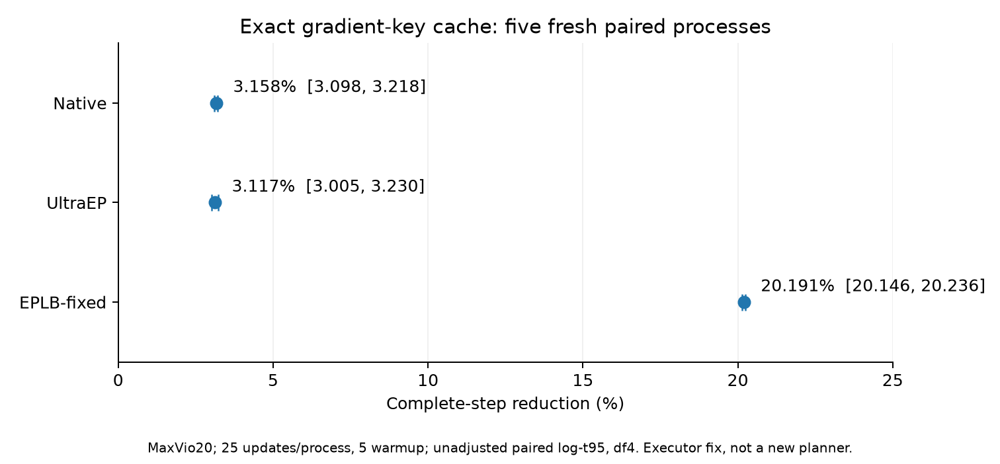

# Exact gradient-order key cache: implementation-cost intervention

This is an additional executor baseline, not the new planner or a latency
claim. Default `MEGAFLUX_GRADIENT_KEY_CACHE=0` preserves the original code.

The frozen backward `EnableGradientPipe` sorts up to64 physical experts. Each
comparison calls `GradientKey` twice, and each nonempty key scans all256 plan
entries through `Fresh` uncached reads. Even the key of the insertion value
is recomputed in the loop. This structure is present in the frozen source;
the experimental fan-in priority did not create it.

The cache performs one current-plan metadata pass, builds contributor counts
and local slot IDs, then computes all exact keys once and sorts local keys.
The resulting expert order is unchanged, including empty slots, shared-first
priority, logical tie order and the optional fan-in priority. No key survives
the call; plan/epoch/payload ready flags and summation order are unchanged.
Supported EP2/4/8, home/slots<=32 uses bounded private arrays; unsupported
topologies retain the original algorithm. There is no new collective or
activation buffer. Actual code is shared with the CPU oracle via
`include/mega_moe_gradient_order.h`.

CPU: 8572 rank/order comparisons passed against independent original ordering,
covering all Native/UltraEP/EPLB actual endpoint fixtures, random EP2/4/8
layouts, empty slots and unsupported/malformed inputs. Source-level evaluations
at high skew average roughly392767 plan reads per core/call for EPLB versus
33439 for Native; cached keys read256. These are **not** disassembly counts,
memory-bandwidth measurements or NPU durations. Inactive-copy kernels skip
initialization, so their effective count is0.

Matched cache0/1 built from cb4c5df, runahead0, flags0/panel/priority0/wide0:
all14 independent-reference/checkpoint/full-shape Adam gates passed. All16
online endpoint screens passed identity, actual loaded SO and source audits.
Each cell is one fresh process,25 complete updates, first5 excluded. These are
screening results, not five-process confirmation or a new planner.

| MaxVio | Planner | Original ms | Cached ms | Step reduction |
|---|---|---:|---:|---:|
|20|Native|1210.340|1171.825|3.182%|
|20|UltraEP|1193.586|1157.106|3.056%|
|20|EPLB budget32|1253.414|1169.724|6.677%|
|20|EPLB-fixed full|1639.596|1308.716|20.181%|
|0.2|Native|1081.609|1081.776|-0.015%|
|0.2|UltraEP|1104.758|1087.654|1.548%|
|0.2|EPLB budget32|1222.722|1122.287|8.214%|
|0.2|EPLB-fixed full|1717.999|1356.731|21.028%|

At high skew the full-EPLB versus UltraEP gap shrinks from446.010 to151.610ms
when both receive the fix (66.0% of the original gap). The residual is real in
this screen but not yet attributed. Metadata-only intervention supports an
executor explanation for much of the old gap; source read counts do not by
themselves measure where hardware time was spent. Native at low skew skips
the routine and is a no-op control. Next: five fresh paired process repeats
at high skew, excluding screening runs from confirmatory inference.

Keep the faster qualified executor as a strong baseline for every later
planner; pathological initialization cannot establish a new load-balancing
algorithm. Receipt: research/single_mb_fbw/analysis/gradient-key-cache-screen-audit.json.

Distinguish Host allocation from device execution. The real forward and
routed-only ABI3 backward kernels select homeTiling32 and skip this routine
when the header has no active copies, despite64-slot Host allocations. The
first-copy regime transition needs native measurement, not a per-copy penalty
or inference from Host tensor shape alone.

## Fresh five-process confirmation at MaxVio20

Thirty additional online training processes completed after screening. Each
policy has five independent paired cache0/1 processes; order is interleaved
and reversed. Screening is excluded from inference. All raw records were
downloaded and re-audited for initial weights, inputs, routes, actual loaded
SO, common source identity,25 updates,50 original planning calls and no live
plan leases. First5 updates are warmup. Driver HBM remains under90GiB.

| Planner | Mean original ms | Mean cached ms | Geometric paired step reduction | Unadjusted log-t95, df4 |
|---|---:|---:|---:|---:|
|Native|1209.696|1171.495|3.158%|3.098%–3.218%|
|UltraEP|1193.339|1156.139|3.117%|3.005%–3.230%|
|EPLB-fixed full|1639.479|1308.455|20.191%|20.146%–20.236%|

The inference unit is a process pair, not an update. These are parametric
paired t intervals on log ratios, without multiple-comparison adjustment;
normal/independent paired log ratios are assumed. All five pairs improve
for every policy. This confirms the metadata intervention on this fixed
shape/synthetic route bank, not a new planner or natural training quality.
Low-MaxVio and budget32 remain single-process screening results.

Exact per-pair measurements, memory and inference scope are archived in
`research/single_mb_fbw/analysis/key-cache-confirmation-summary.json`.
