# MegaMoE Balanced 框架到算子：调用点分析

源码按四仓 megamoe-balanced 分支核对。主路径使用八卡方法 C、EP4 × Expert-FSDP2、E8 / Top2 和 custom FSDP。11 月 2 日采集使用独立启动包装、冻结 Python 路由、panel2 和 BF16 saved。初始化以仓库脚本说明装配，整网前向标出实验路由覆盖，反向章节的补充阅读列出可选保存格式。

入口：[系统导览](index.html#system-guide) · [源码时序图](index.html)。生命周期总览按职责分列，详图按文件分列。纵向为调用顺序。

## 训练生命周期

一次启动包住多次训练 step。总览按职责分列，详图展开到源码文件。实线表示调用或提交，虚线表示返回或框架调度。

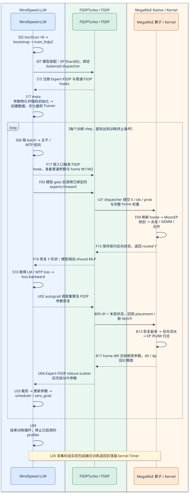

| 编号 | 调用点 | 进入位置 | 参数、返回与职责 |
|---|---|---|---|
| L01 | [dispatcher_megamoe_balanced.py:119](reference-src/FSDPTurbo/fsdp_turbo/distributed/expert_parallel/dispatcher_megamoe_balanced.py) | [fsdp2_bridge.py:116](../../ascend_deepep/fsdp2_bridge.py) | dispatcher 读取 unshard 后的参数，将本层张量交给 Native bridge。 |
| L02 | [fsdp2_bridge.py:85](../../ascend_deepep/fsdp2_bridge.py) | [modeling_deepseek_v4.py:2017](reference-src/MindSpeed-LLM/mindspeed_llm/fsdp2/models/deepseek_v4/modeling_deepseek_v4.py) | 模型消费 routed Y，并把 shared 输出相加。反向 tape 留在自定义 autograd 节点。 |
| L03 | [trainer.py:450](reference-src/MindSpeed-LLM/mindspeed_llm/fsdp2/train/trainer.py) | [trainer.py:468](reference-src/MindSpeed-LLM/mindspeed_llm/fsdp2/train/trainer.py) | 积累结束后裁剪梯度，有限时更新参数及学习率，然后清梯度。 |
| L04 | [trainer.py:584](reference-src/MindSpeed-LLM/mindspeed_llm/fsdp2/train/trainer.py) | [trainer.py:634](reference-src/MindSpeed-LLM/mindspeed_llm/fsdp2/train/trainer.py) | 训练达到步数上限时跳出循环。已启用的框架 profiler 在循环外停止。 |
| L05 | [whole_entry.py:254](reference-src/experiment/tools/whole_entry.py) | [whole_entry.py:256](reference-src/experiment/tools/whole_entry.py) | 训练入口返回后，采集轮导出保留的 kernel Timer 记录。 |

## 初始化与绑定

以仓库 run_training_case.sh 的方法 C 为入口。Python 固定路由与采集使用独立实验包装器，参数见顶部说明。

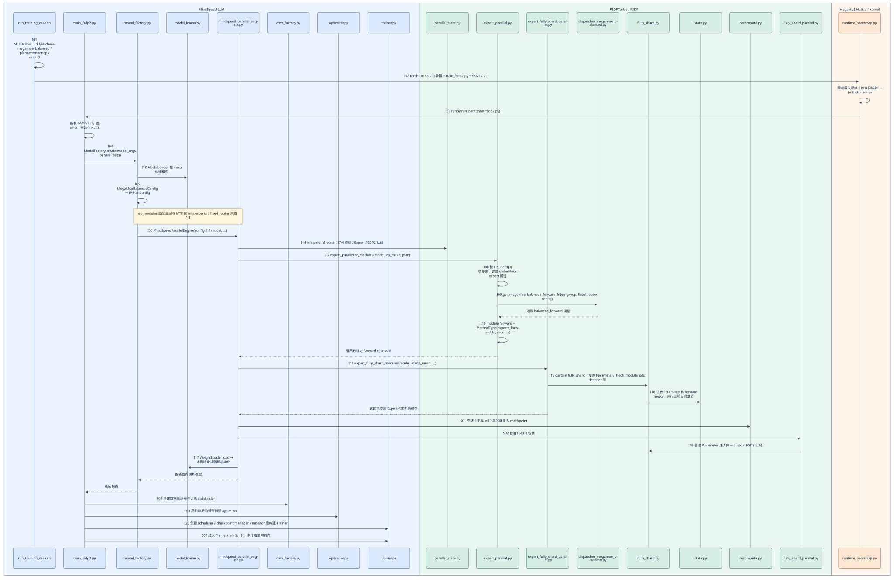

| 编号 | 调用点 | 进入位置 | 参数、返回与职责 |
|---|---|---|---|
| I01 | [run_training_case.sh:96](../../integration/wuhan/run_training_case.sh) | [run_training_case.sh:100](../../integration/wuhan/run_training_case.sh) | 方法C选择megamoe_balanced、MoonEP planner与2副本槽。 |
| I02 | [run_training_case.sh:119](../../integration/wuhan/run_training_case.sh) | [runtime_bootstrap.py:16](../../integration/wuhan/runtime_bootstrap.py) | 仓库启动入口创建各rank进程，把训练入口、YAML和CLI参数交给runtime wrapper。 |
| I03 | [runtime_bootstrap.py:54](../../integration/wuhan/runtime_bootstrap.py) | [train_fsdp2.py:303](reference-src/MindSpeed-LLM/train_fsdp2.py) | 通用脚本直接传train_fsdp2.py。固定Python实验在两者之间插入whole_entry.py。 |
| I04 | [train_fsdp2.py:210](reference-src/MindSpeed-LLM/train_fsdp2.py) | [model_factory.py:63](reference-src/MindSpeed-LLM/mindspeed_llm/fsdp2/models/model_factory.py) | 模型创建调用；初始化分布式、数据、optimizer与Trainer的上层入口是MindSpeedAutoTrainer。 |
| I05 | [model_factory.py:257](reference-src/MindSpeed-LLM/mindspeed_llm/fsdp2/models/model_factory.py) | [model_factory.py:266](reference-src/MindSpeed-LLM/mindspeed_llm/fsdp2/models/model_factory.py) | planner/slots/restore/capacity/validation连同fixed_router写入EP plan。 |
| I06 | [model_factory.py:182](reference-src/MindSpeed-LLM/mindspeed_llm/fsdp2/models/model_factory.py) | [mindspeed_parallel_engine.py:65](reference-src/MindSpeed-LLM/mindspeed_llm/fsdp2/distributed/mindspeed_parallel_engine.py) | engine依次应用并行转换；返回包装后的模型。 |
| I07 | [mindspeed_parallel_engine.py:140](reference-src/MindSpeed-LLM/mindspeed_llm/fsdp2/distributed/mindspeed_parallel_engine.py) | [expert_parallel.py:40](reference-src/FSDPTurbo/fsdp_turbo/distributed/expert_parallel/expert_parallel.py) | balanced分支走普通专家EP与Expert-FSDP路径，非作者MoonEP mirror附着路径。 |
| I08 | [expert_parallel.py:93](reference-src/FSDPTurbo/fsdp_turbo/distributed/expert_parallel/expert_parallel.py) | [expert_parallel.py:280](reference-src/FSDPTurbo/fsdp_turbo/distributed/expert_parallel/expert_parallel.py) | 先按专家维Shard(0)切分；home=E/EP。图中表达的是EP切分，不是副本搬运。 |
| I09 | [expert_parallel.py:310](reference-src/FSDPTurbo/fsdp_turbo/distributed/expert_parallel/expert_parallel.py) | [dispatcher_megamoe_balanced.py:24](reference-src/FSDPTurbo/fsdp_turbo/distributed/expert_parallel/dispatcher_megamoe_balanced.py) | get_dispatcher_fn显式选择balanced闭包；传入ep_group、fixed_router和config。 |
| I10 | [expert_parallel.py:99](reference-src/FSDPTurbo/fsdp_turbo/distributed/expert_parallel/expert_parallel.py) | [dispatcher_megamoe_balanced.py:28](reference-src/FSDPTurbo/fsdp_turbo/distributed/expert_parallel/dispatcher_megamoe_balanced.py) | 方法绑定使模型内self.experts(...)进入balanced_forward；原模型上层调用保持。 |
| I11 | [mindspeed_parallel_engine.py:151](reference-src/MindSpeed-LLM/mindspeed_llm/fsdp2/distributed/mindspeed_parallel_engine.py) | [expert_fully_shard_parallel.py:43](reference-src/FSDPTurbo/fsdp_turbo/distributed/expert_parallel/expert_fully_shard_parallel.py) | EFSDP包装管理Parameter生命周期；该文件配置BF16参数、FP32 reduce及gradient divide factor。 |
| I12 | [whole-stage-a1.sh:11](reference-src/experiment/tools/whole-stage-a1.sh) | [run-whole-a1.sh:121](reference-src/experiment/tools/run-whole-a1.sh) | 真实Python实验选择方法C、panel、20480容量与隔离库。 |
| I13 | [whole_entry.py:254](reference-src/experiment/tools/whole_entry.py) | [train_fsdp2.py:303](reference-src/MindSpeed-LLM/train_fsdp2.py) | 实验harness安装采集包装并转入原训练入口。 |
| I14 | [mindspeed_parallel_engine.py:62](reference-src/MindSpeed-LLM/mindspeed_llm/fsdp2/distributed/mindspeed_parallel_engine.py) | [parallel_state.py:37](reference-src/FSDPTurbo/fsdp_turbo/distributed/parallel_state.py) | 注册普通FSDP与EP/Expert-FSDP mesh。 |
| I15 | [expert_fully_shard_parallel.py:86](reference-src/FSDPTurbo/fsdp_turbo/distributed/expert_parallel/expert_fully_shard_parallel.py) | [fully_shard.py:39](reference-src/FSDPTurbo/fsdp_turbo/distributed/fine_grained_fully_shard/fully_shard.py) | 本例YAML选custom。Expert-FSDP管专家Parameter，hook_module匹配相应decoder层。 |
| I16 | [fully_shard.py:108](reference-src/FSDPTurbo/fsdp_turbo/distributed/fine_grained_fully_shard/fully_shard.py) | [state.py:79](reference-src/FSDPTurbo/fsdp_turbo/distributed/fine_grained_fully_shard/state.py) | custom fully_shard 初始化FSDPState，在匹配模块登记pre/post-forward hooks。 |
| I17 | [mindspeed_parallel_engine.py:87](reference-src/MindSpeed-LLM/mindspeed_llm/fsdp2/distributed/mindspeed_parallel_engine.py) | [model_loader.py:195](reference-src/MindSpeed-LLM/mindspeed_llm/fsdp2/models/model_loader.py) | 本例meta + train_from_scratch，且未开pre-shard init。FSDP后to_empty与随机初始化。 |
| I18 | [model_factory.py:161](reference-src/MindSpeed-LLM/mindspeed_llm/fsdp2/models/model_factory.py) | [model_loader.py:102](reference-src/MindSpeed-LLM/mindspeed_llm/fsdp2/models/model_loader.py) | 按实际配置在meta上构建空模型，随后才做并行装配。 |
| I19 | [fully_shard_parallel.py:41](reference-src/FSDPTurbo/fsdp_turbo/distributed/fully_shard_parallel/fully_shard_parallel.py) | [fully_shard.py:39](reference-src/FSDPTurbo/fsdp_turbo/distributed/fine_grained_fully_shard/fully_shard.py) | 普通FSDP与Expert-FSDP使用同一custom实现，由各自mesh与模块计划区分。 |
| I20 | [train_fsdp2.py:89](reference-src/MindSpeed-LLM/train_fsdp2.py) | [trainer.py:48](reference-src/MindSpeed-LLM/mindspeed_llm/fsdp2/train/trainer.py) | 模型、数据、optimizer、scheduler、checkpoint manager和monitor都已就绪，注入Trainer。 |

## 整网前向：从 batch 经 MegaMoE kernel 到 loss

从 Trainer 取 batch 开始，沿主干 decoder 追踪一次 routed MoE。MTP 的 decoder 复用这条专家路径。

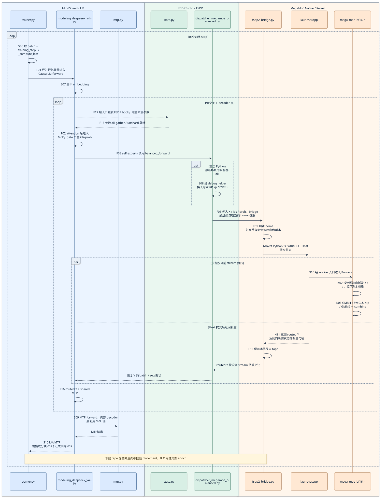

| 编号 | 调用点 | 进入位置 | 参数、返回与职责 |
|---|---|---|---|
| S01 | [mindspeed_parallel_engine.py:218](reference-src/MindSpeed-LLM/mindspeed_llm/fsdp2/distributed/mindspeed_parallel_engine.py) | [recompute.py:45](reference-src/FSDPTurbo/fsdp_turbo/memory/recompute/recompute.py) | 方法C实验给主干与MTP目标层包装非重入checkpoint。 |
| S02 | [mindspeed_parallel_engine.py:118](reference-src/MindSpeed-LLM/mindspeed_llm/fsdp2/distributed/mindspeed_parallel_engine.py) | [fully_shard_parallel.py:18](reference-src/FSDPTurbo/fsdp_turbo/distributed/fully_shard_parallel/fully_shard_parallel.py) | 为模型普通参数安装FSDP包装。 |
| S03 | [train_fsdp2.py:260](reference-src/MindSpeed-LLM/train_fsdp2.py) | [data_factory.py:172](reference-src/MindSpeed-LLM/mindspeed_llm/fsdp2/data/data_factory.py) | 实验YAML选择mg管理器，读取Python BIN/IDX并创建dataloader。 |
| S04 | [train_fsdp2.py:215](reference-src/MindSpeed-LLM/train_fsdp2.py) | [optimizer.py:213](reference-src/MindSpeed-LLM/mindspeed_llm/fsdp2/optim/optimizer.py) | 框架根据配置创建Muon相关优化器，持有训练参数。 |
| S05 | [train_fsdp2.py:159](reference-src/MindSpeed-LLM/train_fsdp2.py) | [trainer.py:213](reference-src/MindSpeed-LLM/mindspeed_llm/fsdp2/train/trainer.py) | 训练组件创建后进入训练循环。 |
| S06 | [trainer.py:377](reference-src/MindSpeed-LLM/mindspeed_llm/fsdp2/train/trainer.py) | [trainer.py:835](reference-src/MindSpeed-LLM/mindspeed_llm/fsdp2/train/trainer.py) | 取batch后进入training_step并计算loss。 |
| S07 | [modeling_deepseek_v4.py:2195](reference-src/MindSpeed-LLM/mindspeed_llm/fsdp2/models/deepseek_v4/modeling_deepseek_v4.py) | [modeling_deepseek_v4.py:2082](reference-src/MindSpeed-LLM/mindspeed_llm/fsdp2/models/deepseek_v4/modeling_deepseek_v4.py) | 主干执行decoder层，attention之后进入MoE。 |
| S08 | [utils.py:615](reference-src/FSDPTurbo/fsdp_turbo/distributed/expert_parallel/utils.py) | [fixed_python_route.py:9](reference-src/experiment/tools/fixed_python_route.py) | 11月2日实验overlay在此debug入口调用fixed_routes。左侧是当前checkout的入口，右侧是冻结实验源码。 |
| S09 | [modeling_deepseek_v4.py:2454](reference-src/MindSpeed-LLM/mindspeed_llm/fsdp2/models/deepseek_v4/modeling_deepseek_v4.py) | [mtp.py:115](reference-src/MindSpeed-LLM/mindspeed_llm/fsdp2/models/common/mtp.py) | MTP分支内部decoder可再次调用MoE。 |
| S10 | [trainer.py:1158](reference-src/MindSpeed-LLM/mindspeed_llm/fsdp2/train/trainer.py) | [trainer.py:1192](reference-src/MindSpeed-LLM/mindspeed_llm/fsdp2/train/trainer.py) | Trainer收集LM/MTP等loss。 |

## 框架前向：从 experts.forward 到 Native bridge

沿方法 C / MoonEP planner 展开。设备消费与快照复制按 stream 排序，release_pending 释放调用租约。

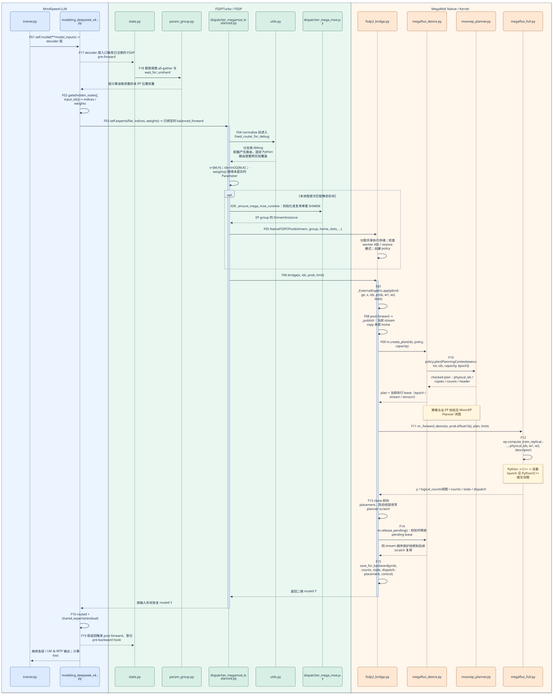

| 编号 | 调用点 | 进入位置 | 参数、返回与职责 |
|---|---|---|---|
| F01 | [trainer.py:1158](reference-src/MindSpeed-LLM/mindspeed_llm/fsdp2/train/trainer.py) | [modeling_deepseek_v4.py:1999](reference-src/MindSpeed-LLM/mindspeed_llm/fsdp2/models/deepseek_v4/modeling_deepseek_v4.py) | 模型递归调用到MoE block；不是Trainer直接调用某层MoE。 |
| F02 | [modeling_deepseek_v4.py:2015](reference-src/MindSpeed-LLM/mindspeed_llm/fsdp2/models/deepseek_v4/modeling_deepseek_v4.py) | [modeling_deepseek_v4.py:1936](reference-src/MindSpeed-LLM/mindspeed_llm/fsdp2/models/deepseek_v4/modeling_deepseek_v4.py) | 普通TopK与hash层各有gate分支；本例fix_router随后覆盖传给experts的路由。 |
| F03 | [modeling_deepseek_v4.py:2016](reference-src/MindSpeed-LLM/mindspeed_llm/fsdp2/models/deepseek_v4/modeling_deepseek_v4.py) | [dispatcher_megamoe_balanced.py:28](reference-src/FSDPTurbo/fsdp_turbo/distributed/expert_parallel/dispatcher_megamoe_balanced.py) | flat输入、逻辑专家索引、概率；经nn.Module与FSDP hooks间接进入已绑定forward。 |
| F04 | [dispatcher_megamoe_balanced.py:41](reference-src/FSDPTurbo/fsdp_turbo/distributed/expert_parallel/dispatcher_megamoe_balanced.py) | [utils.py:615](reference-src/FSDPTurbo/fsdp_turbo/distributed/expert_parallel/utils.py) | 先normalize_expert_args；若fixed_router=True则覆盖gate输出，人工负载不等同自然路由语义。 |
| F05 | [dispatcher_megamoe_balanced.py:101](reference-src/FSDPTurbo/fsdp_turbo/distributed/expert_parallel/dispatcher_megamoe_balanced.py) | [fsdp2_bridge.py:123](../../ascend_deepep/fsdp2_bridge.py) | 首次静态shape建立进程共享pool；每层bridge保存权重获取闭包；不是每层复制一整套执行池。 |
| F06 | [dispatcher_megamoe_balanced.py:119](reference-src/FSDPTurbo/fsdp_turbo/distributed/expert_parallel/dispatcher_megamoe_balanced.py) | [fsdp2_bridge.py:116](../../ascend_deepep/fsdp2_bridge.py) | x[M,H] / ids[int32,M,K] / prob；bridge再次动态取得当前层unshard后的w1/w2。 |
| F07 | [fsdp2_bridge.py:119](../../ascend_deepep/fsdp2_bridge.py) | [fsdp2_bridge.py:66](../../ascend_deepep/fsdp2_bridge.py) | 训练autograd入口是本文件的_ExternalExperts；不经过megaflux_device._DeviceReplica.apply。 |
| F08 | [fsdp2_bridge.py:220](../../ascend_deepep/fsdp2_bridge.py) | [fsdp2_bridge.py:206](../../ascend_deepep/fsdp2_bridge.py) | 当前stream将live Parameter detach-copy到SHMEM home。 |
| F09 | [fsdp2_bridge.py:222](../../ascend_deepep/fsdp2_bridge.py) | [megaflux_device.py:138](../../ascend_deepep/megaflux_device.py) | 申请调用epoch/lease，固定stream；planner必须返回已校验计划。 |
| F10 | [megaflux_device.py:159](../../ascend_deepep/megaflux_device.py) | [moonep_planner.py:52](../../ascend_deepep/moonep_planner.py) | 动态分派到MoonEPPlanner.plan；Native是另一个policy adapter。 |
| F11 | [fsdp2_bridge.py:224](../../ascend_deepep/fsdp2_bridge.py) | [megaflux_full.py:23](../../ascend_deepep/megaflux_full.py) | Python MRO：Worker→Early→Full；当前真正前向实现为Full._forward_device。 |
| F12 | [megaflux_full.py:27](../../ascend_deepep/megaflux_full.py) | [torch_classes.cpp:318](../../csrc/torch_classes.cpp) | 返回五个native张量；Python重排成y、逻辑counts视图、执行counts、state、dispatch。 |
| F13 | [fsdp2_bridge.py:227](../../ascend_deepep/fsdp2_bridge.py) | [fsdp2_bridge.py:15](../../ascend_deepep/fsdp2_bridge.py) | 冻结logical_ids、physical_ids、copies、logical_counts；避免后续层复用scratch破坏反向。 |
| F14 | [fsdp2_bridge.py:229](../../ascend_deepep/fsdp2_bridge.py) | [megaflux_device.py:197](../../ascend_deepep/megaflux_device.py) | 校验当前stream和lease，释放pending。下一次调用在同一stream按序复用scratch。 |
| F15 | [fsdp2_bridge.py:85](../../ascend_deepep/fsdp2_bridge.py) | [fsdp2_bridge.py:90](../../ascend_deepep/fsdp2_bridge.py) | prob/counts/state/dispatch/placement/header经save_for_backward进入本层autograd tape。 |
| F16 | [modeling_deepseek_v4.py:2017](reference-src/MindSpeed-LLM/mindspeed_llm/fsdp2/models/deepseek_v4/modeling_deepseek_v4.py) | [modeling_deepseek_v4.py:1999](reference-src/MindSpeed-LLM/mindspeed_llm/fsdp2/models/deepseek_v4/modeling_deepseek_v4.py) | routed结果恢复batch/seq维度后，与原共享专家分支相加。 |
| F17 | [state.py:79](reference-src/FSDPTurbo/fsdp_turbo/distributed/fine_grained_fully_shard/state.py) | [state.py:80](reference-src/FSDPTurbo/fsdp_turbo/distributed/fine_grained_fully_shard/state.py) | 本例hooks挂在相应decoder层。进入层时框架pre-forward负责参数准备。 |
| F18 | [state.py:80](reference-src/FSDPTurbo/fsdp_turbo/distributed/fine_grained_fully_shard/state.py) | [param_group.py:95](reference-src/FSDPTurbo/fsdp_turbo/distributed/fine_grained_fully_shard/param_group.py) | 继承的FSDP pre-forward触发参数准备；custom参数组在等待all-gather后执行copy-out。 |
| F19 | [state.py:144](reference-src/FSDPTurbo/fsdp_turbo/distributed/fine_grained_fully_shard/state.py) | [state.py:157](reference-src/FSDPTurbo/fsdp_turbo/distributed/fine_grained_fully_shard/state.py) | 层输出经过FSDP post-forward；参数组按配置reshard，输出上登记pre-backward hook。 |

## MoonEP Planner：从逻辑路由到物理计划

EP4、未强制 GM planner 的方法 C 路径。HCCL all-gather 是 validator 的调用；图中每一列仍是源码文件。

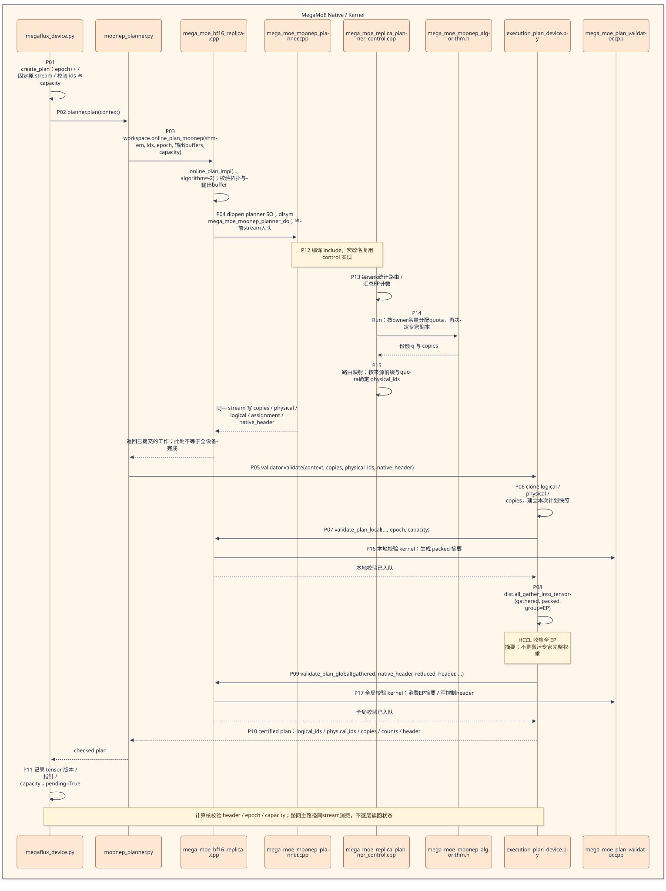

| 编号 | 调用点 | 进入位置 | 参数、返回与职责 |
|---|---|---|---|
| P01 | [megaflux_device.py:153](../../ascend_deepep/megaflux_device.py) | [megaflux_device.py:154](../../ascend_deepep/megaflux_device.py) | epoch单调递增；保存原stream，禁止foreign/expired/mutated lease。 |
| P02 | [megaflux_device.py:159](../../ascend_deepep/megaflux_device.py) | [moonep_planner.py:52](../../ascend_deepep/moonep_planner.py) | 调用policy adapter；context携带executor、逻辑ids、容量、epoch。 |
| P03 | [moonep_planner.py:67](../../ascend_deepep/moonep_planner.py) | [mega_moe_bf16_replica.cpp:203](../../csrc/ops/mega_moe_bf16_replica.cpp) | C++ Workspace接收预分配输出buffers；online_plan_impl用algorithm=-2选择MoonEP策略。 |
| P04 | [mega_moe_bf16_replica.cpp:249](../../csrc/ops/mega_moe_bf16_replica.cpp) | [mega_moe_moonep_planner.cpp:11](../../kernels/mega_moe_bf16/mega_moe_moonep_planner.cpp) | EP<=8且未强制GM时，加载libascend_deepep_moonep_planner.so并调用导出符号；kernel由宏改名复用control实现。 |
| P05 | [moonep_planner.py:72](../../ascend_deepep/moonep_planner.py) | [execution_plan_device.py:51](../../ascend_deepep/execution_plan_device.py) | MoonEP策略输出必须经全EP计划验证；策略本身不初始化作者MoonEP权重搬运runtime。 |
| P06 | [execution_plan_device.py:65](../../ascend_deepep/execution_plan_device.py) | [execution_plan_device.py:71](../../ascend_deepep/execution_plan_device.py) | 返回计划持有逻辑/物理路由和copies快照；header/counts中间空间按lease复用，bridge另冻结反向placement。 |
| P07 | [execution_plan_device.py:66](../../ascend_deepep/execution_plan_device.py) | [mega_moe_bf16_replica.cpp:273](../../csrc/ops/mega_moe_bf16_replica.cpp) | 本地device验证与摘要打包；epoch/capacity仍随调用传入。 |
| P08 | [execution_plan_device.py:68](../../ascend_deepep/execution_plan_device.py) | [execution_plan_device.py:68](../../ascend_deepep/execution_plan_device.py) | 全EP收集packed摘要；不是完整专家权重传输。 |
| P09 | [execution_plan_device.py:69](../../ascend_deepep/execution_plan_device.py) | [mega_moe_bf16_replica.cpp:295](../../csrc/ops/mega_moe_bf16_replica.cpp) | 检查全局路由/容量/一致性并生成header，后续计算kernel消费。 |
| P10 | [execution_plan_device.py:71](../../ascend_deepep/execution_plan_device.py) | [megaflux_device.py:114](../../ascend_deepep/megaflux_device.py) | certified plan包含logical_ids、physical_ids、copies、logical_counts、header、epoch、owner、max_recv。 |
| P11 | [megaflux_device.py:165](../../ascend_deepep/megaflux_device.py) | [megaflux_device.py:171](../../ascend_deepep/megaflux_device.py) | 记录tensor身份、版本、指针和capacity，防止运行期修改；同一pool串行使用。 |
| P12 | [mega_moe_moonep_planner.cpp:12](../../kernels/mega_moe_bf16/mega_moe_moonep_planner.cpp) | [mega_moe_replica_planner_control.cpp:96](../../kernels/mega_moe_bf16/mega_moe_replica_planner_control.cpp) | 编译时将control实现带入MoonEP planner SO。 |
| P13 | [mega_moe_replica_planner_control.cpp:96](../../kernels/mega_moe_bf16/mega_moe_replica_planner_control.cpp) | [mega_moe_replica_planner_control.cpp:131](../../kernels/mega_moe_bf16/mega_moe_replica_planner_control.cpp) | 统计本地直方图与来源前缀，汇总EP计数。 |
| P14 | [mega_moe_replica_planner_control.cpp:191](../../kernels/mega_moe_bf16/mega_moe_replica_planner_control.cpp) | [mega_moe_moonep_algorithm.h:5](../../include/mega_moe_moonep_algorithm.h) | 计算owner到目标rank的quota，按逻辑专家剩余量分配副本。 |
| P15 | [mega_moe_replica_planner_control.cpp:318](../../kernels/mega_moe_bf16/mega_moe_replica_planner_control.cpp) | [mega_moe_replica_planner_control.cpp:318](../../kernels/mega_moe_bf16/mega_moe_replica_planner_control.cpp) | 根据份额和来源前缀写每条路由的物理实例。 |
| P16 | [mega_moe_bf16_replica.cpp:290](../../csrc/ops/mega_moe_bf16_replica.cpp) | [mega_moe_plan_validator.cpp:129](../../kernels/mega_moe_bf16/mega_moe_plan_validator.cpp) | 设备本地校验生成packed摘要。 |
| P17 | [mega_moe_bf16_replica.cpp:309](../../csrc/ops/mega_moe_bf16_replica.cpp) | [mega_moe_plan_validator.cpp:134](../../kernels/mega_moe_bf16/mega_moe_plan_validator.cpp) | 设备全局校验消费EP摘要，生成header。 |

## Python/C++ 提交：从 Torch 类到 AIC / AIV kernel

worker 构建目标复制为 early SO；宏与 include 是编译关系，图中以注释标注。kernel 内部阶段可交错，纵向不是实测耗时。

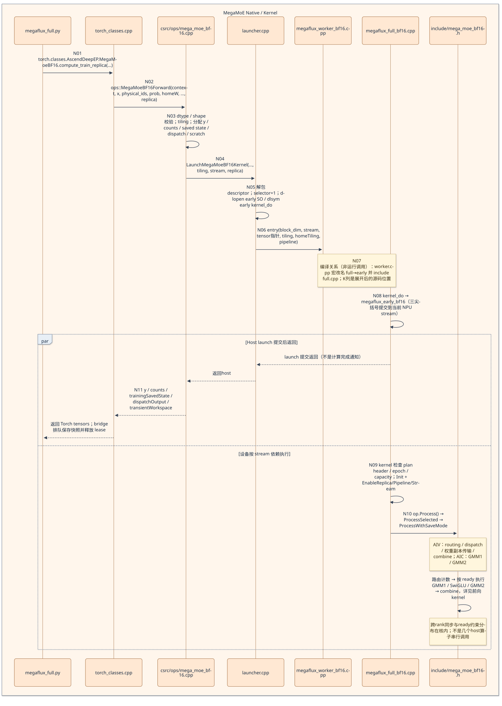

| 编号 | 调用点 | 进入位置 | 参数、返回与职责 |
|---|---|---|---|
| N01 | [megaflux_full.py:27](../../ascend_deepep/megaflux_full.py) | [torch_classes.cpp:318](../../csrc/torch_classes.cpp) | Torch自定义类调用，非torch.ops同名算子；类实例在Mixed.__init__构建。 |
| N02 | [torch_classes.cpp:329](../../csrc/torch_classes.cpp) | [mega_moe_bf16.cpp:414](../../csrc/ops/mega_moe_bf16.cpp) | C++转发context、tensor、rank/world、SHMEM buffer及replica descriptor。 |
| N03 | [mega_moe_bf16.cpp:522](../../csrc/ops/mega_moe_bf16.cpp) | [mega_moe_bf16.cpp:478](../../csrc/ops/mega_moe_bf16.cpp) | 校验BF16/int32布局，计算tiling并分配输出和持久/瞬时workspace；pool.home权重与replica槽通过descriptor描述。 |
| N04 | [mega_moe_bf16.cpp:536](../../csrc/ops/mega_moe_bf16.cpp) | [launcher.cpp:585](../../csrc/launcher.cpp) | 带replica的训练前向进入launcher；launch选择基于descriptor，不是dispatcher字符串。 |
| N05 | [launcher.cpp:667](../../csrc/launcher.cpp) | [launcher.cpp:676](../../csrc/launcher.cpp) | early selector由Early._descriptor追加1；worker sidecar由Worker._descriptor写入descriptor[20]。 |
| N06 | [launcher.cpp:678](../../csrc/launcher.cpp) | [megaflux_worker_bf16.cpp:6](../../kernels/mega_moe_bf16/megaflux_worker_bf16.cpp) | 通过early导出名调用worker构建库中的C包装器；当前stream入队，host返回不等于设备完成。 |
| N07 | [megaflux_worker_bf16.cpp:11](../../kernels/mega_moe_bf16/megaflux_worker_bf16.cpp) | [megaflux_full_bf16.cpp:101](../../kernels/mega_moe_bf16/megaflux_full_bf16.cpp) | 编译包含关系，不是两个设备kernel之间的运行时调用；最终导出符号由宏变成early名字。 |
| N08 | [megaflux_full_bf16.cpp:123](../../kernels/mega_moe_bf16/megaflux_full_bf16.cpp) | [megaflux_full_bf16.cpp:28](../../kernels/mega_moe_bf16/megaflux_full_bf16.cpp) | C包装器用三尖括号将混合AIC/AIV kernel提交到NPU stream；源文件full名字经宏改名。 |
| N09 | [megaflux_full_bf16.cpp:51](../../kernels/mega_moe_bf16/megaflux_full_bf16.cpp) | [megaflux_full_bf16.cpp:81](../../kernels/mega_moe_bf16/megaflux_full_bf16.cpp) | 核内校验header/epoch/capacity；有副本时配置pipeline/stripe ready，无副本时选择home tiling。 |
| N10 | [megaflux_full_bf16.cpp:98](../../kernels/mega_moe_bf16/megaflux_full_bf16.cpp) | [mega_moe_bf16.h:1336](../../kernels/mega_moe_bf16/include/mega_moe_bf16.h) | Process分派到saved-mode实现；包含routing/count交换、dispatch、权重stripe、GMM/SwiGLU/combine/unpermute。 |
| N11 | [mega_moe_bf16.cpp:546](../../csrc/ops/mega_moe_bf16.cpp) | [torch_classes.cpp:318](../../csrc/torch_classes.cpp) | native提交后返回输出与保存状态tensor，设备工作继续按stream依赖执行。 |

## 前向 kernel：派发、权重搬运、计算与合并

接 Python/C++ 提交图的 N10。按 BF16 saved 主线展开，AIC/AIV 按 ready 交叠。

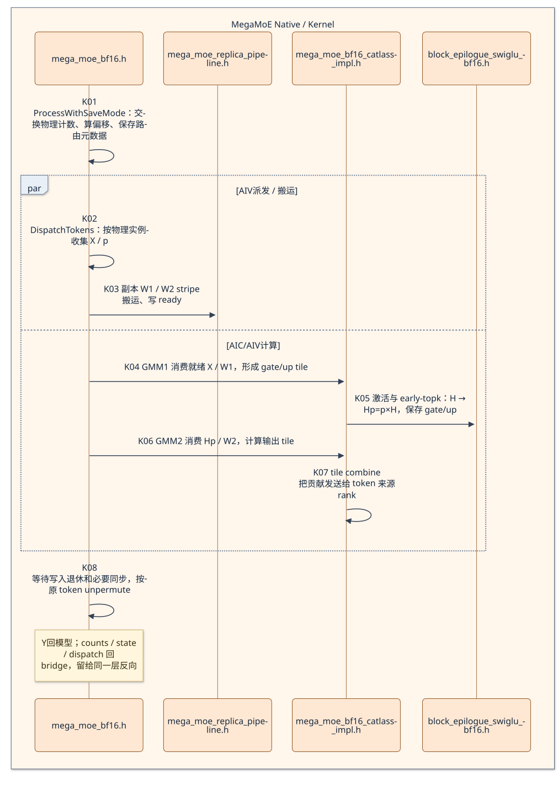

| 编号 | 调用点 | 进入位置 | 参数、返回与职责 |
|---|---|---|---|
| K01 | [mega_moe_bf16.h:1382](../../kernels/mega_moe_bf16/include/mega_moe_bf16.h) | [mega_moe_bf16.h:557](../../kernels/mega_moe_bf16/include/mega_moe_bf16.h) | 物理计数、索引和路由元数据为派发与反向提供地址。 |
| K02 | [mega_moe_bf16.h:1602](../../kernels/mega_moe_bf16/include/mega_moe_bf16.h) | [mega_moe_bf16.h:1004](../../kernels/mega_moe_bf16/include/mega_moe_bf16.h) | 按物理专家收集X及路由权重，按路径发布ready。 |
| K03 | [mega_moe_bf16.h:1677](../../kernels/mega_moe_bf16/include/mega_moe_bf16.h) | [mega_moe_replica_pipeline.h:143](../../kernels/mega_moe_bf16/include/mega_moe_replica_pipeline.h) | 副本W1/W2 stripe传输与dispatch/GEMM交错。 |
| K04 | [mega_moe_bf16.h:1630](../../kernels/mega_moe_bf16/include/mega_moe_bf16.h) | [mega_moe_bf16_catlass_impl.h:430](../../kernels/mega_moe_bf16/include/mega_moe_bf16_catlass_impl.h) | BF16主线进入GMM1/SwiGLU流水，依据选定路径等输入就绪。 |
| K05 | [mega_moe_bf16_catlass_impl.h:745](../../kernels/mega_moe_bf16/include/mega_moe_bf16_catlass_impl.h) | [block_epilogue_swiglu_bf16.h:357](../../kernels/mega_moe_bf16/include/block_epilogue_swiglu_bf16.h) | SwiGLU先生成H，再乘p得到Hp，gate/up进入saved state。 |
| K06 | [mega_moe_bf16.h:1761](../../kernels/mega_moe_bf16/include/mega_moe_bf16.h) | [mega_moe_bf16_catlass_impl.h:1127](../../kernels/mega_moe_bf16/include/mega_moe_bf16_catlass_impl.h) | GMM2读取Hp和本地或副本W2。 |
| K07 | [mega_moe_bf16_catlass_impl.h:1293](../../kernels/mega_moe_bf16/include/mega_moe_bf16_catlass_impl.h) | [mega_moe_bf16_catlass_impl.h:1293](../../kernels/mega_moe_bf16/include/mega_moe_bf16_catlass_impl.h) | 把tile结果按原路由写回来源rank。 |
| K08 | [mega_moe_bf16.h:1772](../../kernels/mega_moe_bf16/include/mega_moe_bf16.h) | [mega_moe_bf16.h:1267](../../kernels/mega_moe_bf16/include/mega_moe_bf16.h) | 完成必要同步后按原token还原并合并TopK贡献。 |

## 整网反向与更新：从 loss.backward 到下一步

从整网 loss 跟到分片参数更新。图按依赖组织，重算和各分支的实际调度由 autograd 决定。

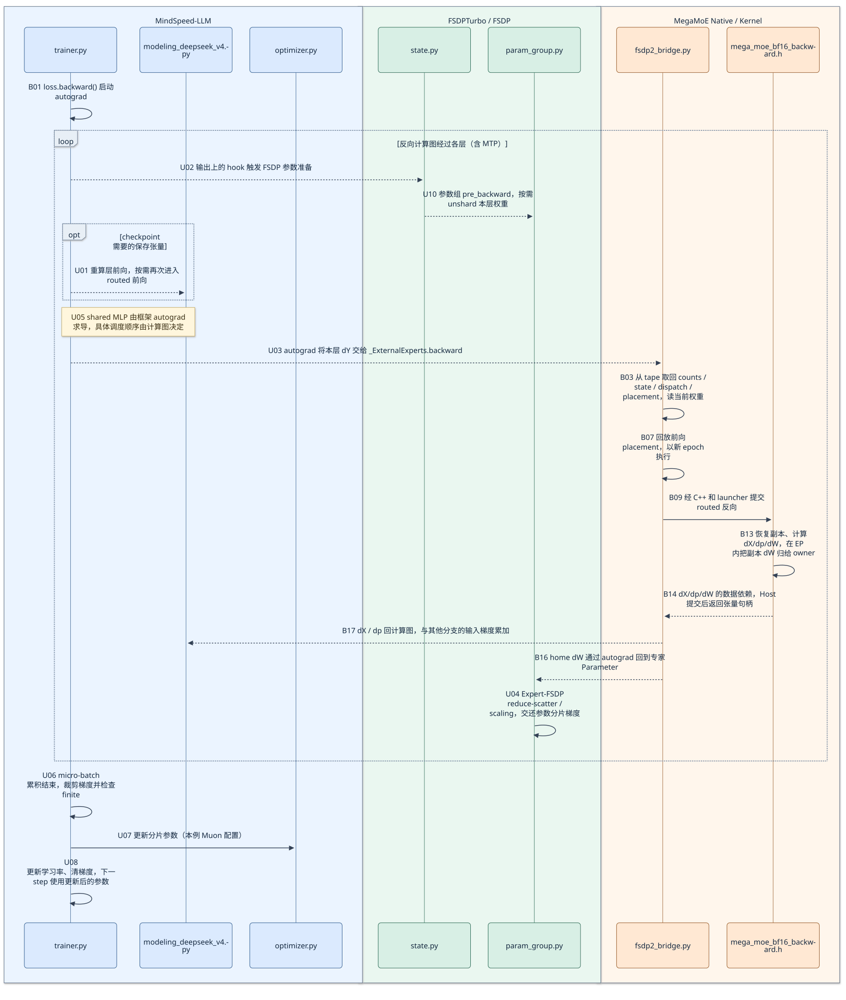

复用详图调用点：[B01](index.html#B01) · [U02](index.html#U02) · [U10](index.html#U10) · [U01](index.html#U01) · [U05](index.html#U05) · [U03](index.html#U03) · [B03](index.html#B03) · [B07](index.html#B07) · [B09](index.html#B09) · [B13](index.html#B13) · [B14](index.html#B14) · [B17](index.html#B17) · [B16](index.html#B16) · [U04](index.html#U04) · [U06](index.html#U06) · [U07](index.html#U07) · [U08](index.html#U08)

## 反向桥接与 placement 回放

主路径选择 panel，staged 分支在 Host 侧显式恢复。虚线标出 autograd 与 FSDP 的间接调度。

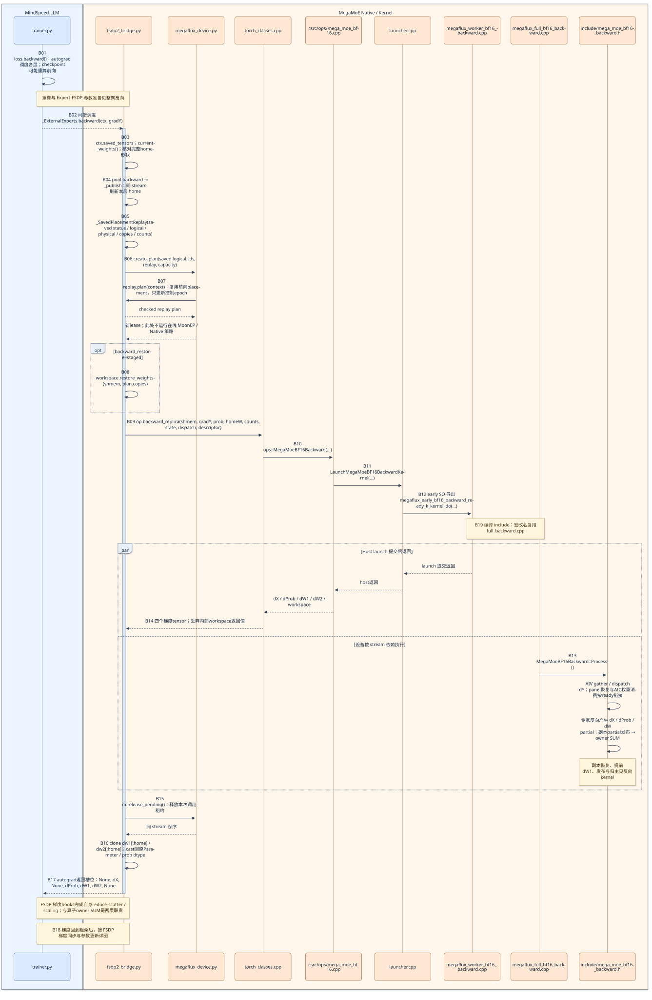

| 编号 | 调用点 | 进入位置 | 参数、返回与职责 |
|---|---|---|---|
| B01 | [trainer.py:906](reference-src/MindSpeed-LLM/mindspeed_llm/fsdp2/train/trainer.py) | [fsdp2_bridge.py:90](../../ascend_deepep/fsdp2_bridge.py) | autograd间接触发；checkpoint重算可重新走前向，并通过saved tensor同步控制epoch。 |
| B02 | [fsdp2_bridge.py:90](../../ascend_deepep/fsdp2_bridge.py) | [fsdp2_bridge.py:94](../../ascend_deepep/fsdp2_bridge.py) | 从本层ctx取回前向保存状态；捕获诊断分支另有x/y，不参与常规主链。 |
| B03 | [fsdp2_bridge.py:96](../../ascend_deepep/fsdp2_bridge.py) | [dispatcher_megamoe_balanced.py:52](reference-src/FSDPTurbo/fsdp_turbo/distributed/expert_parallel/dispatcher_megamoe_balanced.py) | 重新读取本层live Parameter并核对shape；不沿用被其他层覆盖的pool内容。 |
| B04 | [fsdp2_bridge.py:254](../../ascend_deepep/fsdp2_bridge.py) | [fsdp2_bridge.py:206](../../ascend_deepep/fsdp2_bridge.py) | 反向仍需刷新home与EP发布；即使前向已经复制过，本层权重也必须恢复。 |
| B05 | [fsdp2_bridge.py:256](../../ascend_deepep/fsdp2_bridge.py) | [fsdp2_bridge.py:24](../../ascend_deepep/fsdp2_bridge.py) | 回放前向已成功的placement，验证容量与home/slots匹配。 |
| B06 | [fsdp2_bridge.py:257](../../ascend_deepep/fsdp2_bridge.py) | [megaflux_device.py:138](../../ascend_deepep/megaflux_device.py) | 相同lease入口，但policy是replay，不能误画成重新调用MoonEPPlanner.plan。 |
| B07 | [fsdp2_bridge.py:56](../../ascend_deepep/fsdp2_bridge.py) | [fsdp2_bridge.py:47](../../ascend_deepep/fsdp2_bridge.py) | 设备端clone header并更新epoch，复用前向逻辑/物理路由与copies。 |
| B08 | [fsdp2_bridge.py:259](../../ascend_deepep/fsdp2_bridge.py) | [mega_moe_bf16_replica.cpp:340](../../csrc/ops/mega_moe_bf16_replica.cpp) | 只有staged在host桥层显式先恢复所有副本；panel/expert将恢复交给核内ready流水。 |
| B09 | [fsdp2_bridge.py:262](../../ascend_deepep/fsdp2_bridge.py) | [torch_classes.cpp:336](../../csrc/torch_classes.cpp) | 输入gradY/prob/当前home权重/前向counts-state-dispatch/本次descriptor；不再依赖旧pool副本。 |
| B10 | [torch_classes.cpp:351](../../csrc/torch_classes.cpp) | [mega_moe_bf16.cpp:552](../../csrc/ops/mega_moe_bf16.cpp) | C++ binding提取四个梯度，丢弃backward workspace返回值。 |
| B11 | [mega_moe_bf16.cpp:776](../../csrc/ops/mega_moe_bf16.cpp) | [launcher.cpp:1026](../../csrc/launcher.cpp) | host构造backward tiling、分配梯度和scratch，带descriptor启动相应执行器。 |
| B12 | [launcher.cpp:1116](../../csrc/launcher.cpp) | [megaflux_worker_bf16_backward.cpp:7](../../kernels/mega_moe_bf16/megaflux_worker_bf16_backward.cpp) | full-pipeline backward分支加载early SO并解析early backward导出；该库来自worker编译目标。 |
| B13 | [megaflux_full_bf16_backward.cpp:91](../../kernels/mega_moe_bf16/megaflux_full_bf16_backward.cpp) | [mega_moe_bf16_backward.h:1867](../../kernels/mega_moe_bf16/include/mega_moe_bf16_backward.h) | early-topk路径gather/dispatch未乘p的上游梯度，panel恢复和计算按ready交错。 |
| B14 | [torch_classes.cpp:359](../../csrc/torch_classes.cpp) | [fsdp2_bridge.py:265](../../ascend_deepep/fsdp2_bridge.py) | C++提交后返回四个梯度tensor。 |
| B15 | [fsdp2_bridge.py:266](../../ascend_deepep/fsdp2_bridge.py) | [megaflux_device.py:197](../../ascend_deepep/megaflux_device.py) | 反向释放lease，后续home梯度clone与其他设备操作按stream顺序执行。 |
| B16 | [fsdp2_bridge.py:271](../../ascend_deepep/fsdp2_bridge.py) | [fsdp2_bridge.py:108](../../ascend_deepep/fsdp2_bridge.py) | 只返回home前缀并clone，明确FSDP梯度所有权；副本槽梯度已归主，不作为额外Parameter交回。 |
| B17 | [fsdp2_bridge.py:108](../../ascend_deepep/fsdp2_bridge.py) | [fsdp2_bridge.py:68](../../ascend_deepep/fsdp2_bridge.py) | 返回顺序严格对应apply输入：bridge无梯度，x有梯度，ids无梯度，prob/w1/w2有梯度，limit无梯度。 |
| B18 | [trainer.py:461](reference-src/MindSpeed-LLM/mindspeed_llm/fsdp2/train/trainer.py) | [expert_fully_shard_parallel.py:69](reference-src/FSDPTurbo/fsdp_turbo/distributed/expert_parallel/expert_fully_shard_parallel.py) | 算子内owner SUM之后，框架autograd/FSDP hooks处理其reduce-scatter与缩放；Trainer执行clip、finite检查及optimizer。 |
| B19 | [megaflux_worker_bf16_backward.cpp:9](../../kernels/mega_moe_bf16/megaflux_worker_bf16_backward.cpp) | [megaflux_full_bf16_backward.cpp:91](../../kernels/mega_moe_bf16/megaflux_full_bf16_backward.cpp) | 编译展开后的反向实现位于full_backward.cpp。 |

## 反向 kernel 与 owner 归并

接反向桥接图的 B13。BF16 saved、panel2、earlyDW1=1、owner ratio2 为 11 月 2 日实际实验配置。

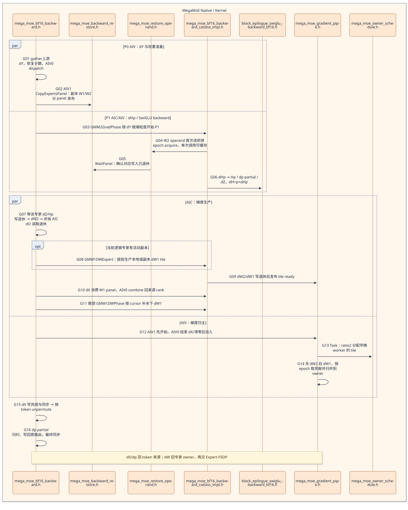

| 编号 | 调用点 | 进入位置 | 参数、返回与职责 |
|---|---|---|---|
| G01 | [mega_moe_bf16_backward.h:1899](../../kernels/mega_moe_bf16/include/mega_moe_bf16_backward.h) | [mega_moe_bf16_backward.h:830](../../kernels/mega_moe_bf16/include/mega_moe_bf16_backward.h) | gather未乘p的dY，按保存路由恢复计数和派发。 |
| G02 | [mega_moe_bf16_backward.h:1924](../../kernels/mega_moe_bf16/include/mega_moe_bf16_backward.h) | [mega_moe_backward_restore.h:96](../../kernels/mega_moe_bf16/include/mega_moe_backward_restore.h) | AIV1搬运副本权重并按panel发布对应epoch。 |
| G03 | [mega_moe_bf16_backward.h:1210](../../kernels/mega_moe_bf16/include/mega_moe_bf16_backward.h) | [mega_moe_bf16_backward_catlass_impl.h:374](../../kernels/mega_moe_bf16/include/mega_moe_bf16_backward_catlass_impl.h) | AIC计算dHp，AIV执行后处理；具体ready协议按路径。 |
| G04 | [mega_moe_bf16_backward_catlass_impl.h:415](../../kernels/mega_moe_bf16/include/mega_moe_bf16_backward_catlass_impl.h) | [mega_moe_restore_operand.h:70](../../kernels/mega_moe_bf16/include/mega_moe_restore_operand.h) | P1 W2 operand首次取panel检查精确epoch，可复用本AIC本专家已完成的acquire。 |
| G05 | [mega_moe_restore_operand.h:70](../../kernels/mega_moe_bf16/include/mega_moe_restore_operand.h) | [mega_moe_backward_restore.h:84](../../kernels/mega_moe_bf16/include/mega_moe_backward_restore.h) | 从对应slot/projection/panel检查ready。 |
| G06 | [mega_moe_bf16_backward_catlass_impl.h:493](../../kernels/mega_moe_bf16/include/mega_moe_bf16_backward_catlass_impl.h) | [block_epilogue_swiglu_backward_bf16.h:154](../../kernels/mega_moe_bf16/include/block_epilogue_swiglu_backward_bf16.h) | AIV形成Hp、dp partial和dZ。 |
| G07 | [mega_moe_bf16_backward.h:1359](../../kernels/mega_moe_bf16/include/mega_moe_bf16_backward.h) | [mega_moe_bf16_backward.h:1380](../../kernels/mega_moe_bf16/include/mega_moe_bf16_backward.h) | dZ/Hp和dW2的dO读取都退休后才进入后续阶段。 |
| G08 | [mega_moe_bf16_backward.h:1384](../../kernels/mega_moe_bf16/include/mega_moe_bf16_backward.h) | [mega_moe_bf16_backward_catlass_impl.h:907](../../kernels/mega_moe_bf16/include/mega_moe_bf16_backward_catlass_impl.h) | 活动副本专家的owner与副本实例提前算dW1。 |
| G09 | [mega_moe_bf16_backward_catlass_impl.h:975](../../kernels/mega_moe_bf16/include/mega_moe_bf16_backward_catlass_impl.h) | [mega_moe_gradient_pipe.h:51](../../kernels/mega_moe_bf16/include/mega_moe_gradient_pipe.h) | 梯度tile写完再发布；owner消费相同epoch。 |
| G10 | [mega_moe_bf16_backward.h:1401](../../kernels/mega_moe_bf16/include/mega_moe_bf16_backward.h) | [mega_moe_bf16_backward_catlass_impl.h:670](../../kernels/mega_moe_bf16/include/mega_moe_bf16_backward_catlass_impl.h) | dX读取W1 panel，随后将贡献回送token来源。 |
| G11 | [mega_moe_bf16_backward.h:1430](../../kernels/mega_moe_bf16/include/mega_moe_bf16_backward.h) | [mega_moe_bf16_backward.h:1461](../../kernels/mega_moe_bf16/include/mega_moe_bf16_backward.h) | 从early cursor接续，跳过已完成的专家。 |
| G12 | [mega_moe_bf16_backward.h:2044](../../kernels/mega_moe_bf16/include/mega_moe_bf16_backward.h) | [mega_moe_gradient_pipe.h:122](../../kernels/mega_moe_bf16/include/mega_moe_gradient_pipe.h) | AIV1在P1后进入owner服务，AIV0走P5；两路各负责独占tile。 |
| G13 | [mega_moe_gradient_pipe.h:165](../../kernels/mega_moe_bf16/include/mega_moe_gradient_pipe.h) | [mega_moe_owner_schedule.h:9](../../kernels/mega_moe_bf16/include/mega_moe_owner_schedule.h) | ratio2将较多任务交给较早到达的AIV1，保留固定贡献者求和次序。 |
| G14 | [mega_moe_gradient_pipe.h:155](../../kernels/mega_moe_bf16/include/mega_moe_gradient_pipe.h) | [mega_moe_gradient_pipe.h:211](../../kernels/mega_moe_bf16/include/mega_moe_gradient_pipe.h) | 先消费dW2，再消费dW1，按slot/rank读取副本贡献。 |
| G15 | [mega_moe_bf16_backward.h:2177](../../kernels/mega_moe_bf16/include/mega_moe_bf16_backward.h) | [mega_moe_bf16_backward.h:2187](../../kernels/mega_moe_bf16/include/mega_moe_bf16_backward.h) | 本地与跨rank退休边界后还原token dX。 |
| G16 | [mega_moe_bf16_backward.h:2198](../../kernels/mega_moe_bf16/include/mega_moe_bf16_backward.h) | [mega_moe_bf16_backward.h:2207](../../kernels/mega_moe_bf16/include/mega_moe_bf16_backward.h) | 归约并回送dp，再进行必要同步与清理。 |

## FSDP 梯度同步与参数更新

将自动微分调度、框架 FSDP hook、算子副本 SUM 和优化器更新分开。

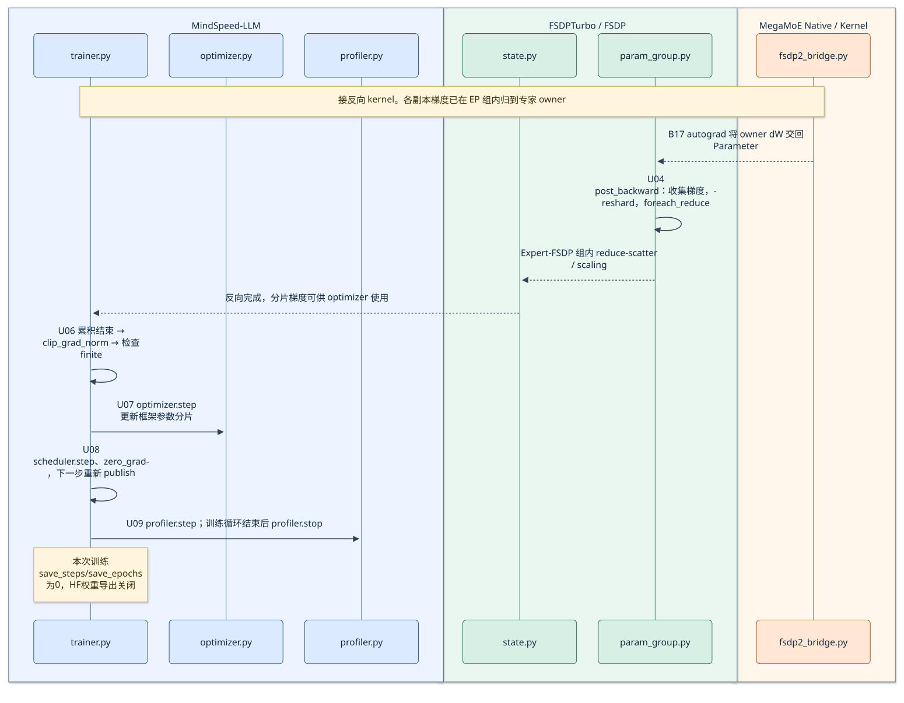

| 编号 | 调用点 | 进入位置 | 参数、返回与职责 |
|---|---|---|---|
| U01 | [trainer.py:906](reference-src/MindSpeed-LLM/mindspeed_llm/fsdp2/train/trainer.py) | [recompute.py:45](reference-src/FSDPTurbo/fsdp_turbo/memory/recompute/recompute.py) | 非重入checkpoint由PyTorch按需回放层forward。 |
| U02 | [state.py:157](reference-src/FSDPTurbo/fsdp_turbo/distributed/fine_grained_fully_shard/state.py) | [param_group.py:152](reference-src/FSDPTurbo/fsdp_turbo/distributed/fine_grained_fully_shard/param_group.py) | 输出hook由autograd触发；FSDP为反向恢复本层参数。 |
| U03 | [trainer.py:906](reference-src/MindSpeed-LLM/mindspeed_llm/fsdp2/train/trainer.py) | [fsdp2_bridge.py:90](../../ascend_deepep/fsdp2_bridge.py) | PyTorch间接调度自定义反向。 |
| U04 | [param_group.py:158](reference-src/FSDPTurbo/fsdp_turbo/distributed/fine_grained_fully_shard/param_group.py) | [param_group.py:234](reference-src/FSDPTurbo/fsdp_turbo/distributed/fine_grained_fully_shard/param_group.py) | custom参数组收集Parameter梯度、reshard，并调用PyTorch foreach_reduce；Expert-FSDP走其自己的mesh。 |
| U05 | [modeling_deepseek_v4.py:2017](reference-src/MindSpeed-LLM/mindspeed_llm/fsdp2/models/deepseek_v4/modeling_deepseek_v4.py) | [modeling_deepseek_v4.py:1826](reference-src/MindSpeed-LLM/mindspeed_llm/fsdp2/models/deepseek_v4/modeling_deepseek_v4.py) | shared MLP在框架计算图中独立求导，输入梯度在上游累加。 |
| U06 | [trainer.py:450](reference-src/MindSpeed-LLM/mindspeed_llm/fsdp2/train/trainer.py) | [trainer.py:460](reference-src/MindSpeed-LLM/mindspeed_llm/fsdp2/train/trainer.py) | 累积完成后进行梯度裁剪和finite检查。 |
| U07 | [trainer.py:461](reference-src/MindSpeed-LLM/mindspeed_llm/fsdp2/train/trainer.py) | [optimizer.py:383](reference-src/MindSpeed-LLM/mindspeed_llm/fsdp2/optim/optimizer.py) | 梯度范数有限时，Trainer 调用已创建的优化器。本实验的 optimizer=muon 进入 FSDPTurbo Muon 工厂。 |
| U08 | [trainer.py:462](reference-src/MindSpeed-LLM/mindspeed_llm/fsdp2/train/trainer.py) | [trainer.py:468](reference-src/MindSpeed-LLM/mindspeed_llm/fsdp2/train/trainer.py) | 有限时随 optimizer.step 更新学习率，随后清梯度。跳过更新的分支也会清梯度。 |
| U09 | [trainer.py:482](reference-src/MindSpeed-LLM/mindspeed_llm/fsdp2/train/trainer.py) | [profiler.py:140](reference-src/MindSpeed-LLM/mindspeed_llm/fsdp2/utils/profiler.py) | 采集窗口随step推进，训练循环结束停止profiler。 |
| U10 | [param_group.py:152](reference-src/FSDPTurbo/fsdp_turbo/distributed/fine_grained_fully_shard/param_group.py) | [param_group.py:153](reference-src/FSDPTurbo/fsdp_turbo/distributed/fine_grained_fully_shard/param_group.py) | custom参数组委托继承的FSDP流程进行pre-backward unshard。 |

## 补充阅读：保存格式与两层重算

将 11 月 2 日实际运行的 BF16 saved 主线，与当前 checkout 的新增可选模式并列标记。

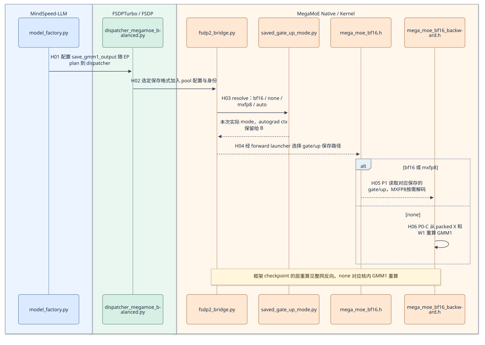

| 编号 | 调用点 | 进入位置 | 参数、返回与职责 |
|---|---|---|---|
| H01 | [model_factory.py:263](reference-src/MindSpeed-LLM/mindspeed_llm/fsdp2/models/model_factory.py) | [dispatcher_megamoe_balanced.py:77](reference-src/FSDPTurbo/fsdp_turbo/distributed/expert_parallel/dispatcher_megamoe_balanced.py) | 配置随EP计划进入balanced dispatcher。 |
| H02 | [dispatcher_megamoe_balanced.py:101](reference-src/FSDPTurbo/fsdp_turbo/distributed/expert_parallel/dispatcher_megamoe_balanced.py) | [fsdp2_bridge.py:128](../../ascend_deepep/fsdp2_bridge.py) | 格式计入pool身份。 |
| H03 | [fsdp2_bridge.py:69](../../ascend_deepep/fsdp2_bridge.py) | [saved_gate_up_mode.py:31](../../ascend_deepep/saved_gate_up_mode.py) | 解析调用格式，前向保存模式与反向mode匹配。 |
| H04 | [fsdp2_bridge.py:224](../../ascend_deepep/fsdp2_bridge.py) | [mega_moe_bf16.h:1336](../../kernels/mega_moe_bf16/include/mega_moe_bf16.h) | 由launcher传递saved mode，前向按模式处理gate/up。 |
| H05 | [mega_moe_bf16_backward.h:548](../../kernels/mega_moe_bf16/include/mega_moe_bf16_backward.h) | [block_epilogue_swiglu_backward_bf16.h:341](../../kernels/mega_moe_bf16/include/block_epilogue_swiglu_backward_bf16.h) | BF16或MXFP8保存路径使用对应前向数据。 |
| H06 | [mega_moe_bf16_backward.h:1967](../../kernels/mega_moe_bf16/include/mega_moe_bf16_backward.h) | [mega_moe_bf16_backward.h:1176](../../kernels/mega_moe_bf16/include/mega_moe_bf16_backward.h) | none走kernel内GMM1重算，和框架checkpoint是两个层级。 |

## 补充：继承、构建与运行库

- X01：../../ascend_deepep/megaflux_worker_pipeline.py:7。实际MRO入口：Worker继承Early，Early继承Full；_forward_device来自Full，create_plan/release_pending来自Device。
- X02：../../ascend_deepep/megaflux_early.py:8。selector=1选early launcher分支；不是用Python类名推断SO名。
- X03：../../ascend_deepep/megaflux_worker_pipeline.py:57。Worker只扩展descriptor与ABI/feature检查；并不另写完整前向。
- X04：../../ascend_deepep/megaflux_mixed.py:46。创建Torch算子类与SHMEM workspace；pool的w1/w2执行存储并非optimizer拥有的Parameter。
- X05：../../scripts/build_megaflux_worker_pipeline.sh:50。构建脚本将worker库复制为early库名；必须结合WORKER_NATIVE与LD_LIBRARY_PATH辨认运行库。
- X06：../../CMakeLists.txt:908。CMake真正编译worker前反向cpp；不是另选early.cpp来猜运行实现。
- X07：../../kernels/mega_moe_bf16/include/mega_moe_bf16_backward.h:1924。panel恢复由AIV执行；AIC使用相应ready约束权重消费。
- X08：../../kernels/mega_moe_bf16/include/mega_moe_gradient_pipe.h:122。gradient_pipe负责副本partial的owner归主辅助，独立于FSDP组内梯度同步。
- X09：reference-src/FSDPTurbo/fsdp_turbo/distributed/expert_parallel/dispatcher_mega_moe.py:164。dispatcher首次调用建立/复用一套ShmemInstance与窗口；balanced显式请求window_pool_size=1，所需容量包含home/replicas/partial空间。
- X10：reference-src/FSDPTurbo/fsdp_turbo/distributed/fine_grained_fully_shard/strategy.py:58。本次 YAML 的 fsdp_implementation=custom 指向 FSDPTurbo 的 fine_grained_fully_shard。该实现复用 PyTorch FSDP 的基础流程，并提供自定义 hooks 与参数组。

## 版本

- ascend_deepep_hkq: be9ec2c5fa8fdbc14e8ee071d7defd03c8f21372
- FSDPTurbo: b276c041cb8cd658ee9e7d99dd143ab666026a3c
- MindSpeed-LLM: 2b73c46d9c3b7cb5e4ef8398effddd6886ea4139
- wuhan: e28f9f1753984421d57b4d070ecee74bc83ceb5b

每个引用文件的SHA256与解析行号见 source-evidence.json。未执行NPU训练/性能测量。
