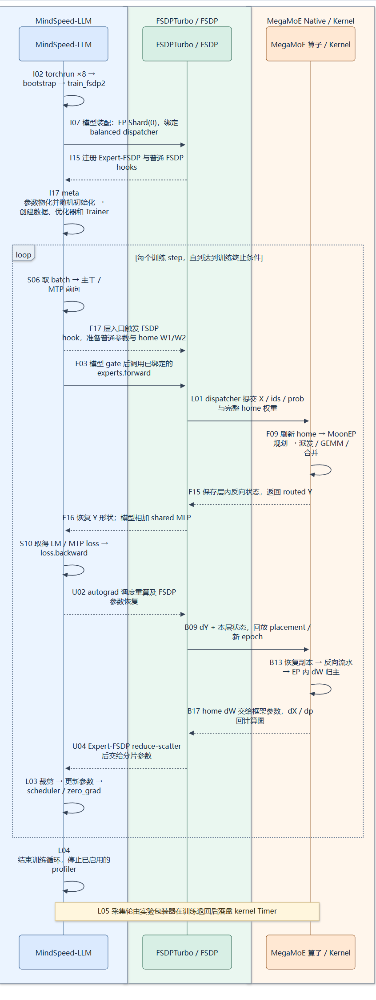

# MegaMoE Balanced 源码时序图

[系统导览](index.html#system-guide) · [源码时序图](index.html) · [源码调用点对照表](CALLPOINTS.md) · [跨仓源码来源](reference-src/README.md)

「系统导览」按问题选图。系统架构用带张量标签的分组流程图，训练进程和专家参数各用一张状态图，跨库的数据交接用原生泳道。每张图下面可以打开对应时序、Mermaid 源码和 VS Code 调用点。

在顶栏打开[实验实例](index.html#12-python-case)，用左侧固定目录切换实验数据、整体流程、前向、反向、参数更新和证据。窄窗口的目录折叠为常驻按钮。Planner 分配、AIC/AIV 依赖、tape 保存与回放和各类梯度去向都有独立小节，实测记录和重放指纹见 [实验清单](python-case.json)。

[交互阅读场景](index.html#case-scenes)沿同一个 rank2 / X[2] 样本读三个问题：选择 TopK 槽，联动前后向路径；检查前向 tape 到反向消费者；逐个推进多 tile 依赖与同址复用。当前选择和源码详情保留在旁栏，点击“打开实现”进入对应源码。图中检查点只表达依赖，实测计时仍在原实验章节。

下载 `megamoe-balanced` 分支 ZIP 并解压，或克隆该分支。用浏览器从磁盘打开 `docs/megamoe-balanced-visual/index.html`。网页可离线浏览。

点击图中的调用编号或实验导读里的源码链接，直接在 **VS Code 桌面版**打开实现行。表格中的两个文件名分别跳到调用行和实现行，左侧编号展开内嵌源码。浏览器首次打开 VS Code 时可能弹出确认。算子链接指向本仓的实际源码，框架和实验脚本链接指向随文档附带的固定版本。完整仓库可以解压到任意目录。

```bash
git clone --depth 1 --single-branch --branch megamoe-balanced https://gitcode.com/zhangwanhao/ascend_deepep_hkq_wuhan.git
```

## 在 VS Code 内一键打开源码

可选安装 [源码导览扩展](vscode/README.md)，离线页面和图源仍使用同一份。在本目录执行：

```bash
python tools/package-editor.py
code --install-extension .artifacts/megamoe-balanced-source-guide-0.1.0.vsix
```

随后运行命令 **MegaMoE Balanced: 打开源码泳道图**。点击图中调用点或旁栏“打开实现”，会在固定的旁边编辑列定位源码。扩展无需 NPU、CANN、HTTP 服务或网站配置；普通浏览器仍可直接阅读。算子链接打开本仓实现，跨仓框架链接打开 `reference-src/` 中随文档保留的版本。

| 颜色 | 组件 | 负责的流程 |
|---|---|---|
| 蓝色 | MindSpeed-LLM | 模型、数据、loss、训练循环和参数更新 |
| 绿色 | FSDPTurbo / FSDP | EP 切分、dispatcher、参数恢复和梯度归约 |
| 橙色 | MegaMoE 算子 / Kernel | 规划副本、前反向通信计算和梯度归主 |

图以 `megamoe-balanced` 四仓源码为依据，展开八卡 EP4 × Expert-FSDP2 的方法 C。固定 Python 路由与 Timer 采集属于实验配置，图中有单独标注。[四仓提交与源码指纹](source-evidence.json)

## 一起修改

安装 Node.js 22.12 或以上，进入 `docs/megamoe-balanced-visual` 执行。

```bash
npm ci
npx puppeteer browsers install chrome
npm run build
npm run verify
npm run test:editor
```

1. 修改 `diagrams/*.mmd` 中的 Mermaid `sequenceDiagram`。`00-lifecycle.mmd` 是首页总览。原生 `box` 表示仓库分组，参与者列对应组件或文件，`activate/deactivate` 标明关键调用的作用域。每张图都可以独立编辑或渲染。[Mermaid 时序图语法](https://mermaid.js.org/syntax/sequenceDiagram.html)
2. 调整章节、导航、样式或三组件配色时，编辑 `build.cjs`。修改已有调用点的说明时，编辑 `collect-source.cjs` 中对应条目，并同步 `source-evidence.json` 的 `detail`。
3. 重跑构建和验证，刷新浏览器里的 `index.html`。提交 Mermaid 源图和重新生成的网页、SVG，便于同事直接下载查看。

实验实例由 `python-case.cjs` 组织章节，`case-inputs.*`、`case-forward.*` 和 `case-backward.*` 分别维护输入、前向与反向图表。实验条件和数值见 `python-case.json`，证据路径以实验工作区为基准。更新后运行同样的构建和验证命令。

三个交互场景在 `learning-scenes.cjs/js/css`，讲解和检查点定义在 `learning-scenes.json`；token 的实际路线、概率、shape 与实例行数取自 `python-case.json`。新增代码出处在 V01–V03 调用点中统一采集。场景检查覆盖两槽联动、tape / 缓冲切换、依赖检查点、原生桥消息和窄屏；截图写入 `.artifacts/`。

系统导览的 Mermaid 源图位于 `maps/*.mmd`，页面文案和入口在 `map-guide.cjs`。锁文件中的 Mermaid 12.2.0 可渲染 `swimlane-beta`，渲染后的 SVG 随仓库提供。[泳道语法](https://mermaid.js.org/syntax/swimlanes) · [状态图语法](https://mermaid.js.org/syntax/stateDiagram.html) · [流程图语法](https://mermaid.js.org/syntax/flowchart.html)

### 实验实例的图表

- 输入用数据谱系、专家分布和八卡拓扑，分别展示数据加工、路由偏斜和并行组。
- 整步交接用按库分列的泳道。实测部分采用按层分轨的时间轴，分别标出前向、重算、反向的起点与时长。参考 [Mermaid 时序与参与者](https://mermaid.js.org/syntax/sequenceDiagram.html) 和 [Perfetto 的 track 与 slice](https://perfetto.dev/docs/visualization/perfetto-ui)。
- Planner 沿用共用零点的前后对比条形图，用桑基图补充 owner 到执行卡的配额流向，再用矩阵区分 token 来源和物理落点。参考 [Datawrapper 图表选择指南](https://www.datawrapper.de/blog/chart-types-guide) 和 [D3 Sankey](https://github.com/d3/d3-sankey)。
- 样本 token 的前后向用等宽依赖线连接真实 rank，算子合同与参数生命周期用表格。实测时间轴只使用对应的 Host 时间或单 rank 设备周期。

构建从仓库内的 Mermaid 源图、调用点清单和内嵌源码片段生成网页。默认用 Puppeteer 安装的 Chrome。已有 Chrome 时，也可将 `CHROME_PATH` 设为本机可执行文件路径，直接执行构建和验证。

已有浏览器与 Puppeteer 启动不兼容时，可设置 `MERMAID_ENGINE=playwright` 后运行 `npm run build`，通过现有 Playwright 依赖渲染同一批 Mermaid 源图；浏览器仍由 `CHROME_PATH` 选择。图源、配置和源码校验保持共用。

运行 `npm run refresh-source` 可从本仓源码和随文档附带的快照更新行号和片段。同步框架源码时，将 `MEGAMOE_SOURCE_ROOT` 指向包含 `ascend_deepep_hkq`、`FSDPTurbo`、`MindSpeed-LLM`、`wuhan` 四个 checkout 的目录。同步实验脚本时，将 `MEGAMOE_EXPERIMENT_ROOT` 指向 `whole-network-python-balanced-20261102`。刷新后重新构建和验证。


