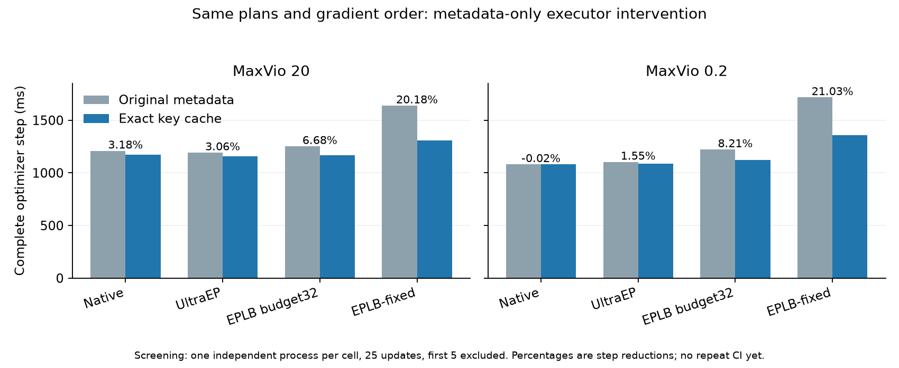

# 单 microbatch 剩余空间：已检验范围与下一步

本报告不宣称提出了已获整网收益的新 planner。基座始终是封存的
MindSpeed＋FSDPTurbo＋解耦 MegaMoE；独立 pod5-8 八卡，其他任务节点排除。

## 已经区分的几种原因

| 实验 | 观察 | 结论边界 |
|---|---|---|
| 相同计划，在线/配额预载/body预载，22格 | Native预载收益不到1%；满预算EPLB仍慢 | host规划不是EPLB主差距；预载不是在线成绩 |
| 精确缓存梯度排序键，14设备门禁＋16筛选＋30新进程确认 | 高偏斜EPLB降20.191%，Native/Ultra降3.158%/3.117% | 五个独立进程对确认执行器收益；不作为新planner贡献 |
| 四版runahead，29门禁＋8筛选 | 高偏斜Native/Ultra约降1.71%/1.50% | 未过2%工程门槛；低偏斜Native原mode3不生效 |
| 强制删副本，24预载格 | 快速执行器下高偏斜proxy候选只比Native快约0.16%，慢于Ultra约1.13% | 这些旧proxy候选未过工程门槛；没有在native中穷举所有子集，不能称空间上限 |

排序键干预图（单进程筛选，非确认统计）：

所有百分比均为完整step缩短比例。不同预载/正常在线实验有额外诊断开销，
不能直接跨协议比较它们的绝对步时，更不能相加重叠kernel区间。

## 原始路由银行没有充分覆盖来源差异

六档银行的source分布平均两两L1距离仅0.040–0.049；按token加权，
每个专家最大的source份额约13.1%–13.3%，接近八卡均匀12.5%。
因此它们改变了全局专家冷热，却较少覆盖source×expert的异质性。

新增压力银行将完整token路由行重新分组，严格保持全局专家计数、每卡
16384个token、每行top-k的身份/顺序/唯一性。使用预先固定的随机专家域
进行容量约束分配，没有使用计时结果。分组后L1约0.467–0.486，加权最大
source份额30.9%–32.0%。运行时仍使用原来的逐调用专家/行置换。

这是受控合成压力，不是自然路由；synthetic输入仍按原benchmark种子生成。
完整token来源置换已保存，未来应用到真实样本时必须一起移动对应输入及
router probability，不能只移动ID后声称训练质量不变。

原数据和置换位于项目 `artifacts/source-heterogeneity-bank-v1/`；简要索引
见 `research/single_mb_fbw/analysis/source-heterogeneity-coverage.json`。

## 固定副本与计算量，单独诊断来源配额

离线LP固定每个专家的目的rank任务量，只优化source quota，最小化最大
非本地链路的聚合行数；二级目标减总远端行数。整数修复后严格保持源/目的
边际，因此副本集合、各专家GEMM形状、贡献者扇入、完整dW大小全部相同。

已搜索原/重分组银行×MaxVio1/5/20×Native/Ultra×50调用，共600次。
高偏斜原银行Ultra最大链路均值17808.6行，整数解16553.7行；重分组银行
为23083.1→21348.9行。这只是约7%–8%的网络行数空间，不能解释成相同幅度
的通信或整步收益。低偏斜空间更小。

LP求解器报告值是数值松弛解，不是精确有理数对偶证书；同时给出独立的
可证明行数下界（不可迁移流量、源必要流出/7、目的必要流入/7）。两者都
不是时延下界。100个小规模穷举对照已核验松弛/整数边界；物理路由的独立
向量编译器与标量参考在90个EP2/4/8场景一致。四个50调用候选银行已生成，
必须先通过设备数值门禁和实际物理ID哈希验证，才允许计时。

它是额外强来源配额诊断，不是新在线planner；LP开销、源前缀就绪、共享
通信资源与owner服务均未被这个目标建模。后续会用实际native执行判断
聚合链路目标是否排错序，不能根据这组结构数字直接发布算法。

## 设计约束和近邻

下一轮流水仅研究GM dHp的合法依赖松弛、AIC/AIV非对称顺序和有界搬运
批量。源准备保持原路径，dW/dX前保留全局读租约；完整UB只在向量tile尚未
存活的局部区间借用，并在P1前归还。当前仅CPU通过，NPU资格待验收。

[MegaScale-MoE](https://arxiv.org/html/2505.11432v1)已经把选择性重物化与
通信重叠结合；[RelayMoE](https://arxiv.org/html/2610.07333v1)在逐跳反向中
重建、消费并释放中间态；[MemFine](https://arxiv.org/html/2511.21431v1)按
显存压力分块并重计算。因此，保存激活、内存感知、分块或考虑反向本身都
不够新。需要证明当前单microbatch的源就绪、完整梯度贡献和执行器合法
顺序的联合选择，提供这些方法/强planner没有兑现的完整step增量。

严格小参数数值/长轨迹告警、六档强基线、五进程交织重复、四格消融、独立
路由/形状及自然训练质量仍未全部完成。没有把阶段负结果包装成研究终结。
