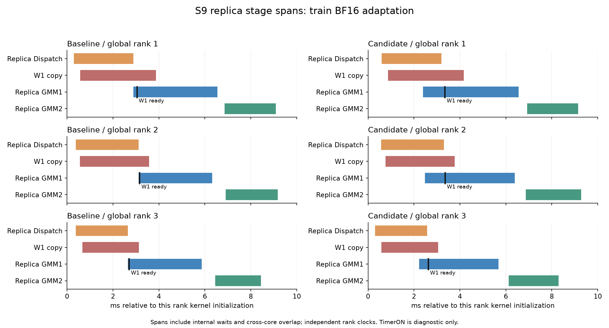

# train BF16 优化适配与 S9 基线对照

本轮在 `work/moonep-bench-delivery` 适配 train 已有 BF16 优化，统一构建、统一验证。基线固定为 `91fa98d77bb66c295e07686e4941bc88012a8adb`。不迁入 W8A8，不新增权重交替搬运或提前 GMM2 流水。

## 来源与适配

来源为 train 的 `014e154`、`20f79db`、`e59c09b`：SwiGLU/Gather、前反向 Dispatch 细分和静态元数据、SwiGLU 反向 FP32 数值语义修正。采用共同祖先 `92626f8` 的三方合并，不用 train 文件覆盖 S9。

前向保留副本寻址、W1/W2 stripe-ready、Timer 和回退路径，增加所有符合条件的物理专家 Ready384。反向保留 panel restore、梯度归主和共享专家优先顺序；进度槽固定为自然专家顺序中的非空序号，避免共享专家重排后错配元数据。该映射每次调用准备一次，不在 tile 循环搜索专家。

反向新增 workspace 进度后缀和显式 split-expert 参数。普通 BF16 与副本系列使用 `*_backward_ready_k_kernel_do` 新符号，Host binding 和 kernel 必须配套重建；旧 SO 不会被按新参数签名调用。原 descriptor、保存状态和 panel 协议保持原定义。

`docs/BF16_*` 中迁入的性能及精度记录来自上游普通 BF16，不代表本分支的 S9 验证结果。SwiGLU 数值语义修正可能改变旧版梯度，须与数学参考比较；同一版本 TimerOFF/ON 仍必须五输出逐位一致。

## 对照条件

八卡、两个 EP4 组：M8192、H7168、F3072、逻辑 E8、TopK2、每卡 home2/slots2、capacity20480、BF16 保存、limit10、MoonEP/S9/panel。合成 rank_skew rho6/hot2，seed42。记录真实路由、计划、五输出及 SO 哈希；不声称与旧训练捕获逐 token 相同。

执行范围是完整专家前反向，包含在线 planner、home 权重发布、plan snapshot/finish、副本权重恢复及梯度归主；不包括真实 FSDP all-gather/reduce-scatter、Attention、optimizer。

构建和采图使用 [Timer 入口](TIMER-CAPTURE.md)。新增采集器参数：

- `--save-outputs`：仅 TimerOFF 将检查后的五输出保存为 `outputs-rankN.pt`，用于版本间精度对照。
- `--timer 0 --warmup 10 --measure 30`：先完成常规精度检查，再测完整 pool 前反向；每次计时前 barrier/synchronize，计时内无诊断哈希或 CPU 输出回读，最后一次计时后重新核对五输出。
- `--reference`：可以使用本版本对应采图的 `control` 目录，确保性能测量的输入、形状和输出与已检查运行相同。

完整 wall latency 为主要性能指标。forward/backward 分段值是 Host 完成语义的子区间，不是纯 kernel 时间。每轮按 iteration 取八卡最大值，再统计 p50/p95，保留全部样本。Timer 图只作归因，不用 TimerON 时间代替正式性能。

基线在 177.8.24.1 完成后，该机器被外部作业占用。按本轮确认的时间安排，候选版迁到 177.2.25.1，沿用已有基线，不重跑基线性能及采图。两端均为 Ascend950DT、CANN 9.2.0、torch 2.10.0、torch_npu 2.10.0.post6；候选二进制直接迁移并逐文件校验哈希。此轮是相同输入和配置的跨机器对照，报告保留机器信息，不标为同机配对。

基线构建目录只加入同一份采集/计时测试入口，算子源码保持 `91fa98d`；测试入口单独记录哈希。两版都输出前向和反向 JSON，保留原始 NPY 及轨道审计。

## 验证记录

2026-10-29 完成统一候选版验证。所有成功运行均通过运行前两次、运行后一次设备空闲门禁，退出码 0；未停止外部作业。候选版在原机器的首次大 shape 启动被门禁拦住，设备测试未启动，该次不计入结果。

| TimerOFF，10 次预热 / 30 次测量 | 基线 p50 / p95（ms） | 候选 p50 / p95（ms） | p50 耗时下降 |
| --- | ---: | ---: | ---: |
| 完整前反向 | 35.819345 / 36.373557 | 35.179885 / 35.520059 | **1.785%** |
| 前向 Host 子区间 | 10.829520 / 10.951354 | 10.431660 / 10.546393 | 3.674% |
| 反向 Host 子区间 | 25.090715 / 25.233245 | 24.876785 / 25.250105 | 0.853% |

完整前反向 p95 下降 2.346%；反向 p95 增加 0.017 ms，基本持平。两个阶段独立取各轮八卡最大值后再取分位数，不能把表中两个 p50 相加代替完整前反向 p50。样本是固定输入的 30 次迭代，不代表多次独立实验；跨机器对照约 1.8% 的差异用于本轮快速判断，不声称已排除机器差异或覆盖其他 shape。

五输出精度对照均通过现有 `compare_results.metric`，未放宽容差；增加的 relative-L2 上限仍为 5%。输入、计划和副本放置逐项相同。

| 输出 | 八卡最大 relative-L2 | 八卡最大绝对误差 | 超出现有逐元素判据的比例 |
| --- | ---: | ---: | ---: |
| Y | 0，逐位一致 | 0 | 0 |
| dX | 0.004152803 | 0.000244140625 | 0 |
| dP | 0.003798421 | 0.001953125 | 0 |
| dW1 | 0.004161644 | 0.00390625 | 0 |
| dW2 | 0.004162600 | 0.00390625 | 0 |

为避免跨机器传输约 4 GB 的旧输出，只在新机器执行了一次 TimerOFF、不计时的旧版输出重建；其五输出 SHA256 与原机器旧版记录全部相同。没有重测基线性能，也没有重新采集基线图。上述误差是候选相对旧版的差异，并非相对 FP64 真值的误差。

其他门禁：

- 两版各自 TimerOFF/ON 三轮、八卡、五输出全部逐位一致；前向和反向 JSON 均成功导出，同轨道 duration 重叠数为 0。
- 候选另过真正 EP8 的小规模 bridge 回归：M2049/H512/F1024/E16/TopK2，panel restore、双层共享池、更新 live weights、checkpoint、balanced/hot/rotate 路由，八卡全部通过。这与上面八卡两个 EP4 组的大 shape 性能测试是两项不同验证。
- C++ Dispatch policy、schedule、forward SwiGLU policy、TopK gather 检查通过；schedule 覆盖 1080 组配置、1,869,889 个 tile、1085 个尾部分组。CPU SwiGLU 数值测试 4 项、capture 5 项、trace 7 项、planner header 3 项通过。
- 候选普通 BF16、S9、Host binding、TimerOFF/ON 构建均完成。交付前核对 227 个算子/Host/构建文件，与验证时的归一化源码哈希一致。

原始样本、每卡精度和二进制哈希见 [comparison.json](reports/train-bf16-sync-20261029/comparison.json)；编译时源码清单见 [source-manifest.json](reports/train-bf16-sync-20261029/source-manifest.json)。小规模 EP8 记录见 [ep8-bridge-ranks.json](reports/train-bf16-sync-20261029/ep8-bridge-ranks.json)。

## 打点结论



所有横轴以各自 rank 的 kernel 初始化为原点；各 rank 时钟未对齐。横条是多个核上的阶段包络，包含等待，不能把条长当作纯计算时间，也不能将各条相加。黑色竖线是首次观测到 W1 ready 的消费侧打点。

副本物理专家 2 的 GMM1 在旧版中紧接整个副本 Dispatch 完成后进入；候选已能在 Dispatch 尚未全部完成时进入：

| global rank | 候选 GMM1 进入比副本 Dispatch 完成提前（ms） | GMM1 首次进入至首次 W1 ready 观测间隔（ms） |
| --- | ---: | ---: |
| 1 | 0.802 | 0.951 |
| 2 | 0.827 | 0.869 |
| 3 | 0.351 | 0.396 |
| 5 | 0.797 | 0.953 |
| 6 | 0.809 | 0.852 |
| 7 | 0.354 | 0.396 |

**提前进入已经生效，但 W1 就绪仍挡住一部分计算。** 表中间隔使用阶段最早时间，不是某一个 Cube 的精确等待时长，也不是可直接节省的完整前向时间。本次没有新增第一条 MMAD 打点，不能把 GMM1 条的起点解释为已经开始矩阵乘。

现有流程是各个搬运 worker 先完成自己负责的 Dispatch，再进入权重服务。因此快 worker 的 W1 copy 可以与慢 worker 的 Dispatch 重叠，不能说所有权重都在全局 Dispatch 完成后才开始；但 `WaitStripe` 仍要求对应 stripe 的全部 producer 达到就绪，慢 worker 会推迟真正可消费的 W1。这解释了 token-ready 提前而总体收益有限的现象。

本轮到此停止扩展。若下一步继续，重点应是让首批 token 与其所需 W1 stripe 更早同时就绪，并量化对 Dispatch 带宽的影响；不因这次 GMM1 提前进入就认定需要立即改 GMM2。planner、权重搬运/梯度归主算法本身未在本轮改写。

## 构建和使用

主要改动文件：

| 范围 | 文件 | 作用 |
| --- | --- | --- |
| 前向调度 | `mega_moe_bf16.h`、`mega_moe_bf16_catlass_impl.h`、`forward_prepared_phase.h` | 所有符合条件专家的 Ready384、一次准备静态元数据，保留 S9 stripe 等待和回退 |
| 反向调度 | `mega_moe_bf16_backward.h`、`mega_moe_bf16_backward_catlass_impl.h`、`backward_dispatch_*.h` | Dispatch 进度和 GMM2Grad tile 等待；适配共享专家优先顺序 |
| 向量与 Gather | `block_epilogue_swiglu*.h`、`mega_moe_topk_weight_gather*.h`、共享 `moe_v3_gather_out.h` | 迁入 train 的 BF16 向量和批量搬运路径；共享头新增路径由 BF16 宏保护 |
| Host/ABI | `csrc/launcher.*`、`csrc/ops/mega_moe_bf16.cpp`、`launch.h`、反向 kernel 入口 | 增加进度区和显式 split-expert 参数，新入口符号要求配套构建 |
| 验证 | `capture_kernel_timer.py`、`compare_train_bf16_sync.py` | 同输入完整前反向计时、保存五输出、离线容差和分位数统计 |

这些 BF16 优化使用上游默认选择和形状门限，不需要设置新的 planner 环境变量。要回退，应使用保留的旧版完整目录和匹配 Host binding；不要只把旧 kernel SO 混装进新版目录。将来回移 train 时应挑选 S9 适配或测试部分，避免重复应用 train 已有三个提交。

以下命令在已确认空闲的自有容器内运行。CANN/SHMEM 环境沿用 [Timer 使用说明](TIMER-CAPTURE.md)。`ROOT` 是当前 checkout；`OUT` 必须是新目录：

```bash
cd "$ROOT"
bash test/megamoe_planner_test/build_benchmark.sh
bash scripts/build_megaflux_timer_capture.sh candidate
bash integration/wuhan/run_timer_capture.sh \
  --variants "$ROOT/worker-variants/candidate" --out "$OUT/capture" \
  --world-size 8 --master-port 32450 --shmem-port 32460 \
  --ep 4 --tokens 8192 --hidden 7168 --ffn 3072 --experts 8 \
  --topk 2 --slots 2 --capacity 20480 --rho 6 --hot-experts 2 \
  --limit 10 --seed 42 --repeat 3 --save-outputs
```

无 Timer 性能使用同一个已验收的 control；采集器默认 shape 正是上面的配置：

```bash
export WORKER_NATIVE="$ROOT/worker-variants/candidate-off"
export PYTHONPATH="$ROOT:${PYTHONPATH:-}"
export LD_LIBRARY_PATH="$WORKER_NATIVE:$ROOT/ascend_deepep/lib:$LD_LIBRARY_PATH"
export WUHAN_PUBLISH_SYNC=device WUHAN_CONTROL_TAPE_DEVICE=npu
export TORCH_DEVICE_BACKEND_AUTOLOAD=0 TASK_QUEUE_ENABLE=2
export OMP_NUM_THREADS=1 OPENBLAS_NUM_THREADS=1 MKL_NUM_THREADS=1
torchrun --nnodes=1 --nproc-per-node=8 --master-port=32450 \
  integration/wuhan/runtime_bootstrap.py --native-only \
  integration/wuhan/capture_kernel_timer.py \
  --timer 0 --out "$OUT/performance" --reference "$OUT/capture/control" \
  --shmem-port 32460 --repeat 1 --warmup 10 --measure 30
```

独立采集器只覆盖专家算子链路，两个 EP4 组没有执行真实 expert-FSDP 的 all-gather/reduce-scatter。这次也没有运行整网训练、EP16+ 或 W8A8 验证。

## 本轮原始图位置

本地：`D:\gitcode\deepep\Profiling\moonep_train_bf16_sync\20261029`，`baseline/`、`candidate/` 各有 `all_8_rank_forward_trace.json` 和 `all_8_rank_backward_trace.json`。较大的原始 JSON 不进入 Git；仓库保留摘要、哈希和阶段对照图。

服务器自有目录：基线 `177.8.24.1:/data/x00610564/moonep_megamoe_owner_20261029/optimization/train-sync-20261029-baseline`；候选 `177.2.25.1:/data/x00610564/moonep_megamoe_large_ep_20261027/optimization/train-sync-20261029-candidate-a1`。各自 `sync-evidence/capture-a1/capture/` 保存采图、五输出和验收记录；`sync-evidence/performance-a1/` 保存 30 次性能样本及运行前后空闲检查。
