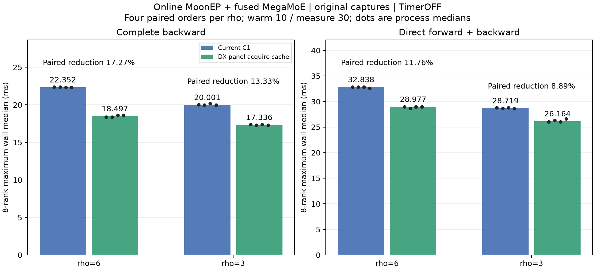
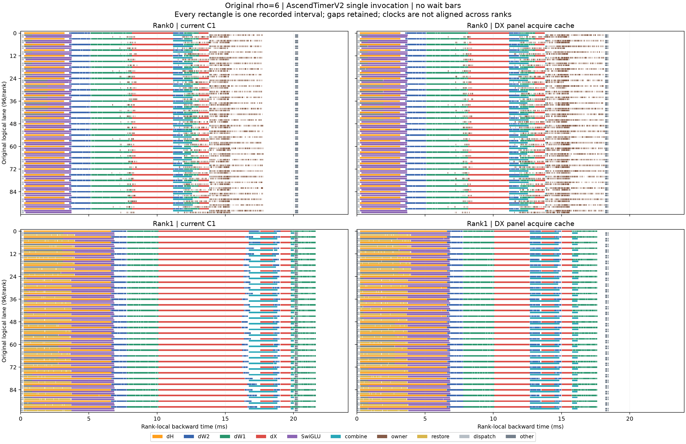
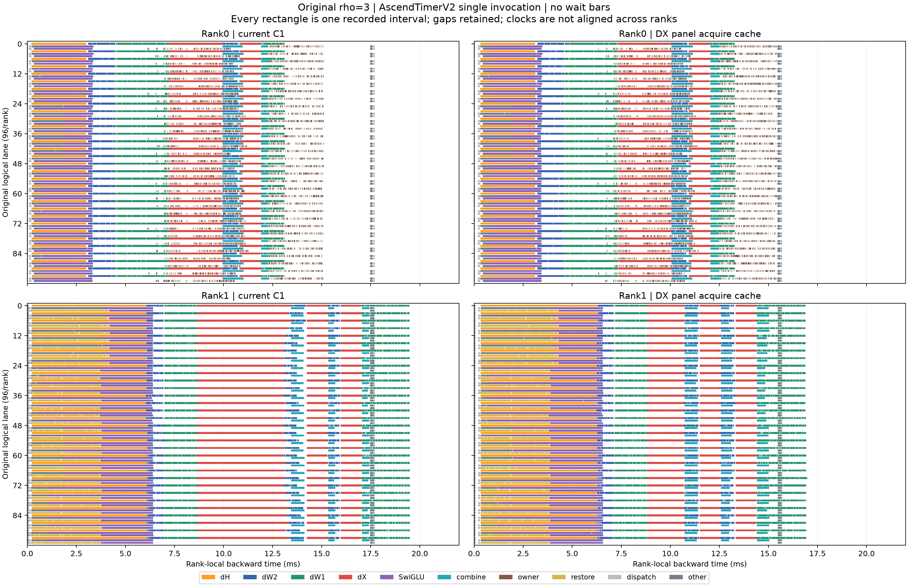

# rho6/rho3：DX panel acquire cache实验报告（2026-10-31）

代码提交为`9d036d2b5ffe6b16e25666957124eed3cbf5b407`，基线为`f6daec8a38cebe8d9596af05174edd8570179ca7`的当前C1。新开关`MEGAFLUX_RESTORE_PANEL_ACQUIRE_CACHE`默认**0**，实验库显式为1；C1仍显式为1。同事已push的适用train优化均纳入，互斥worker/owner实验位没有混用。

本目录提供报告、小型原始性能证据、输入/构建指纹、实际运行脚本及[复现说明](REPRODUCTION.md)。原始PT、SO、依赖环境、NPY和完整trace JSON不入Git，位置见[数据索引](ARTIFACTS.md)。这仅是两个固定真实capture的算子验收，不是整网、实际FSDP或四场景完整矩阵结论。

## TimerOFF结果

同一rack08-4节点、同环境，真实在线MoonEP每次F规划，B使用该次保存placement；没有冻结plan替代在线planner。每进程预热10次/测量30次，逐样本取八rank最大wall，hash/诊断回读在计时外，Timer和profiler关闭。每rho两轮ABBA，共四个正反序配对。

| rho | 阶段 | 当前C1(ms) | C1+cache(ms) | 配对耗时下降中位 | 四组下降范围 | P90下降中位 | 控制波动 |
|---:|---|---:|---:|---:|---:|---:|---:|
| 6 | 完整B | 22.352 | 18.497 | **17.266%** | 16.601–17.906% | 17.412% | 0.247% |
| 6 | 直接FB | 32.838 | 28.977 | **11.764%** | 11.135–12.656% | 11.832% | 0.683% |
| 3 | 完整B | 20.001 | 17.336 | **13.332%** | 13.318–13.871% | 13.338% | 1.040% |
| 3 | 直接FB | 28.719 | 26.164 | **8.893%** | 7.080–9.607% | 8.732% | 0.499% |

绝对耗时为四进程中位数的中位数；收益为四个配对下降百分比的中位数，不能用两个汇总数相除替代。FB直接计时，未将单测F/B相加。完整B/FB包含相应home刷新、bridge、恢复、计算、归主和完成成本。

保留条件全部满足：四组B均改善，中位收益超过`max(2%,2×控制波动)`；FB中位为正，FB/P90没有超过`max(1%,对应控制波动)`的回归，实际上各对P90均改善。ρ3 B门槛为2.079%，实际为13.332%。

原始30样本数组和逐组结果：[JSON](evidence/panel-cache-performance.json)、[进程CSV](evidence/panel-cache-processes.csv)、[配对及P90](evidence/panel-cache-pairs.csv)。

## 改动与收益来源

原`ReadyOperandCopy`在每个输出tile的新CATLASS copy functor内，对完整K循环遇到的W1 panel反复扫描所有32个生产者并执行DSB。panel已经恢复，后续只读，但检查成本仍重复。

新实现为每AIC、每专家、这一次GM dX调用维护私有缓存。首次实际GM→L1 B copy（含prefetch）仍执行原全生产者精确epoch检查和DSB，之后只复用已完成acquire的事实。ready地址/slot/projection/维度/epoch变化会清零，panel索引≥64走原检查，调用结束即销毁。外层首panel检查和更早的dH operand-ready原样保留。

数学、完整K、tile遍历、BF16 partial、owner贡献者SUM顺序、dO退休保护、生产者发布、AIV/UB和workspace不变。AIV1恢复结束后才进入P1，dX之前全AIV dZ/Hp退休检查也保留；缓存不跨层、SGD、checkpoint或kernel复用。

以下来自同rank单次TimerON，仅解释机制，不作为正式收益或通信延迟：

| rank1副本physical2 | rho6 C1 | rho6 cache | rho3 C1 | rho3 cache |
|---|---:|---:|---:|---:|
| dX tile中位(us) | 88.115 | 32.320 | 88.255 | 32.090 |
| dX末tile(ms) | 16.719 | 12.685 | 13.443 | 10.723 |
| AIV0加入Reduce中位(ms) | 20.055 | 16.212 | 17.428 | 15.014 |
| 最后本地DW1 publish(ms) | 21.638 | 17.644 | 19.486 | 16.976 |

dX回到本地权重约32us/tile后，后续dW2、本地dX、combine、AIV0加入归约和非复制DW1一起提前。WGRAD/DGRAD/partial publish/owner done坐标集合完全相同，收益不是少算或换planner。

图的每个矩形来自真实记录区间，wait隐藏但保留空隙；每rank96轨道、同轨零重叠，时钟不跨rank对齐。当前动态AIC_DO_WAIT原记录是last-Tik和累计值，诊断版只保留标记/计数，未伪造连续等待条。对应CPU解码修正及5项契约测试随本次复现工具交付；原NPY未修改。[分rank stage/worker/sync证据](evidence/pipeline-summary.json)。

## 正确性、身份与范围

- world8/两个EP4组，E8/Top2、M8192/H7168/F3072、home2/slots2、capacity20480、BF16 saved、limit10；原rho6/rho3共16个PT逐文件和逐tensor SHA核验，未用新合成路由替代。
- 两rho每rank连续三次五输出逐位匹配当前C1，OFF/ON一致；当前普通MegaMoE完整参考沿用原判据，未放宽阈值。旧capture的旧数学hash保留为元数据，未冒称与更早数值路径逐位相同。
- EP4两层共享pool，balanced/hot/rotate三次SGD、普通/非重入checkpoint；故意污染home/replica权重后检查反向恢复，输出及更新前后参数hash均逐位对C1。
- 默认关闭实现头与基线等价；实际C++ helper检查key/epoch、新调用、未Record前miss和63/64边界，UB sanitizer trap模式通过。
- 运行时getters、实际SO与源码SHA核验，planner/validator每模式使用基线相同字节；未换binding。实际构建和输入详见[指纹](evidence/FINGERPRINTS.json)，[独立正确性审计](evidence/panel-cache-capture-acceptance.json)。

没有声称其他拓扑/legacy布局、长期训练质量或整网验收。源控制默认新flag0，选择已验收库时显式设1；回退用flag0或原C1库。

## 未保留方案与剩余瓶颈

先试过DW1-retire-fill：所有专家完整DW1放在本核DW2退休后、全AIC dO退休等待前。正确性通过且等待减少，但dX/combine和AIV0加入Reduce被推迟；rho6 B退化3.47/3.74%，rho3退化4.53/3.69%，FB也退化，已拒绝且没有与本方案叠加。[全部失败配对](evidence/retire-fill-pairs.csv)。

新图中rho6 owner归并更突出：rank0 AIV0约13.9ms加入，owner服务约18.2ms结束；非owner rank1自己的跨rank同步等待约1.966ms，不能称为网络传输延迟。rho3非复制DW1仍拖尾：rank1 AIV最终同步约15.705ms结束，AIC末DW1约16.976ms才发布。后续优化从这两条依赖链分别研究，未验收改动保持独立。

## 实验完整性

每批同boot两次准入相隔≥120秒，每进程前后八卡健康/NPU进程/root-fuser均检查；占用即停止，无reset/reboot或外部进程干预。最终仅本任务tail剩余时停止容器，前后门禁通过；自己的构建容器也已停止。

失败编号和修正证据保留，包括shell CRLF、迁移遗漏、参考概率dtype、累计wait解码、主机libubsan依赖及getter LD路径错误。未把准备错误计作数值失败，未静默重试或放宽判据。原四场景完整矩阵仍取消。
