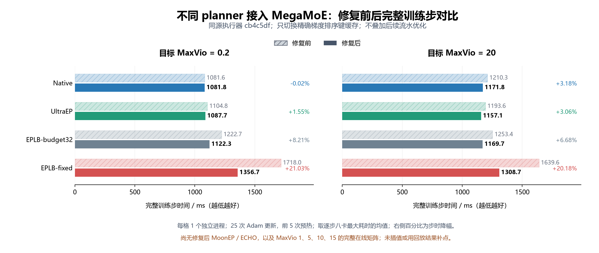
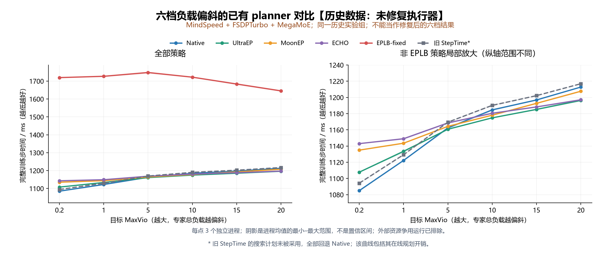
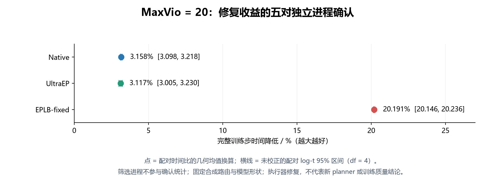

# 不同 planner 接入 MegaMoE：梯度排序键缓存修复后的实验图

2026-11-16。本次只读取已有实验并绘图，没有启动 NPU 实验、重启容器或恢复已暂停的研究目标。

## 修复后的同版本对比

| 目标 MaxVio | planner | 修复前 ms | 修复后 ms | 步时降低 |
|---:|---|---:|---:|---:|
|0.2|Native|1081.6|1081.8|-0.02%|
|0.2|UltraEP|1104.8|1087.7|1.55%|
|0.2|EPLB-budget32|1222.7|1122.3|8.21%|
|0.2|EPLB-fixed|1718.0|1356.7|21.03%|
|20|Native|1210.3|1171.8|3.18%|
|20|UltraEP|1193.6|1157.1|3.06%|
|20|EPLB-budget32|1253.4|1169.7|6.68%|
|20|EPLB-fixed|1639.6|1308.7|20.18%|

同源算子提交 `cb4c5df0f50a182146310785a70aec33a2062cc8`，原流水，Timer 关闭；只切换 `MEGAFLUX_GRADIENT_KEY_CACHE=0/1`。这里的“修复”指缓存精确相同的梯度排序键，计划和执行顺序保持不变；没有叠加之后的 runahead 等流水原型。所有 planner 都使用对应的公共执行器，不能只给 EPLB 应用修复。

每格一个独立进程，25 次完整 Adam 更新，前 5 次预热。先对同一步取八卡本地 elapsed time 的最大值，再对 20 步取算术均值。计时包含前向、重计算、反向、在线规划、通信、梯度裁剪、optimizer 和计划回收等实际训练路径。它是本模型形状下的完整训练步，不是单个 MoE kernel 或预载计划回放。

共同设置：MindSpeed＋FSDPTurbo＋解耦 MegaMoE；八卡 Ascend950DT；两层 DeepSeekV4 测试配置，H=7168、专家中间维度=2048、256 个路由专家、TopK=8，每卡 16384 tokens，接收容量 163840，开启重计算。使用固定合成路由银行，不是自然路由训练质量评估。

目前同一缓存修复实验组只覆盖 MaxVio=0.2、20 的这四种策略。MoonEP、ECHO、旧 StepTime，以及中间四档修复后数据缺失。未插值、未按固定百分比外推，未把其他流水或回放结果填入这张图。

从这些端点筛选可见，EPLB-fixed 修复后仍比 UltraEP 慢；限制预算的 EPLB 在高偏斜时已接近 Native／UltraEP。这不等价于六档排名已确认。低偏斜 Native 不进入该活跃副本调度路径，约 0.02% 的差别不应解释为确定性退化。

[SVG](../figures/planner-after-cache-endpoints-20261116.svg) · [PDF](../figures/planner-after-cache-endpoints-20261116.pdf) · [CSV](../analysis/planner-comparison-after-cache-20261116/repaired-endpoints.csv)

## 六档历史参照：未修复执行器

六档为 0.2、1、5、10、15、20，每个策略每档三个独立进程。共使用 108 个成功进程，排除 13 个被原实验标注为外部资源争用的运行；阴影是独立进程均值的最小–最大范围，不是置信区间。右图采用不同纵轴范围，便于观察非 EPLB 策略差异。

该历史组使用原来未修复的 MegaMoE 执行器，在不同节点／实验阶段采集。它只回答“此前六档曲线是什么”，不能与上面的修复后端点混合成新曲线，也不能用于计算跨实验阶段的修复收益。旧 StepTime 的 900 次全局 planner 调用均回退 Native，曲线仍包含规划尝试开销，不代表搜索计划被实际执行。

[SVG](../figures/planner-historical-six-bins-20261116.svg) · [PDF](../figures/planner-historical-six-bins-20261116.pdf) · [CSV](../analysis/planner-comparison-after-cache-20261116/historical-six-bins.csv)

## 五对独立进程确认：仅 MaxVio=20 的三种策略

另行采集的确认进程不包含上面的筛选数据。Native、UltraEP、EPLB-fixed 各五对独立进程，共 30 个进程；固定路由、权重和模型形状。整步降低的几何配对均值分别为 3.158%、3.117%、20.191%。图中横线是配对 log 时间比的未做多重比较校正的 t95 区间，df=4；假设进程对独立且 log 比率近似正态，不把同一进程内的 20 个训练步当成独立重复。

低偏斜与 EPLB-budget32 仍只有单进程筛选证据。以上都是公共执行器修复收益，不是新 planner 的创新效果。原有门禁通过不代表严格全参数相对误差、长期训练轨迹和自然训练质量告警已解决。

[SVG](../figures/planner-cache-confirmation-zh-20261116.svg) · [PDF](../figures/planner-cache-confirmation-zh-20261116.pdf) · [进程 CSV](../analysis/planner-comparison-after-cache-20261116/confirmation-processes.csv)

## 数据、复核与复画

原始日志、配置、身份文件和所有图表均位于项目目录 `D:\megamoe_train\single-mb-fbw-planner-study`。原实验目录 `D:\megamoe_train\planner-executor-ep8-lab` 在本次操作中只读。

- 筛选原始日志：`evidence/gradient-key-cache-screen-vio{0.2,20}-{planner}-{0,1}-v1/`，输入索引 `evidence/gradient-key-cache-screen-v1.json`。
- 确认原始日志：`evidence/key-cache-confirmation-v1.json` 内每条 tag 对应的 `evidence/{tag}/`。
- 历史输入只读快照：`analysis/planner-comparison-after-cache-20261116/historical-{runs,points}.json`；原始来源为旧实验 `analysis/{runs,points}.json`。
- 本次复核：46 个当前进程逐一检查八卡完成、25 次更新、50 次原始规划、无存活计划租约、初始权重／输入／路由身份、实际加载 SO 哈希，并从八卡步日志重新计算均值。历史 108 个进程从归档的 20 个 world-max 步时重新计算进程均值与三进程均值。
- [覆盖 CSV](../analysis/planner-comparison-after-cache-20261116/coverage.csv) 明确列出每个策略／偏斜档位的已测与缺失格；[校验清单](../analysis/planner-comparison-after-cache-20261116/manifest.json) 保存输入和产物 SHA256。
- 复画：项目根目录执行 `.venv\Scripts\python.exe tools/plot_planner_comparison_after_cache.py`。使用本地 matplotlib 与 Windows 微软雅黑字体；不连接 NPU。

报告不升级此前实验的数值或训练质量资格状态。
